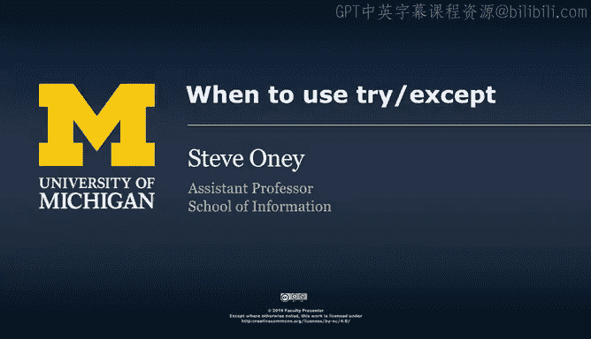
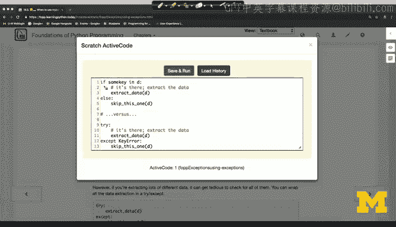
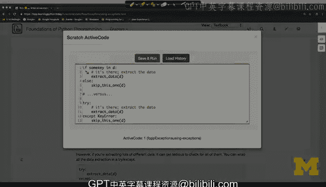

# 密歇根大学《Python3编程》课程3、4、5｜第103课：try-except使用场景 🎯




在本节课中，我们将要学习Python中`try-except`语句的使用场景，并探讨它与`if-else`条件判断的区别。我们将通过具体的例子来理解在何种情况下选择哪种结构更为合适。

## 概述

在之前的一些使用`try-except`的例子中，你可能已经注意到，有些情况同样可以使用`if`和`else`语句来实现。本节我们将深入探讨这两种方法的适用场景，帮助你做出更明智的选择。

## `if-else`与`try-except`的对比

假设我们需要从一个通过互联网API获取的字典`D`中提取数据，并且需要处理某个键可能缺失的情况。

以下是使用`if-else`的实现方式：
```python
if key in D:
    # 正确提取数据
    data = D[key]
else:
    # 跳过该项
    pass
```

另一种方式是使用`try-except`：
```python
try:
    data = D[key]
except KeyError:
    # 跳过该项
    pass
```

这两种方法实现了完全相同的功能。一种使用`if`和`else`，另一种使用`try`和`except`。那么，何时应该使用其中一种而非另一种呢？

## 选择标准

答案实际上取决于具体情况。

如果你能轻松预见并处理少数几种特定的错误，那么使用`if-else`可能更好，因为它更针对你所预期的错误类型。例如，在上述情况中，我预期某个键可能不在我的字典里，这比笼统地说“如果我遇到任何`KeyError`”更为具体。

如果你无法预见可能出现什么问题，但知道某些环节可能会出错，换句话说，你无法预料具体会出什么错，但知道有出错的可能性，那么使用`try-except`则更为合适。

## 通用原则

一般来说，在决定使用`try-except`还是`if-else`时，**尽可能具体**是一个好原则。

*   如果你知道某个特定的键要么存在要么不存在，我会使用`if-else`。
*   如果我不知道具体会出什么问题，但知道某些地方可能会出错（例如，字典的格式可能与我预期的不同），那么我可能会使用`try-except`。

## 例外情况

当然，这个规则也有一些例外。

例如，假设我需要一个`if`语句，但后面跟着一大堆检查条件。假设不是检查一个键，而是有10个不同的键需要检查它们是否在我的字典中。那么我可能会选择只使用一个`try-except`，仅仅因为它更简洁，而不必逐一检查所有10个键。

因此，这最终归结于：**你能预见多少问题**，以及**写出所有可能需要处理异常的条件是否繁琐**。这更像是一门艺术，而非严格的科学。

## 总结





本节课中，我们一起学习了`try-except`和`if-else`在错误处理中的不同应用场景。核心在于根据对错误的预见性和代码的简洁性来做选择。对于可预见的、特定的错误，使用`if-else`更精确；对于不可预见的或需要处理多种潜在异常的情况，使用`try-except`更简洁和安全。掌握这种选择能力，将使你的代码更加健壮和优雅。