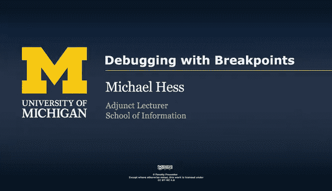
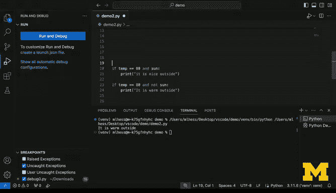

# 课程3：Python 3编程 - P105：使用断点进行调试 🐛




在本节课中，我们将要学习如何使用调试器，特别是断点功能，来高效地查找和修复代码中的问题。调试是编程中至关重要的技能，它能帮助我们理解代码的执行流程和变量的状态。

## 概述

编写能正常工作的代码很容易，但我们很少能一次就写出完美的代码。代码中常常包含语法错误或逻辑错误。调试就是发现并解决这些问题的过程。

## 调试的常见方法

大多数人调试时会使用 `print` 语句来输出变量的值。这是一种有效的方法，但并非最专业的方式。

以下是使用 `print` 语句调试的一个例子：

```python
c = "hello"  # 假设这个值来自某个网络API
if c == "high":
    print("C equals high")
```

运行这段代码，它不会输出任何内容，因为条件不满足。为了找出原因，你可能会添加一个 `print` 语句：

```python
c = "hello"
print(c)  # 调试语句
if c == "high":
    print("C equals high")
```

运行后，控制台会输出 `hello`，这样你就知道 `c` 的实际值不是 `"high"`。虽然这种方法有效，但存在一些缺点：你可能会忘记删除这些调试语句，或者当你要检查的数据结构非常庞大（如一个很长的字典或列表）时，输出会变得难以阅读。

## 使用断点进行专业调试

上一节我们介绍了基础的打印调试法，本节中我们来看看更专业的工具——断点调试。在 VS Code、PyCharm 等集成开发环境中，你可以设置断点。

断点的作用是：告诉 Python 解释器在运行到特定代码行时暂停执行，让你有机会查看此时所有变量的状态。通常，我们运行代码时，它对我们来说是“不透明”的——我们按下运行按钮，它执行一系列操作，然后输出结果。而断点则允许我们在代码执行的中间步骤停下来“四处查看”。

### 如何设置和使用断点

1.  **设置断点**：在代码行号旁边点击，会出现一个红点，这表示已在该行设置了一个断点。
2.  **启动调试**：不要直接点击“运行”，而是点击调试按钮（通常是一个带虫子的图标或下拉菜单中的“Debug”选项）。
3.  **检查状态**：当代码执行到断点处暂停时，你可以在调试面板中看到所有已定义变量的当前值。
4.  **控制执行**：你可以选择“继续”让代码运行到下一个断点或结束，也可以“单步执行”来一行一行地运行代码。

例如，设置断点后启动调试，你会看到变量 `c` 的值是 `"hello"`，这解释了为什么 `if` 条件没有满足。

## 调试器的进阶用法

仅仅查看变量值已经很强大，但调试器还能做得更多。它允许你在代码暂停时，动态地修改变量的值，从而测试不同的执行路径，而无需修改源代码并重新运行。

让我们通过一个更复杂的例子来探索这个功能。

假设我们有以下代码，变量可能来自某个API：

```python
temp = 80
sun = False

if temp == 80 and sun:
    print("It is nice outside.")
if temp == 80 and not sun:
    print("It is warm outside.")
```

正常运行时，因为 `sun` 为 `False`，所以会输出 `"It is warm outside."`。

### 利用调试器进行动态测试



以下是使用调试器进行动态测试的步骤：

1.  在 `if` 语句前设置一个断点。
2.  启动调试器，代码会在断点处暂停。此时在调试面板中，你可以看到 `temp` 是 80，`sun` 是 `False`。
3.  在调试面板中，直接将 `temp` 的值从 80 改为 10，然后将 `sun` 的值从 `False` 改为 `True`。
4.  点击“继续”运行。由于 `temp` 不再是 80，第一个条件不满足；而 `sun` 是 `True`，所以 `not sun` 为 `False`，第二个条件也不满足。因此没有输出。
5.  再次调试，将 `temp` 改回 80，保持 `sun` 为 `True`，然后继续运行。此时将输出 `"It is nice outside."`。

通过这种方式，你可以快速验证不同输入下，代码的逻辑是否正确，而无需反复修改和运行源代码。

## 总结

本节课中我们一起学习了Python调试的核心技能。我们首先了解了使用 `print` 语句进行调试的局限性，然后深入学习了如何利用IDE的断点功能进行更高效、更专业的调试。关键点在于，断点允许我们在代码执行的任意时刻暂停并检查状态，而调试器的“修改变量值”功能更是为我们测试各种场景提供了极大的便利。掌握调试器是深入理解代码执行流程和变量交互关系的利器。