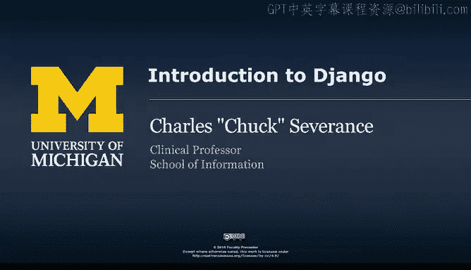
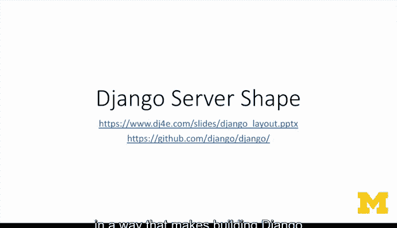
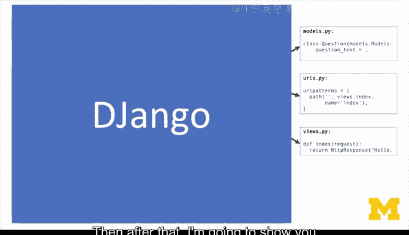
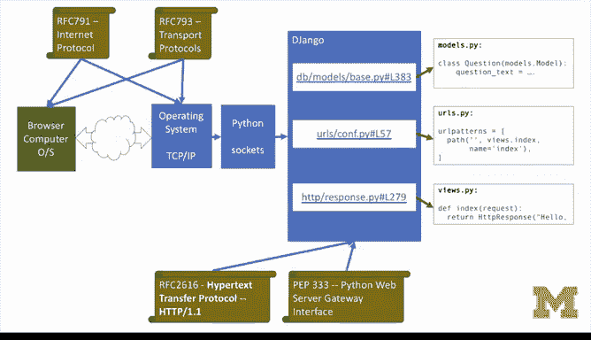

# 课程3：Django框架入门 🚀




## 概述

在本节课中，我们将学习Django框架的基本概念，并通过一个简单的Web服务器示例，理解Django如何利用面向对象编程（OOP）简化Web开发。我们将从零开始构建一个基础的Web服务器，然后对比Django框架如何以更高效、更结构化的方式完成相同任务。

---

## 从零构建Web服务器

上一节我们介绍了Django框架的基本结构。本节中，我们来看看如果不使用任何框架，如何用Python原生代码构建一个最简单的Web服务器。

以下是一个使用Python `socket` 库创建的基础Web服务器代码示例：

```python
import socket

def create_server():
    server_socket = socket.socket(socket.AF_INET, socket.SOCK_STREAM)
    server_socket.bind(('localhost', 9000))
    server_socket.listen(5)
    print("服务器启动，监听端口 9000...")

    try:
        while True:
            client_socket, address = server_socket.accept()
            request_data = client_socket.recv(5000).decode('utf-8')
            request_lines = request_data.split('\n')
            print(f"收到请求: {request_lines[0]}")

            response_body = "<html><body>Hello World</body></html>"
            response_headers = (
                "HTTP/1.1 200 OK\r\n"
                "Content-Type: text/html; charset=utf-8\r\n"
                f"Content-Length: {len(response_body)}\r\n"
                "\r\n"
            )
            response = response_headers + response_body
            client_socket.sendall(response.encode('utf-8'))
            client_socket.shutdown(socket.SHUT_WR)
    except KeyboardInterrupt:
        print("\n服务器关闭。")
    finally:
        server_socket.close()

if __name__ == "__main__":
    create_server()
```



这段代码的核心功能如下：

1.  **创建并绑定套接字**：服务器在本地主机的9000端口监听连接。
2.  **接受连接**：当浏览器发起请求时，服务器接受连接并获取一个客户端套接字对象。
3.  **解析请求**：服务器读取浏览器发送的HTTP请求数据（例如 `GET / HTTP/1.1`）。
4.  **构建响应**：服务器构建一个包含状态行、响应头和HTML正文的HTTP响应。
5.  **发送响应并关闭连接**：将响应发送回浏览器，然后关闭该次连接的套接字。

运行此服务器后，在浏览器访问 `http://localhost:9000`，你将看到“Hello World”页面。这个服务器非常简陋，它只会对任何请求返回相同的“Hello World”页面，无法处理不同的URL路径、静态文件或表单数据。

---



## Django框架的简化之道

上一节我们手动实现了一个基础Web服务器，过程繁琐且功能有限。本节中，我们来看看Django框架如何通过面向对象编程，让我们用极少的代码实现更强大的功能。

Django框架的核心思想是提供一套基础架构和通用组件，开发者只需通过继承和扩展Django提供的类，并填充自己的业务逻辑，即可快速构建应用。这主要涉及三个核心文件：

以下是Django应用中的三个关键文件及其作用：

1.  **`urls.py` (URL配置)**：此文件将特定的URL路径映射到对应的处理函数。它定义了用户访问哪个地址时，应该执行哪段代码。
2.  **`views.py` (视图函数)**：此文件包含处理HTTP请求并返回响应的函数或类。它是应用程序的业务逻辑核心。
3.  **`models.py` (数据模型)**：此文件使用Python类来定义数据库结构。每个类对应数据库中的一张表，类的属性对应表的字段。

通过定义这三个文件，Django框架在背后自动处理了网络通信、URL路由、数据库连接与操作等复杂任务。开发者只需关注 `urls.py` 中的路径映射、`views.py` 中的业务逻辑以及 `models.py` 中的数据设计。

---

## 面向对象在Django中的应用

上一节我们了解了Django的三个核心文件如何分工协作。本节中，我们深入探讨面向对象编程（OOP）是如何成为这种协作模式的基础的。

Django框架本身是一个由众多类构成的复杂系统。当开发者使用Django时，实际上是在与这些类进行交互和扩展。这种交互的核心模式是 **继承**。

例如，在 `models.py` 中定义数据模型时，我们编写的类继承自Django提供的 `django.db.models.Model` 基类。

```python
from django.db import models

class Question(models.Model):
    question_text = models.CharField(max_length=200)
    pub_date = models.DateTimeField('date published')
```

通过继承 `models.Model`，`Question` 类自动获得了与数据库交互的所有能力，如创建表、查询、保存和删除记录等。Django的ORM（对象关系映射）系统会在背后将 `question_text` 和 `pub_date` 这样的类属性转换为数据库表中的列，并生成相应的SQL语句。

这种设计模式带来了巨大优势：
*   **代码复用**：开发者无需编写底层数据库操作代码。
*   **一致性**：所有数据模型都遵循相同的定义和操作模式。
*   **可维护性**：业务逻辑（你的代码）与框架基础设施（Django的代码）清晰分离。

Django的视图（View）、表单（Form）等组件也广泛采用了类似的面向对象设计模式。你通过继承特定的基类并重写或添加方法，来定制它们的行为，从而将你的应用程序逻辑“插入”到Django的请求-处理-响应工作流中。

---

## 总结

本节课中我们一起学习了Web开发从底层到框架的演进过程。

我们首先从零开始，用Python `socket` 库手动实现了一个最简单的Web服务器，理解了HTTP请求和响应的基本原理。这个过程揭示了直接处理网络协议和原始数据的复杂性。

然后，我们引入了Django框架。通过分析一个典型Django应用的结构（`urls.py`, `views.py`, `models.py`），我们看到了框架如何将复杂的Web开发任务模块化和标准化。

最后，我们重点探讨了**面向对象编程（OOP）**，特别是**继承**机制，在Django中的核心作用。Django通过提供一系列设计精良的基类（如 `models.Model`），让开发者能够通过扩展这些类来快速构建功能，而无需关心底层实现细节。这正是Django能极大提升开发效率的关键所在。



通过本课的学习，你应该对Django如何利用面向对象思想来简化Web开发有了一个直观的认识。在后续课程中，我们将更深入地实践这些概念。