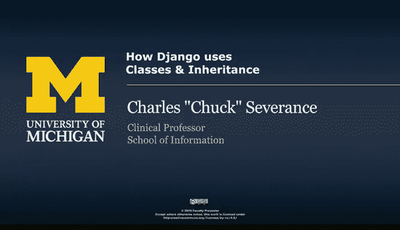
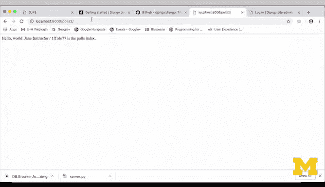
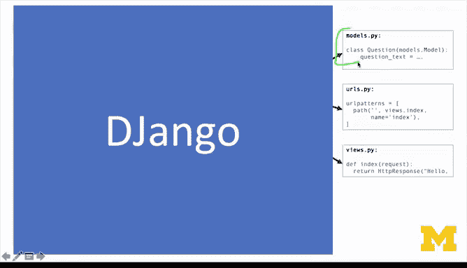
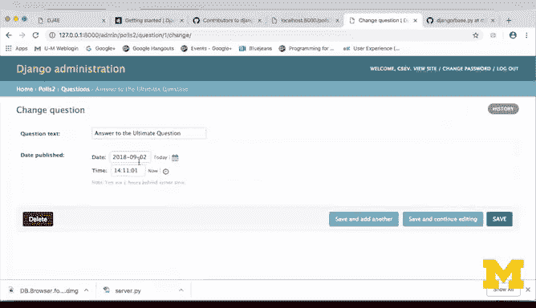
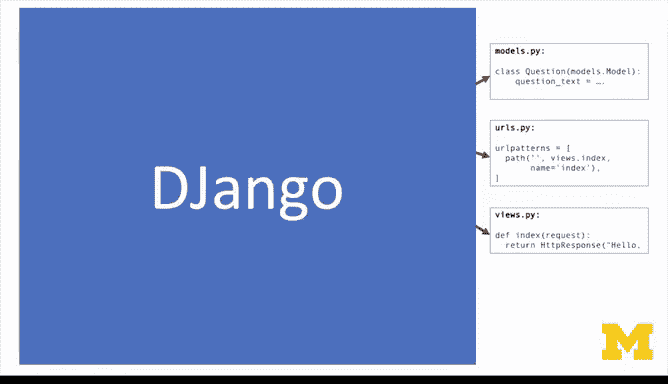
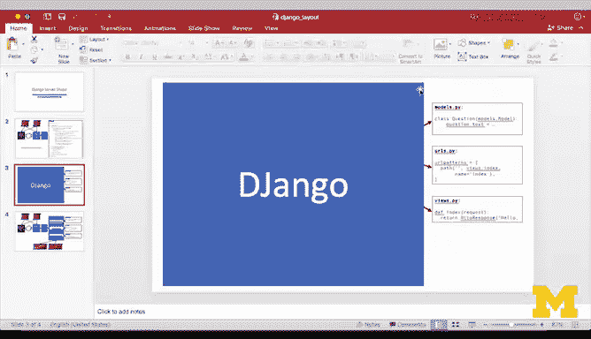
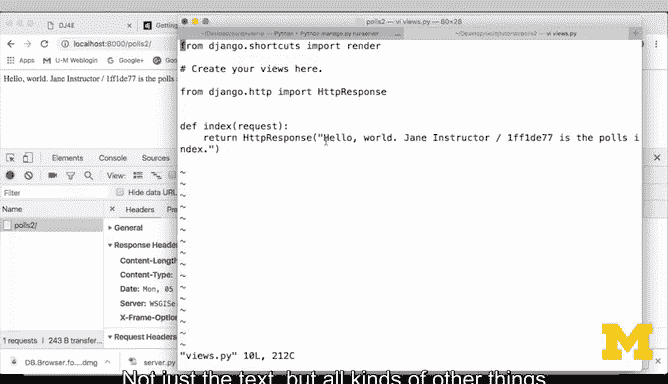
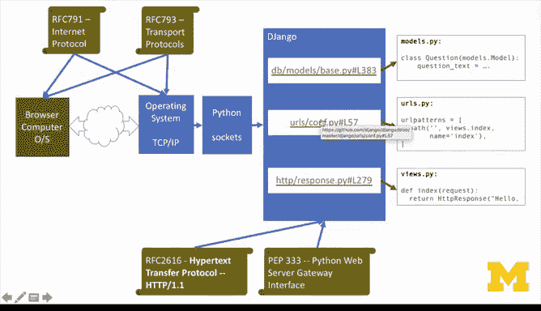
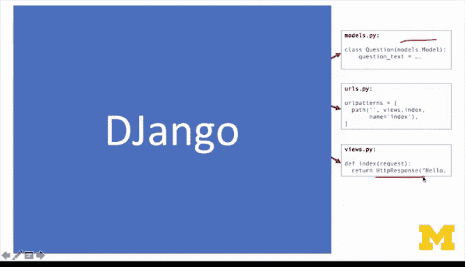

# 课程3：Django如何运用类与继承 🏗️




在本节课中，我们将深入探讨作为Django应用开发者，如何通过对象与Django框架本身进行交互。我们将通过查看Django的源代码，理解其如何利用类与继承来封装复杂功能，从而让我们能够用极简的代码构建强大的Web应用。

---

## 概述：Django的面向对象设计



Django是一个开源的企业级Web框架，拥有庞大的代码库和众多贡献者。它的强大之处在于，它将复杂的Web开发细节（如数据库操作、HTTP协议处理）封装在精心设计的类中。作为开发者，我们通过继承这些类并编写少量代码，就能获得全部功能。



上一节我们介绍了面向对象编程的基本概念，本节中我们来看看这些概念在Django这样的真实框架中是如何具体应用的。

---

## 模型（Models）：定义数据库结构

在Django中，我们通过定义“模型”来创建数据库表。模型本质上是Python类，它们继承自Django内置的`models.Model`类。

以下是我们编写的一个简单模型文件示例：

```python
from django.db import models

class Question(models.Model):
    question_text = models.CharField(max_length=200)
    pub_date = models.DateTimeField('date published')

    def __str__(self):
        return self.question_text

    def was_published_recently(self):
        return self.pub_date >= timezone.now() - datetime.timedelta(days=1)

class Choice(models.Model):
    question = models.ForeignKey(Question, on_delete=models.CASCADE)
    choice_text = models.CharField(max_length=200)
    votes = models.IntegerField(default=0)
```

通过继承`models.Model`，我们的`Question`和`Choice`类自动获得了以下能力：
*   **数据库表创建**：Django的迁移系统会读取这些类定义，自动在数据库中创建对应的表（如`polls_question`, `polls_choice`）。
*   **数据读写**：在程序运行时，我们可以通过这些类的对象轻松地查询、创建、更新和删除数据库记录。
*   **管理界面集成**：模型会自动出现在Django强大的内置管理后台中，无需额外编写管理代码。

我们仅仅编写了上面这个简单的文件，就获得了所有这些功能。这就像使用一种专门用于定义数据库模型的Python方言。

---

## 深入源码：理解`models.Model`类

既然我们知道`Question`类继承自`models.Model`，那么让我们去看看这个父类的源代码，理解它背后隐藏的复杂性。

我们可以在Django的GitHub仓库中找到`base.py`文件。`Model`类就定义在其中。它的结构与你编写过的简单类并无本质不同：

```python
class Model(metaclass=ModelBase):
    def __init__(self, *args, **kwargs):
        # ... 大量初始化数据库连接、设置字段属性的代码 ...
        pass

    def __str__(self):
        # ... 定义对象如何被转换为字符串 ...
        pass

    def save(self, force_insert=False, force_update=False, using=None, update_fields=None):
        # ... 复杂的逻辑，用于将对象数据持久化到数据库 ...
        pass

    # 还有许多其他方法，如 delete(), clean(), validate_unique() 等
```

这个类的构造器（`__init__`）和方法（如`save`）包含了成百上千行代码。这些代码是由Django项目的众多贡献者编写的，他们深入理解了HTTP协议、SQL以及多种数据库（如SQLite, MySQL, PostgreSQL）的细节。

面向对象编程的目标之一正是如此：**你只需编写少量代码，就能利用他人编写的数百甚至数千行复杂、经过充分测试的代码。** 所有这些关于数据库通信、协议规范的复杂细节都被隐藏在了`models.Model`这个“抽象边界”之后。

---



## 视图（Views）与HTTP响应





同样的设计模式也体现在处理Web请求的视图（Views）中。在Django视图里，我们返回`HttpResponse`对象。

以下是一个简单的视图示例：

```python
from django.http import HttpResponse

def index(request):
    return HttpResponse("Hello, world. You're at the polls index.")
```



这个`HttpResponse`对象同样是一个类。我们通过其构造器传入一个字符串，它就自动生成了一个完整的HTTP响应，包括正确的状态码（如200 OK）、内容类型头（`Content-Type`）等。

如果我们查看`HttpResponse`的源码，会发现它同样封装了大量细节：

```python
class HttpResponse(HttpResponseBase):
    def __init__(self, content=b'', *args, **kwargs):
        # ... 设置内容、字符集等 ...
        super().__init__(*args, **kwargs)

    # 它提供了许多便捷方法
    def set_cookie(self, key, value='', max_age=None, ...):
        # ... 封装了RFC 6265规范中设置Cookie的复杂逻辑 ...
        pass
```

例如，如果你想在响应中设置一个Cookie（用于实现登录等功能），你不必去阅读长达37页的RFC 6265规范文档。因为Django的开发者已经在`HttpResponse`类中提供了一个`set_cookie`方法，你直接调用即可。你可以根据需要使用这个对象的一点或全部功能。

---

## 总结：抽象与继承的价值

本节课我们一起探索了Django框架内部如何运用类与继承。





*   **模型系统**：通过继承`models.Model`，我们用声明式的简单代码定义了数据库结构，并自动获得了数据持久化和管理界面等全套功能。
*   **HTTP处理**：通过使用`HttpResponse`等类，我们无需关心HTTP协议的细节，就能构建符合标准的Web响应。
*   **核心思想**：Django利用面向对象的**抽象**和**继承**机制，将Web开发中繁琐、复杂的底层细节（数据库操作、协议规范）封装起来。作为应用开发者，我们站在这些“巨人”（即基础类）的肩膀上，只需关注业务逻辑本身，从而极大地提升了开发效率和应用可靠性。

希望这次对Django源码的浅析，能帮助你理解大型框架或库是如何构建的，以及面向对象编程中的抽象、隐藏和继承模式，如何在构建库和使用库这两个方面都发挥巨大作用。