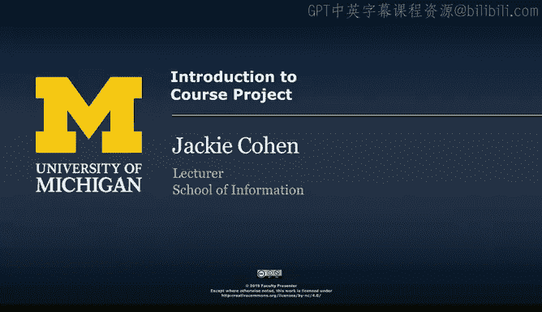

# 课程4：Python轮盘项目 🎡




在本课程中，我们将学习如何构建一个名为“Python轮盘”的游戏项目。这个项目模仿了流行的电视游戏节目《命运之轮》。我们将通过完成类定义来实现游戏逻辑，使玩家能够进行游戏。

---

## 项目概述 📋

你已获得两个JSON文件和一些预置代码，这些代码构建了游戏的大部分逻辑。你的任务是完成类定义，以便你或他人能够玩这个“Python轮盘”游戏。

理解类定义在此处的用途是成功完成项目的关键。思考为何要构建这些内容以及为何它们如此有用，将帮助你更轻松地完成代码。

---

## 思考类定义的共同点与差异 🤔

上一节我们介绍了项目的整体目标，本节中我们来看看如何设计玩家类。虽然人类玩家和电脑玩家的类定义不同，且它们在某些方面的行为方式不同，但两者基本上执行相同的操作。例如，两者都需要获取移动指令才能进行游戏。

因此，思考人类玩家和电脑玩家的共同点以及它们的差异，对于构建完整可用的游戏代码非常有帮助。

你可以利用类定义和继承的知识来实现这一切，因为游戏逻辑或代码编写说明中已经提供了大部分结构。

---

## 利用类继承的知识 🧠

反复回顾类的基本概念及其用途，你会发现需要编写的代码量并不大，关键在于理解。花时间绘制示意图和编写大纲绝对是值得的。

以下是关于方法重写的一个重要概念：
```python
class ParentClass:
    def method_name(self):
        # 父类中的实现
        pass

class ChildClass(ParentClass):
    def method_name(self):
        # 子类中的不同实现
        pass
```
在多个子类中，方法可以拥有相同的名称，但内部执行完全不同的操作或返回类似的值。如果方法名称相同，它将在相同的时间被调用，但在不同的子类中可以执行不同的操作。

强烈建议回顾关于类继承的学习材料，并仔细思考你见过的示例如何应用于此游戏中。

---

## 将项目视为构建电脑游戏 🎮

将本项目视为你在构建一个电脑游戏会非常有帮助。思考游戏中的电脑玩家或角色需要做什么，这些正是人类玩家需要做的事情。

那么，人类玩家需要输入什么？以便玩家表现得像任何传统的电脑角色一样。

再次强调，专注于说明以及你需要编写的那一小部分代码，以实现这些功能。

---

## 理解编程任务与已有资源 📂

具体思考所有编程说明以及你已拥有的资源非常重要。这包括回顾JSON文件和为构建游戏而提供的代码。

通常，最困难的部分是理解你需要做什么，而不是编写超级复杂的代码。因此，再次强调，思考你在此课程及之前可能在其他课程中学到的所有知识，将使你准备好完成这个游戏。

你已掌握完成此项目所需的一切知识。只需要非常仔细和系统化地决定何时编写什么代码，以及如何测试它是否有效。

---

## 总结 📝

本节课中我们一起学习了“Python轮盘”游戏项目的构建方法。我们探讨了如何通过类定义和继承来实现人类玩家与电脑玩家的游戏逻辑，理解了方法重写的概念，并强调了在动手编码前充分理解任务和已有资源的重要性。记住，成功的关键在于系统的思考和规划，而非复杂的代码。祝你好运，玩得开心！