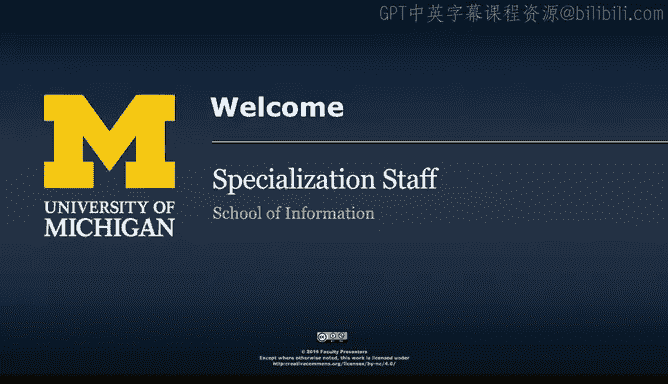
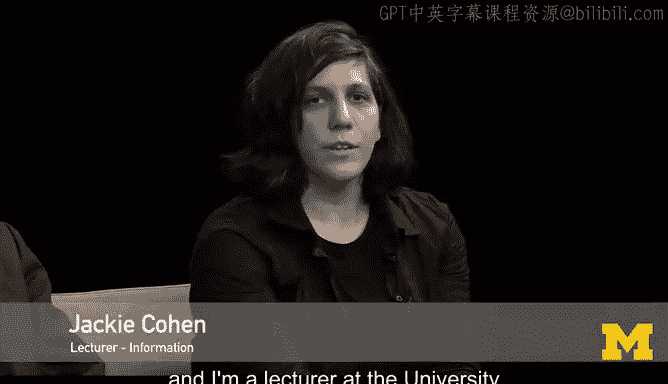
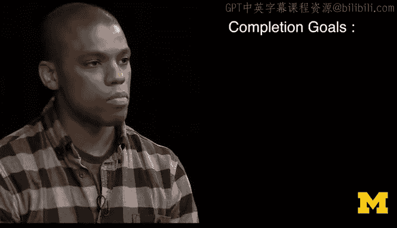
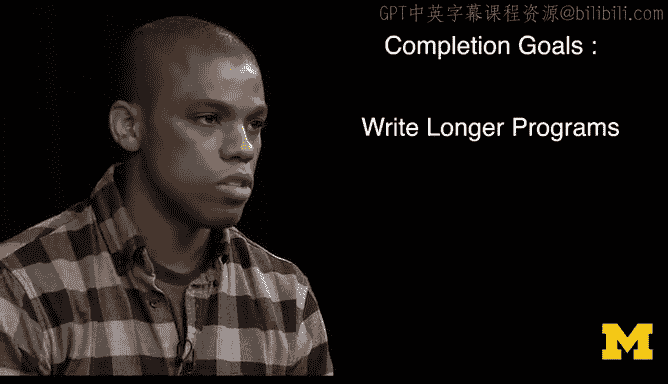
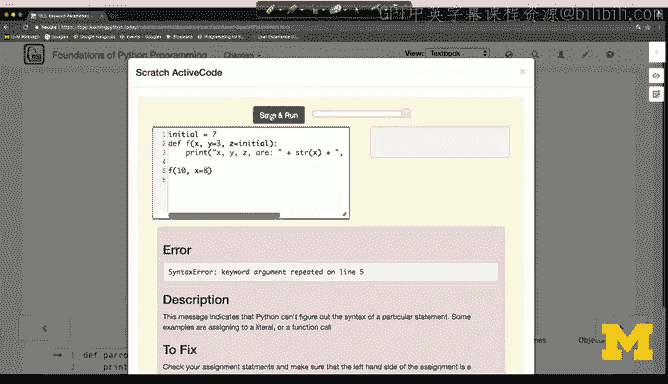
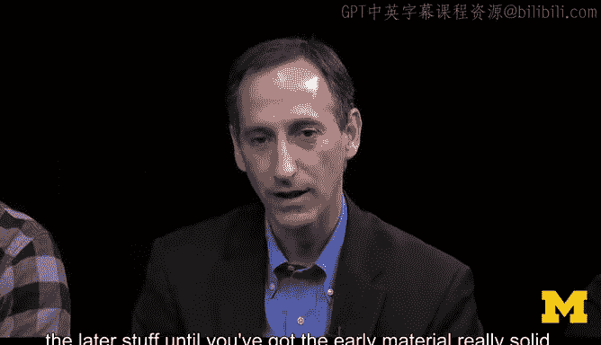
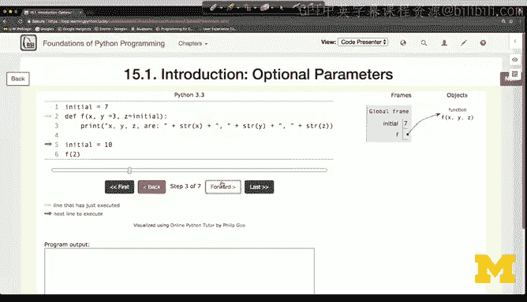
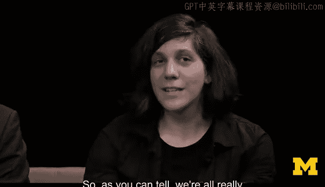

# 课程1：Python 3 编程专业介绍 🐍

在本节课中，我们将要学习密歇根大学《Python 3 编程》专业的整体介绍。我们将认识教学团队的各位老师，了解课程的目标、特色学习工具以及课程的整体结构。

大家好，我是Steonni，我是密歇根大学信息学院的助理教授。我在信息学院教授一些编程入门课程。我非常高兴大家能加入我们，因为我坚信编程将日益成为一种根本性的重要素养，也是我们处理日常生活中日益增长的数据的一种方式。在我的个人生活中，我喜欢踢足球。和Resnick教授一样，我也是一名狂热的自行车爱好者。大家将在课程一、二和四中看到我。我的大部分研究致力于让编程工具更易用，换句话说，就是围绕人们的思维方式和我们实际的编程方式来设计编程工具。

大家好，我是Paul Resnick，我是密歇根大学信息学院的教授兼研究副院长。作为副院长，我授课的机会不多。但我非常享受在这个专业中将要教给大家的内容，也很高兴有机会与大家分享。大家将在课程一、二、几乎整个课程三以及课程四的一小部分中看到我。我喜欢书呆子式的双关幽默，也就是所谓的“老爸笑话”，所以我将在一些课程结束时与大家分享一些。在我的研究中，我可能最出名的是现在所谓的“推荐系统”。我最早在90年代初就发表了相关研究，比如亚马逊网站上显示的“购买此书的顾客也购买了这些书”。最近，我一直在研究在线社区和教育技术。在我的个人生活中，我喜欢打网球和骑自行车。我骑得很慢，四年前骑上了环法自行车赛的标志性爬坡之一旺图山，几年前又骑上了比利牛斯山脉的图尔马莱山口。我的旅行远没有Chuck博士那么多。但我期待在旅行时尝试采纳他的做法，在当地举行实时办公时间，所以也许我有机会见到大家。课程中见。

大家好，我叫Jackie Cohen，我是密歇根大学信息学院的讲师。我教授很多编程课程，包括与大家在这里看到的类似的课程。我还参与设计和支持许多课程资源。所有这些意味着我见过很多不同的学生完成很多不同的编程项目。我在这里要做的是引导大家了解课程期末项目，并给大家一些在完成项目时可能有用的提示和建议。我希望大家喜欢这些项目，因为我认为它们真的很有趣，并且会为大家的日常生活提供很多使用编程的工具。

大家好，我是Chris Brooks，我是密歇根大学的教员。在这个专业中，我将教授最后一门课程。在那门课程中，大家将学习图像处理库和大型图像集，并使用Python将其转换为有用的信息。我的研究重点是教育技术，我教授很多数据科学课程，包括这个平台上的一些课程。我对像大家这样的学习者如何接触技术、与技术互动以及利用技术促进学习非常感兴趣。我期待在最后一门课程中见到大家。

大家好，我叫Charles Severance，大家可能之前在《Python for Everybody》专业中见过我。你们中的一些人可能上过那个课程，然后来到了这个班级。我真的很享受在这个班级中所做的事情，因为我实际上并不教授任何核心内容，而是做我们称之为“程序员之道”的部分。这有点像我可以稍微玩一下，而不是真正教大家什么，而是展示一些很酷的东西，这给了我很大的自由来展示我认为有趣的东西。正如一些人可能知道的，我的研究领域是教育技术。大家正在使用的这个平台是我非常好奇如何改进、如何让它变得更好的东西。我有很多爱好，但我最近的爱好是在赛道上赛车。所以如果你找找看，可能会发现一张我在赛车里的照片。

大家好，我是Lauren Murphy。几年前我参加了这个课程的校园版本，并最终作为教学助理帮助其他学生学习这些材料。后来我回来帮助建设这门课程，制作了大家将要完成的测验、评估和项目。我非常高兴大家有机会学习同样的材料，我希望大家学得愉快。

在这个Python 3编程专业中，大家将通过学习语言的详细基础知识，学会如何成为一名合格的Python程序员。大家将学习如何导航复杂的数据结构并从中累积结果。大家还将学习如何将数据转换为可供其他程序使用的格式。在专业课程结束时，大家将能够编写几百行的Python程序。大家将能够在代码中使用和集成Python模块。大家还将能够通过阅读文档来使用API等外部工具。

我们从零开始，不预设任何先验知识，但我们会深入探讨Python的基础知识，以确保大家理解代码的每一个方面。关于我们的Runestone交互式环境，Runestone交互式教科书允许你将学习材料与主动代码评估交织在一起，让你能够实际编写代码。我们发现编写代码非常重要，因为即使你可以在理论上了解一个概念是如何工作的，比如你可能知道Python的某个特定功能如何工作，但实际编写代码对于获得更多实践理解以及知道如何在实践中应用这些概念至关重要。

还有“程序员之道”的部分。课程的大部分内容是关于如何使用Python和学习Python功能。“程序员之道”部分更多是关于程序员可以并且应该如何工作。编程更像是一门艺术而非科学，做事情有很多正确的方法，但存在最佳实践。例如，如何以渐进的方式编写程序。在“程序员之道”部分，大家还将学习如何编写良好的自动化测试用例。这将在课程4中出现。在此之前，我们将为大家编写这些测试用例。Lauren创建了大量的评估，你不仅可以在浏览器中运行代码，它还会告诉你是否正确，你会得到即时反馈，并且可以随意尝试多次。事实上，我们已经设定了评估，你必须答对所有题目，达到100%正确才能通过评估。这样做的原因是我们真的希望你能建立精通，这样你就不会在真正掌握早期材料之前继续学习后面的内容。

大家还会注意到，在所做的所有项目中，你会发现将课程和专业中学到的概念转化为现实生活的方法。例如，构建程序的不同方式，可能对你的工作、学习或其他你所做的事情很有趣。

我真的很喜欢的一点是，在观看大家构建这一切时，以及在《Python for Everybody》中，你已经提到过这一点。在《Python for Everybody》中，我真正关注的是程序。如果你完成了程序，就像你赢了，你得到了金星。我们没有时间或条件去真正理解程序内部发生了什么，我们只是完成了程序，然后必须继续下一件事。但在Runestone中，你可以探究程序内部真正发生了什么，以及这究竟是如何工作的。精通的一部分就是，如果你不能作为一个程序员，在某种程度上将自己置身于程序中，理解程序实际上是如何运行的，那么就很难编写更复杂的程序。所以，尽管从技术上讲这是一门入门课程，但我认为人们参加不止一门入门课程真的很重要，因为你必须一遍又一遍地学习相同的材料，每次学习都要有更深的理解。

我们有一个很棒的代码透镜工具，我想你指的就是这个。它可以让你可视化程序执行过程中每一行发生的情况，你可以前进和后退，查看那个变量的实际值是什么，我的列表内容是什么时候改变的。所以它给了你一种思考方式。它对于调试非常有用，这样你就不必只是通过试错来改变代码中的某些东西，你可以真正思考程序是什么。另一件学生们总是在课程结束时问我的事情是“接下来做什么”。我认为你们在这个专业中内置了关于他们接下来要做什么的步骤，这很酷。是的，我们在这门课程的最后增加了一个项目课程，这真的是为了让人们专注于如何利用其他可能存在的API或包，并用它们做一些新颖的事情，而不仅仅是学习。这也涉及到你提到的重复练习。为此，我们实际上是在Jupyter环境中进行的。就像你需要对API和Python基础进行重复练习一样，有很多不同的地方可以编写和运行Python代码，Runestone是其中之一，你在《Python for Everybody》中使用的工具也是其中之一，Jupyter是另一个相当常见的环境，我们在数据科学专业中教授它，学生可以接着学习。还有其他环境。所以我们试图真正展示Python编程的学习环境和生产环境的多样性。编程环境不是单一的，不是说你只有这一个东西可以输入内容，那就是所有的编程。在现实世界中，每份工作通常都有不同种类的环境。练习在编程的背景下非常重要，我认为Lauren为大家在整个课程中编写了一些很好的练习题。我们还有一个很棒的练习工具，你会看到它向你展示一些你过去已经见过的问题以供复习，如果你遇到困难，它会更频繁地呈现给你，如果你表现出精通，则呈现频率降低。这是一种真正巩固你所学知识的方式。所以，请留意那个练习工具，它还有有趣的烟花效果，会在你完成当天的所有练习题时显示。

正如大家所看到的，我们都非常兴奋能与大家分享这些材料，我们希望大家玩得开心，并祝大家好运。

在密歇根大学，我们的校色是玉米黄和蓝色。大家可能认为它们是黄色和蓝色，但我们称之为玉米黄和蓝色。如果我旅行到任何地方，身上有密歇根大学的标志，机场就会有人走过来对我说“Go Blue”。所以，数到三，一、二、三，Go Blue！

---

**本节课总结**

在本节课中，我们一起学习了密歇根大学《Python 3 编程》专业的整体概览。我们认识了由Steonni、Paul Resnick、Jackie Cohen、Chris Brooks、Charles Severance和Lauren Murphy组成的教学团队，了解了他们各自的背景和教学角色。课程旨在从零开始，深入Python基础，培养大家成为能编写数百行代码、使用模块和API的合格程序员。课程特色包括Runestone交互式学习环境、代码可视化工具、渐进式评估和“程序员之道”部分。课程结构涵盖从基础到应用，最后以项目课程结束，帮助大家将所学应用于现实场景。