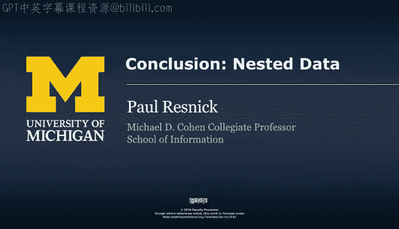

# 课程11：嵌套数据结构总结 🐦

在本节课中，我们将总结关于嵌套数据结构的关键概念，包括如何访问多层嵌套的数据、JSON格式的使用，以及一些相关的编程技巧。

---

## 嵌套数据结构回顾

上一节我们介绍了多层嵌套的数据结构，例如列表和字典相互嵌套的情况。

你已经了解了一些关于外层和内层元素的术语。

并且你已经看到，我们只需要多次使用方括号即可深入这些嵌套的数据结构。

如果一个列表内包含数字列表，而该列表又位于另一个列表内，形成了三层嵌套，那么我们需要使用三个方括号来取出其中一个数字。

我们可以在单行代码中完成此操作，也可以分多个步骤，每步使用一行代码。

但在代码中的某个位置，你都需要进行三次方括号操作。

---

## JSON格式

以下是关于JSON格式的重要操作。

*   **`json.loads()`**：从字符串加载数据，创建一个Python列表或字典。
*   **`json.dumps()`**：将数据转储为字符串，以便你可以将字符串保存到文件中，或者通过漂亮的缩进和换行进行格式化打印。

---

## 总结

本节课中我们一起学习了如何访问和处理多层嵌套的数据结构，掌握了使用多层方括号进行索引的方法。同时，我们也回顾了JSON格式的两个核心函数：`json.loads()`用于读取，`json.dumps()`用于写入和格式化。理解这些概念对于处理复杂的程序数据至关重要。