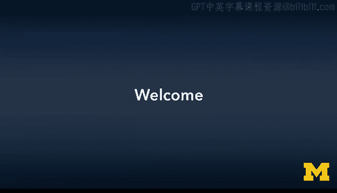
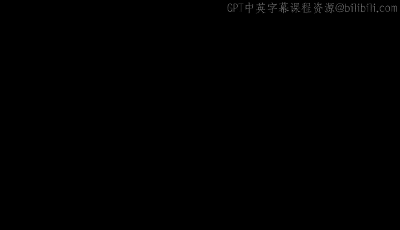
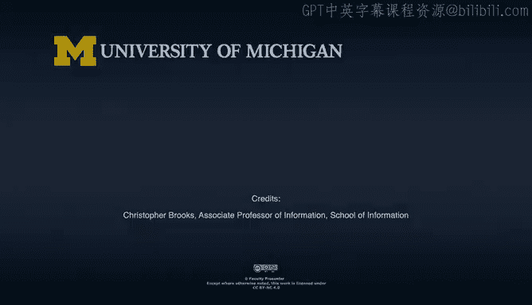

# 课程3：Python 3项目课程 🚀

在本课程中，我们将通过实际项目来巩固和深化之前学到的Python知识，并引入一些新的软件开发概念。课程的核心目标是提供更多编程实践机会，帮助初学者提升编程技能和信心。

## 概述

欢迎来到Python 3项目课程。本课程与本系列的其他课程有所不同。虽然我会教授一些不同的主题，但核心重点是让大家通过实践来巩固之前课程中学到的所有知识。

我在密歇根大学定期教授研究生课程，主要涉及应用数据科学和应用人工智能领域。许多学生没有计算机科学本科学位，我经常被学习者询问如何成为更好的Python程序员。虽然像这样的系列课程可以提供一些基础技能和知识，但对大多数人来说，成为更好程序员的最佳途径就是多编程。坦白说，这对新程序员来说可能有些令人生畏，尤其是那些对自己的技能还不够自信，或者尚未在需要定期编程的职业中工作的人。

因此，本课程的目标是为大家提供更多练习已学Python知识的机会。但同时，我也会不可避免地教授一些新主题。所以，我们将在进行所有这些实践工作的同时，向大家介绍一些新的软件开发概念。

## 课程模块介绍

上一节我们介绍了本课程的目标，本节中我们来看看课程的具体安排。本课程分为三个主要模块，每个模块都结合了实践练习与新概念的引入。

### 第一模块：软件设计与面向对象实践

在第一模块中，我将展示如何通过图表来思考软件设计。我会在大家练习编写面向对象Python代码的同时，介绍软件工程实践的基础知识。

我将引导大家设计一个非常小的文字冒险游戏。在本模块结束时，大家将完成一项作业，根据我提供的规范和约束列表实际编写Python代码。

这项作业对我个人来说很有趣，因为它涉及创建一个能够玩一个名为“Wordy Pi”的猜词游戏的Python程序。这个游戏实际上将在整个课程中使用，并且在课程的第二模块中，我将教大家如何使用新的第三方Python包来改进这个游戏程序。

以下是第一模块的核心内容：
*   通过图表进行软件设计。
*   软件工程实践基础。
*   编写面向对象的Python代码。
*   完成“Wordy Pi”游戏程序的作业。

### 第二模块：使用第三方库增强功能

在第二模块中，我们将学习如何使用新的第三方Python包来改进游戏程序。具体来说，我将向大家介绍Python Imaging Library（PIL），这是一个图像处理和图形包，允许大家在Jupyter Notebook中渲染和处理图像。

### 第三模块：光学字符识别（OCR）

课程的最后一个模块将处理文本和图像问题，通常称为光学字符识别（OCR）。我将在这里向大家介绍的库，可以让大家检查图像中的文本字符串并在Python中处理它们。这是另一个无需自己编写所有代码即可扩展Python编程语言功能的例子。

## 总结

本节课中我们一起学习了Python 3项目课程的总体目标和结构。我们了解到，本课程旨在通过项目实践来巩固知识，并会引入软件设计、第三方库（如图像处理库PIL）以及光学字符识别（OCR）等新概念。现在，让我们开始学习吧。