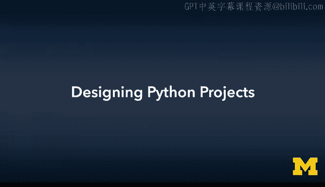
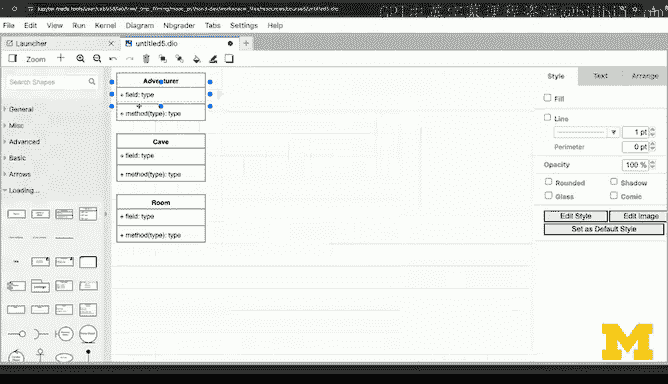

# 课程3：Python项目设计 🎨

在本节课中，我们将学习如何使用图表来设计和规划Python软件系统。我们将介绍一种称为UML（统一建模语言）的标准图表工具，并使用Jupyter环境中的绘图扩展来创建类图。通过设计一个简单的“地牢探险”游戏，我们将了解如何将抽象概念转化为具体的类结构。

---

## 从编程到软件设计

之前我们花费了大量时间学习如何在Python和Jupyter环境中进行编程。现在，让我们将视野放宽一些，讨论如何设计、开发软件系统，并向他人传达系统的工作方式。

走进任何计算机科学教授的办公室或教室，你都会看到白板。这是一个无约束的空间，我们可以在上面绘制图表，描绘软件系统各个部分（通常称为组件）之间的关系。

我们将这种实践统称为软件工程。虽然我不会详细讨论软件工程学科的所有方法，但我想向你介绍一种可以用来规划软件解决方案的图表方法。

更好的是，Jupyter编程环境通过绘图扩展直接提供了对此的基本支持。

---

## 创建新图表

要创建新图表，我们只需转到文件菜单，选择“新建”，然后选择“图表”。

我们会得到一个基于网格的编辑器，左侧可以看到一系列形状，包括一些已为我们安装的、带有形状的可选包。

在本讲座中，我们将重点关注标记为“UML”标题下列出的形状。UML代表统一建模语言，是软件开发人员常用的一种标准符号，用于描述他们的系统。

首先，我要你寻找的第一个形状是第三个，它表示一个类。让我们点击它，将其添加到画布上。

---

## 类与对象：核心概念回顾

这正好是一个停下来反思的好时机。当我刚开始攻读计算机科学本科学位时，面向对象编程才刚刚被引入。它迅速成为主流的编程范式，并且至今仍是如此。

然而，我花了很长时间才真正理解类和对象之间的细微差别，尤其是在涉及类方法等方面。

但你刚刚学完了Python中的面向对象编程，让我问你：根据你在之前课程中学到的，类和对象有什么区别？

*   **类**是你希望在软件中存在的概念的抽象表示。类是抽象的，你通常不会直接“创建”一个类。相反，你将其用作创建新对象的蓝图或模板。
*   **对象**则具有由给定类描述的属性，但这些属性的具体值在不同的对象之间会有所不同。

---

## 设计一个游戏：地牢探险

让我们设计一个小游戏。我打算设计一种我最喜欢的游戏类型，叫做“地牢探险”。

在这个游戏中，用户是一个魔法世界的冒险者，偶然发现了一个洞穴的入口。他们需要探索洞穴，在走入的每个洞室中做出选择，同时击败他们面对的怪物。

让我们首先为我刚才提到的不同种类的游戏元素创建一些类。

首先，我将为冒险者、洞穴和洞穴中的各个房间创建新的类。每一个都成为图表中的一个方框。

你会看到方框由三个部分组成：
1.  **标题**：我已为每个类更改了标题以指示类名。
2.  **字段**：这部分将包含每个给定字段的类型。
3.  **方法**：这些也有各种类型，你可以在这里看到参数。

在本讲座中，我们暂时不涉及方法，而是只关注类字段。

说实话，这里常常是混淆产生的地方。Python中的“字段”是什么？

---

## 理解UML中的“字段”

Python核心语言中没有“字段”这个概念。像UML这样的工具旨在尽可能通用。

在UML中，当我们谈论“字段”时，我们实际上指的是Python中类的不同**属性**。

请记住，Python中类的属性是点号（`.`）后面的任何东西。所以，如果我们写 `my_hero.`，那么点号后面的任何东西都是一个属性。

属性主要有两种：
*   **数据属性**：这实际上是UML中“字段”想要表示的内容。
*   **方法属性**：这些是可调用的属性，如函数和方法，它们应该放在UML类框的底部。

---

## 为游戏类添加字段

回到我们的游戏。我希望这个游戏感觉非常个性化和引人入胜，所以我需要添加一些字段来捕捉其中的一些特性。

以下是需要为各个类添加的字段：

*   **冒险者类**：
    *   `name`：类型为字符串（`str`）。
    *   `strength`：类型为整数（`int`），代表力量。
    *   `constitution`：类型为整数（`int`），代表体质。
    *   `hit_points`：类型为整数（`int`），决定英雄在游戏中的生存能力。
    *   `bag`：一个包含物品的列表。

*   **物品类**：
    *   `name`：类型为字符串（`str`）。
    *   `min_damage`：类型为整数（`int`），代表最小伤害值。
    *   `max_damage`：类型为整数（`int`），代表最大伤害值。

*   **房间类**：
    *   `monster`：一个怪物对象。
    *   `treasure`：一个物品对象。

*   **怪物类**：
    *   `name`：类型为字符串（`str`）。
    *   `hit_points`：类型为整数（`int`）。
    *   `min_damage`：类型为整数（`int`）。
    *   `max_damage`：类型为整数（`int`）。

我们已经偶然发现了图表化软件解决方案的第一个好处：它可以帮助我们发现一些我们感兴趣但尚未考虑到的建模概念。

例如，我们有一个`bag`，它是一个列表。但列表里是什么？我称它们为“物品”，但Python中没有`Item`类。它们是字符串、整数还是布尔值？不，我认为我希望这些是我们自己设计的`Item`类的新实例，这意味着我们必须将其添加到图表中。

同样，当我们考虑房间时，它有`monster`和`treasure`字段。`treasure`是一个物品，我们已经有了。但我们需要为怪物添加另一个类。

---

## 审视我们的第一个类图

现在，我们有了第一个类图。通过图表化系统中可能需要的不同类，你开始发现你试图解决的问题的边界。

在这种情况下，我们没有一开始就考虑对物品和怪物进行建模，但当我们开始思考问题并为自己和他人绘制图表时，这些概念就浮现出来了。

现在，我们必须将所有这些转化为代码，以创建一个可工作的系统。但我想首先向你展示我思考问题的过程。

虽然我们还没有完全想清楚这个问题——游戏实际上如何进行？冒险者是否选择在房间中移动？怪物会先攻击吗？进入房间就能拿到宝藏，还是必须先打败怪物？——但最终，我们需要思考系统中的事件序列。

不过，让我们先看看能否将已有的内容转化为代码。我们将在下一讲中完成这个任务。

---

## 总结

在本节课中，我们一起学习了软件设计的基础。我们介绍了如何使用UML类图在编写代码之前规划和可视化Python项目。通过设计一个“地牢探险”游戏，我们实践了如何识别核心类（如`Adventurer`、`Item`、`Room`、`Monster`）并为它们定义属性（字段）。这个过程帮助我们更清晰地思考问题结构，并能在早期发现缺失的概念。下一讲，我们将把这些设计转化为实际的Python代码。