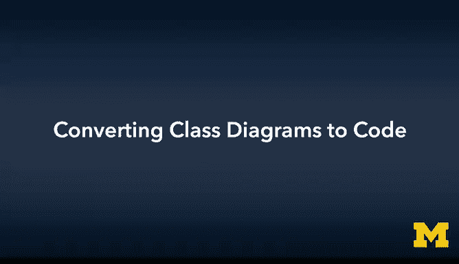

# 课程3：Python面向对象编程 - 第1课：从类图到代码 🗺️➡️💻



在本节课中，我们将学习如何将之前设计的UML类图，逐步转换为实际的Python代码。我们将创建几个核心类，并了解如何为它们编写文档和初始化方法。

---

上一节我们介绍了UML类图的设计。本节中，我们来看看如何将这些设计转化为具体的Python类。

首先，我们将创建`Adventurer`类。以下是创建该类的步骤：

1.  **定义类名与文档**：按照Python惯例，类名以大写字母开头。我们使用三引号字符串为类编写文档，简要描述类的作用，并列出其预期的数据属性。
    ```python
    class Adventurer:
        """
        代表游戏中的用户，一位无畏的冒险者。

        属性：
            name (str): 角色的显示名称。
            dexterity (int): 敏捷值，范围1-18。
            constitution (int): 体质值，范围1-18。
            strength (int): 力量值，范围1-18。
            hit_points (int): 生命值。
            bag (list[Item]): 冒险者持有的物品列表。
        """
    ```

2.  **编写初始化方法 `__init__`**：此方法用于设置对象属性的初始值。方法的第一个参数总是`self`。我们要求初始化时必须提供`name`参数，其他属性则设置合理的默认值。
    ```python
        def __init__(self, name: str) -> None:
            """
            初始化冒险者。

            参数：
                name (str): 冒险者的名称。
            """
            self.name = name
            self.constitution = random.randint(3, 18)
            self.strength = random.randint(3, 18)
            self.dexterity = random.randint(3, 18)
            self.hit_points = self.constitution + random.randint(1, 6)
            self.bag: list[Item] = []
    ```

注意，在定义`bag`属性时，我们使用了类型注解`list[Item]`来提示它应该是一个`Item`对象的列表。即使`Item`类尚未定义，这段代码也能成功执行，因为类型注解在运行时会被Python解释器忽略。

---

现在我们已经创建了`Adventurer`类，接下来让我们创建`Item`类。

以下是创建`Item`类的过程：

1.  **定义类与文档**：同样以大写字母开头，并使用三引号文档字符串描述类及其属性。
    ```python
    class Item:
        """
        可由冒险者持有的物品。

        属性：
            name (str): 物品名称。
            min_damage (int): 物品的最小伤害值。
            max_damage (int): 物品的最大伤害值。
        """
    ```

2.  **编写初始化方法并加入简单校验**：在`__init__`方法中，我们接收名称、最小和最大伤害值。同时，我们加入了一个简单的输入检查，如果名称为空，则设置为“未知”。
    ```python
        def __init__(self, name: str, min_damage: int, max_damage: int) -> None:
            """
            初始化物品。

            参数：
                name (str): 物品名称。
                min_damage (int): 最小伤害值。
                max_damage (int): 最大伤害值。
            """
            self.name = name if name else “未知”
            self.min_damage = min_damage
            self.max_damage = max_damage
    ```

---

本节课中我们一起学习了如何将UML类图转换为Python代码。我们创建了`Adventurer`和`Item`两个类，为它们编写了清晰的文档，并实现了初始化方法。我们还了解到Python的类型注解是“类型提示”，主要用于开发工具，而不影响代码执行。


现在，你已掌握创建类的基础知识。我建议你尝试独立完成剩余类（如`Monster`、`Room`、`CaveSystem`）的创建，以巩固所学。在下一讲中，我们将探讨如何通过图表技术来捕捉类之间的交互关系。