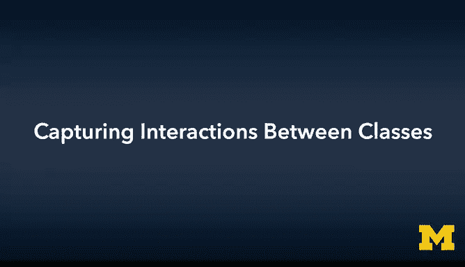
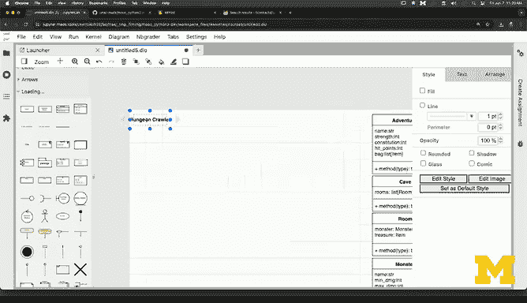

# 课程3：Python面向对象编程 - 第1章 第3节：捕获类间交互 🧩

在本节课中，我们将学习如何通过方法和函数将游戏中创建的基类连接起来。我们将重点介绍一种称为“序列图”的建模方法，它可以帮助我们可视化不同对象（类的实例）之间如何交互。通过绘制序列图，我们可以清晰地规划出用户、冒险者、洞穴和房间等对象之间的调用关系，从而更好地设计我们的应用程序。

---

## 概述：什么是“连接”类？

在软件工程中，我们经常将类之间的方法调用和函数关联称为“连接”类。虽然这里并没有实际的物理线路，但这个比喻能帮助我们理解各个独立组件如何协同工作。为了更清晰地展示这种交互，我们将引入并学习使用“序列图”这一工具。

上一节我们创建了游戏的基本类，本节中我们来看看如何将它们彼此关联起来。

---

## 序列图入门

序列图是一种UML（统一建模语言）图表，用于展示对象之间随时间推移的交互过程。它特别适合描述一个操作或场景中多个对象的调用顺序。

大多数序列图从一个与应用程序交互的“人”（参与者）开始。在UML中，我们用一个方框和下方的一条长竖线来表示参与者。

以下是绘制序列图的基本步骤：
1.  添加一个代表用户的参与者。
2.  添加参与交互的各个对象。
3.  用带箭头的实线表示对象之间发送的消息（即方法调用）。
4.  用带箭头的虚线表示返回消息。

---

## 绘制第一个交互：创建冒险者

让我们从最简单的交互开始：用户创建一个新的冒险者角色。

首先，我们在图中添加一个“参与者”，代表用户。接着，我们需要一个“冒险者”对象。在序列图中，对象框的顶部格式为 `:ClassName`，这里我们将其命名为 `hero`，并指明其类型为 `Adventurer`。请注意命名约定：**类名以大写字母开头，而变量（对象）名以小写字母开头**。

接下来，我们需要表示用户调用 `Adventurer` 类的构造函数来初始化这个对象。在UML面板中找到带箭头的实线，将其拖出，这代表一个“消息”（即方法调用）。我们将这个方法标注为 `__init__(name)`，表明构造函数需要一个 `name` 字符串参数。

最后，我们添加一条从对象返回给参与者的虚线，表示构造函数调用完成。

至此，我们完成了“用户创建冒险者”这一交互的序列图绘制。

---

## 增加复杂性：设计洞穴系统

现在，我们的用户需要一个洞穴来让英雄进行探险。因此，我们需要在系统中加入洞穴。

我们添加一个新的对象，将其命名为 `cave`，类型为 `Cave`。此时，我尚未详细设计洞穴类的细节，但我预期一个 `Cave` 类型的对象会创建多个 `Room`（房间）对象。

因此，在序列图中，我将这样绘制：用户调用洞穴的构造函数，然后洞穴再调用房间的构造函数来创建（例如）五个不同的房间。

建模构造函数调用相对简单。我们添加一个 `Room` 类对象，然后先绘制用户到洞穴的消息线，再绘制洞穴到房间的消息线。

请注意，在添加 `Room` 时，我只标明了其类（`:Room`），而没有给出实例名称。这是因为我们需要创建多个房间实例，这通常通过循环来完成。在UML中，我们通常使用一个称为“框架”的大矩形框来建模循环操作。

我们将这个框架拖到图中，并标明洞穴实例与房间类之间的调用将重复执行五次。

---

## 完善房间：添加怪物和宝藏

我知道每个房间都应该包含一些怪物和宝藏。因此，我需要更新模型，让房间在创建后调用一个名为 `create_monster_and_treasure` 的函数。

我将这个调用正确地添加到序列图中。由于图表可能变得有些杂乱，你可以使用工具提供的黄色指示器来调整标签显示的位置，将其放在易于阅读的地方。请记住，这些图表是为了帮助我们理解软件系统中的流程而绘制的。

在添加了第一个方法调用后，我也同步更新了右侧的类图。与数据属性一样，函数属性在类图中也有自己独立的区域。就个人而言，我通常不会在类图中建模构造函数（即Python中的 `__init__` 方法），但如果你想这样做也完全可以。

在这里，我删除了所有对象的方法，只保留了 `Room` 类，并将 `create_monster_and_treasure` 方法添加到了 `Room` 类中。

现在，我们右侧是更新后的类图，左侧是用户与系统进行此次交互的序列图。

---

## 封装与细节隐藏

我认为本次演示已接近完成。实际上，这里有很多代码细节并未在图中展示出来。例如，我并没有详细画出 `create_monster_and_treasure` 函数内部做了什么。这正是面向对象编程中“封装”的妙处。

如果我想保持高层次的设计视角，我不必在此处详述所有细节。我可以将其放在另一张图中，并暂时假设所有房间都会被设置好怪物和宝藏物品。

当然，如果我愿意，也可以在这里添加这些细节，这将是一个很好的练习。因此，何不暂停视频，自己尝试一下在这个循环中添加 `Item`（物品）和 `Monster`（怪物）对象的创建过程呢？你可以在下一个视频中将自己的解决方案与我的进行比较。

---

## 总结

本节课中，我们一起学习了如何使用序列图来捕获和设计类之间的交互。我们从一个简单的“创建冒险者”场景开始，逐步增加了洞穴和房间的创建，并引入了循环和额外的方法调用。通过绘制序列图，我们能够在编写代码之前清晰地规划出对象之间的协作关系，这是软件设计中的一个重要步骤。同时，我们也体会到了封装如何允许我们在不同层次上隐藏或展示细节，从而保持设计的清晰度。