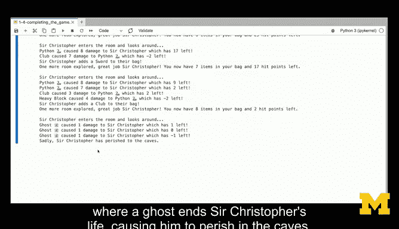

# 课程3：Python面向对象编程实战 🎮


## 概述

在本节课中，我们将一起完成一个基于面向对象编程的简单地牢探险游戏项目。我们将回顾并实现之前设计的类图，包括冒险者、物品、怪物、房间和洞穴，并最终将它们组合成一个可以运行的游戏。通过这个项目，你将学习如何将设计转化为实际代码，并理解类与对象之间的交互。

---

## 回顾类图设计

上一节我们介绍了如何使用类图和交互图来设计软件系统。本节中，我们来看看如何将这些设计转化为具体的Python代码。

我们之前设计了几个核心类：
*   **冒险者**：拥有生命值、属性和一个背包。
*   **物品**：具有名称和伤害值。
*   **怪物**：具有名称、伤害值和生命值。
*   **房间**：包含一个怪物和一件宝藏。
*   **洞穴**：由一系列房间组成。

---

## 实现冒险者与物品类

首先，我们来快速回顾并实现冒险者和物品类。冒险者的生命值将在10到30之间，再加上其体质等级。同时，冒险者初始会携带一根“小木棍”。

以下是冒险者类的初始化部分代码示例：
```python
class Adventurer:
    def __init__(self, name, constitution):
        self.name = name
        self.hit_points = random.randint(10, 30) + constitution
        self.bag = [Item("小木棍", 0, 1)]  # 初始物品
```

每个与类关联的方法都应该有一个三引号字符串来描述其功能和参数。对于方法，第一个参数总是 `self`。

物品类保持不变，但需要强调对输入值进行错误检查的重要性。
```python
class Item:
    def __init__(self, name, min_damage, max_damage):
        # 应在此处添加输入验证（例如，min_damage >= 0）
        self.name = name
        self.min_damage = min_damage
        self.max_damage = max_damage
```

---

## 创建怪物类与工厂模式

现在，让我们继续实现怪物类。根据设计，怪物有名称、最小伤害、最大伤害和生命值。

这里我想介绍一个**类函数**（class function）与**实例方法**（instance method）的区别：
*   **实例方法**：第一个参数是 `self`，可以操作调用它的对象实例的属性（如修改怪物的生命值）。
*   **类函数**：没有 `self` 参数，不能操作类实例，但可以接收参数并返回结果（包括创建新的对象）。

我将使用一个类函数来实现**工厂模式**，用于创建不同类型的随机怪物。

以下是怪物类的框架和工厂函数：
```python
class Monster:
    """怪物类。可能类型：👻 幽灵，👺 哥布林，🐍 Python蛇。"""
    def __init__(self, name, min_damage, max_damage, hit_points):
        # TODO: 添加输入验证
        self.name = name
        self.min_damage = min_damage
        self.max_damage = max_damage
        self.hit_points = hit_points

    @staticmethod
    def create_monster():
        """类函数（工厂），用于创建随机怪物。"""
        monster_types = ["👻", "👺", "🐍"]
        chosen = random.choice(monster_types)
        if chosen == "👻":
            return Monster("👻", random.randint(0,1), random.randint(1,2), 2)
        elif chosen == "👺":
            return Monster("👺", random.randint(0,1), random.randint(1,2), 10)
        else: # 🐍
            return Monster("🐍", random.randint(3,6), random.randint(6,12), 5)
```

使用 `TODO` 注释是提醒自己后续需要完善代码（如添加输入验证）的好习惯。

---

## 构建房间类与游戏逻辑

有了怪物和物品，接下来我们构建房间类。房间在创建时会初始化一个怪物和一件宝藏。

我决定将战斗解决的核心逻辑放在房间类的 `enter` 方法中。这是一个设计选择，你也可以考虑将战斗逻辑放在冒险者类中。将游戏玩法封装在房间类中，可以使代码更清晰。

以下是房间类的初始化和 `enter` 方法框架：
```python
class Room:
    def __init__(self):
        self.monster = None
        self.treasure = None
        self._create_monster_and_treasure() # 调用私有方法初始化

    def _create_monster_and_treasure(self):
        """创建房间内的怪物和宝藏。"""
        possible_items = ["匕首", "长剑", "木棒", "重石块"]
        item_name = random.choice(possible_items)
        min_dmg = random.randint(1, 3)
        max_dmg = random.randint(4, 8)
        self.treasure = Item(item_name, min_dmg, max_dmg)
        self.monster = Monster.create_monster() # 使用工厂函数

    def enter(self, hero):
        """冒险者进入房间，解决战斗。返回‘win’或‘lose’。"""
        # 战斗解决逻辑将在这里实现
        pass
```

---

## 实现战斗逻辑与鸭子类型

`enter` 方法的核心是战斗逻辑。我们需要一个函数来计算伤害。这里引入一个重要的Python概念：**鸭子类型**。

鸭子类型的核心思想是：“如果它走起路来像鸭子，叫起来也像鸭子，那么它就是鸭子。”在编程中，我们不关心对象的具体类型，只关心它是否拥有我们需要的方法或属性。

以下是利用鸭子类型实现的伤害计算函数：
```python
def calculate_damage(attacker: Item | Monster, defender: Adventurer | Monster) -> bool:
    """
    计算攻击者对防御者造成的伤害。
    参数 attacker 需有 min_damage 和 max_damage 属性。
    参数 defender 需有 hit_points 属性。
    返回布尔值：True 表示防御者死亡。
    """
    damage = random.randint(attacker.min_damage, attacker.max_damage)
    defender.hit_points -= damage
    print(f"{attacker.name} 对 {defender.name} 造成了 {damage} 点伤害。")
    if defender.hit_points <= 0:
        print(f"{defender.name} 已死亡。")
        return True
    return False
```

注意类型提示 `Item | Monster` 表示参数可以是 `Item` 或 `Monster` 类型。这使得函数非常灵活。

---

## 完成房间类的战斗循环

现在，我们可以在房间的 `enter` 方法中，使用 `calculate_damage` 函数来实现英雄与怪物的战斗循环。

战斗将随机决定谁先攻击，并持续到一方生命值耗尽为止。

以下是 `enter` 方法中战斗循环的实现：
```python
def enter(self, hero):
    print(f"{hero.name} 进入了房间并四处张望。")
    combat_done = False
    while not combat_done:
        # 随机决定攻击方
        if random.choice([0, 1]) == 1:
            # 英雄攻击：从背包随机选一件物品
            weapon = random.choice(hero.bag)
            print(f"{hero.name} 使用了 {weapon.name}。")
            if calculate_damage(weapon, self.monster):
                combat_done = True
        else:
            # 怪物攻击
            if calculate_damage(self.monster, hero):
                combat_done = True
        # 如果战斗未结束，打印当前状态
        if not combat_done:
            print(f"{hero.name}: {hero.hit_points} HP, {self.monster.name}: {self.monster.hit_points} HP")

    # 战斗结束后的处理
    if hero.hit_points > 0:
        hero.bag.append(self.treasure)
        print(f"{hero.name} 胜利了！获得了 {self.treasure.name}。")
        return "win"
    else:
        print(f"{hero.name} 不幸战败。")
        return "lose"
```

---

## 创建洞穴类与游戏循环

最后，我们需要创建洞穴类来组织房间并运行游戏主循环。洞穴类在初始化时会创建一系列房间，并提供一个 `explore` 方法来让冒险者探索所有房间。

以下是洞穴类的实现：
```python
class Cave:
    def __init__(self, num_rooms=10):
        self.rooms = []
        for _ in range(num_rooms):
            self.rooms.append(Room())

    def explore(self, hero):
        """游戏主循环。带领冒险者探索每个房间。"""
        for i, room in enumerate(self.rooms):
            print(f"\n=== 进入洞穴第 {i+1} 个房间 ===")
            result = room.enter(hero)
            if result == "lose":
                print(f"\n英雄 {hero.name} 在洞穴中陨落。游戏结束。")
                return
            else:
                print(f"恭喜 {hero.name} 成功探索了第 {i+1} 个房间！")
        # 如果循环完成，意味着冒险者通过了所有房间
        print(f"\n🎉 英雄 {hero.name} 成功穿越了所有洞穴，幸存了下来！")
```

---

## 运行游戏

所有组件都已就绪，现在可以运行我们的游戏了。只需创建冒险者、洞穴，然后开始探索。

以下是启动游戏的代码：
```python
# 创建冒险者
hero = Adventurer("克里斯托弗爵士", constitution=5)
# 创建洞穴
cave_system = Cave()
# 开始探索
cave_system.explore(hero)
```

运行这段代码，你将看到冒险者进入一个个房间，与怪物战斗，获取宝藏，直到最终胜利或失败。

---

## 总结

本节课中，我们一起完成了一个完整的Python地牢探险游戏项目。我们从类图设计出发，逐步实现了 `Adventurer`、`Item`、`Monster`、`Room` 和 `Cave` 这几个核心类。我们学习了：

*   如何将面向对象的设计转化为代码。
*   **类函数**与**实例方法**的区别及应用，特别是**工厂模式**的使用。
*   利用**鸭子类型**编写灵活的函数，而不依赖于严格的继承体系。
*   如何组织游戏循环和战斗逻辑。
*   使用 `TODO` 注释来管理未完成的代码任务。




这个项目展示了面向对象编程在组织复杂逻辑时的强大能力。在接下来的课程中，你将运用类似的技能去完成一个不同类型的作业。