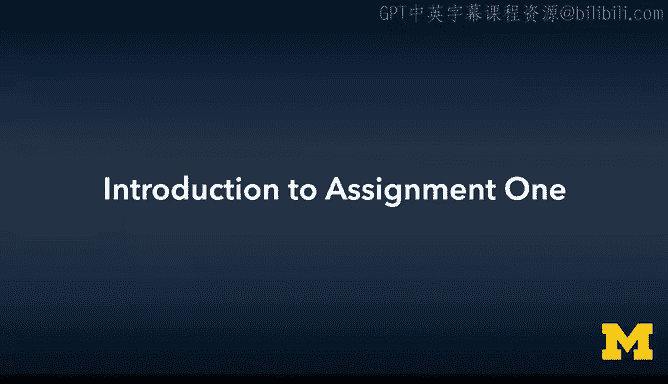
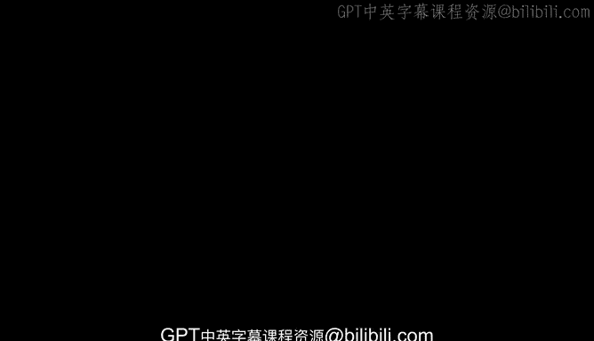
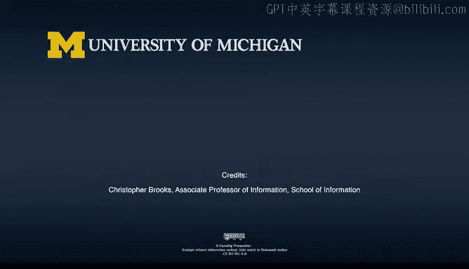

# 课程3：Python 3编程 - 作业1介绍 🎮📝

在本节课中，我们将学习本周编程作业的具体内容。本次作业的主题是构建一个能够玩文字游戏的“机器人”程序。我们将了解作业的基本要求、核心规则以及完成作业所需遵循的严格规范。

---

虽然我喜欢地牢探险游戏，但我也同样喜欢文字游戏。因此，这就是本课程作业的主题。

作业1相当直接明了，但需要关注细节才能正确解决。你的任务是构建一个机器人，即一个自动程序或计算代理，它将玩一个名为“Wordy Pi”的游戏。这是我制作的一个不算太有原创性的文字猜词游戏。

在作业中，我已经为你提供了游戏规则以及一个必须严格遵守的类图。这是为了让你的机器人能够正确地进行游戏。

关于这次作业，请记住你不需要创建一个非常智能的机器人。你只需要能够通过单元测试即可。这些单元测试是我根据作业中给出的规则和类图创建的。

现在，实际上我已经完成了一些繁重的工作，并编写了你将使用的游戏引擎。重要的是，除非说明中明确要求，否则你不要更改或修改其他代码。因为自动评分器将使用我编写的代码来判断你是否正确解决了问题。

但我已将所有的代码公开，供你探索。希望你享受解决本周作业的过程。

---

## 作业核心要点

以下是完成本次作业你需要了解的几个关键点：

*   **作业目标**：构建一个玩“Wordy Pi”文字游戏的机器人程序。
*   **核心要求**：程序必须**严格遵循**提供的游戏规则和类图结构。
*   **成功标准**：你的解决方案需要通过基于给定规则和类图编写的**单元测试**。
*   **重要限制**：**不要修改**已提供的游戏引擎代码，除非作业指示明确要求，否则可能影响自动评分。
*   **代码访问**：所有相关代码均已提供，可供你仔细研究和理解。

---

本节课中，我们一起学习了本周编程作业“Wordy Pi”的基本介绍。我们明确了作业目标是构建一个游戏机器人，并理解了必须严格遵守预定义规则和类结构的重要性。记住，成功的核心在于通过单元测试，而非创造复杂的人工智能。现在，你可以开始探索提供的代码，并着手构建你的解决方案了。