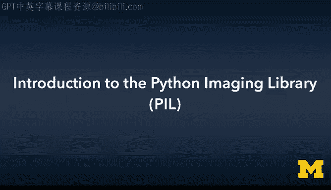
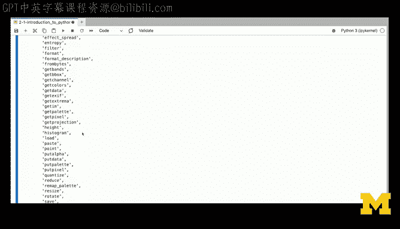

# 课程3：Python图像库(PIL/Pillow)入门 🖼️



在本节课中，我们将学习一个名为Pillow的第三方Python库，它扩展了Python的功能，使其能够处理图像文件。我们将学习如何导入库、查看文档、加载图像，并在Jupyter Notebook中显示图像。

## 导入库与查看文档

首先，我们需要导入Pillow库。这个库并非Python标准库的一部分，但在此环境中已预先安装。

以下是导入库并查看其文档字符串的步骤：

```python
import PIL
help(PIL)
```

执行上述代码会显示一个很长的文档字符串，其中包含模块描述和包内容列表。包内容列表中的每一项都是Pillow包中的一个子模块。

## 探索子模块

接下来，我们导入一个名为`Image`的子模块并查看其文档。

```python
from PIL import Image
help(Image)
```

为了查看`Image`子模块中包含哪些类或方法，我们可以使用`dir()`函数。

```python
dir(Image)
```

在列出的属性中，我们发现了`Image`类。我们可以进一步查看这个类的文档。

```python
help(Image.Image)
```

请注意，`Image.Image`中的第一个`Image`是我们导入的子模块，第二个`Image`是该子模块中的类名。

## 理解模块与类型

为了更清晰地理解这些元素，我们可以打印出它们的类型。

```python
print(type(PIL))
print(type(Image))
print(type(Image.Image))
```



输出显示，`PIL`和`Image`是模块类型，而`Image.Image`是类类型。在Python中，模块名和类名可以相同。

## 使用内联帮助

虽然查看网页文档是学习新库的常用方法，但Python的内联`help()`函数对于回忆不常用库的方法非常有用。让我们查看`Image`类中的`load`方法。

```python
help(Image.Image.load)
```

文档显示`load`是一个方法，它不接受`self`以外的参数，并返回一个图像对象。这里的文档格式是reStructuredText，这是Python中另一种常见的结构化文档格式。

## 创建图像对象

在Pillow中，创建新图像对象遵循工厂模式。`Image`模块有一个`open`函数，用于返回一个新的图像对象。

```python
help(Image.open)
```

`open`函数是一个函数，而不是方法。它的第一个参数`fp`可以接受多种类型：文件名（字符串）、`os.PathLike`对象或文件对象。这体现了Python的“鸭子类型”理念：只要对象具有`read`、`seek`和`tell`方法，它就可以被使用。

## 加载并显示图像

现在，让我们实际加载一张图片。我们将使用一张名为`northquad.jpg`的图片。

```python
im = Image.open('northquad.jpg')
print(im)
```

打印出的对象类型显示为`PIL.JpegImagePlugin.JpegImageFile`。根据文档，`open`函数应返回一个`PIL.Image.Image`对象。这实际上是面向对象继承在起作用。返回的对象既是`JpegImageFile`，也是`Image`。

我们可以使用`inspect`模块来查看这个对象的继承链。

```python
import inspect
print(inspect.getmro(type(im)))
```

输出证实了继承关系：`JpegImageFile` -> `ImageFile` -> `Image` -> `object`。

要查看图像，`Image`对象有一个`show`方法。但在Jupyter Notebook环境中，`show`方法可能无法正常工作。我们可以使用IPython的`display`函数来在笔记本中渲染图像。

```python
from IPython.display import display
display(im)
```

执行上述代码后，图像应该会显示在笔记本中。

## 总结

本节课中，我们一起学习了Python内置的帮助函数`help()`和`dir()`，它们用于查看模块、类和方法的文档与属性。我们初步认识了Python图像库Pillow，学习了如何加载图像并在Jupyter Notebook中显示。我们还通过一个JPEG图像示例，演示了如何编程查看对象的继承层次结构。


掌握了这些基础后，我们将在下一讲中深入探讨计算机系统中图像的基本原理。