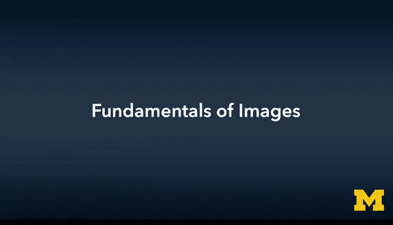
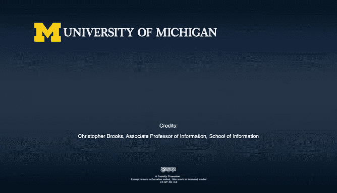

# 课程3：Python图像处理基础 🖼️



## 概述

在本节课中，我们将学习计算机如何存储和处理图像。我们将重点介绍**栅格图像**（也称为位图图像）的基本概念，包括像素、颜色通道和颜色深度。通过Python的PIL库，我们将实际操作图像数据，理解其底层结构。

---

## 图像表示方法

计算机图形学和计算机视觉是一个广阔的领域。本课程无法涵盖其全部内容。然而，我们需要花些时间讨论计算机存储图像的基本原理，这对你完成作业以及未来进行任何图像处理都至关重要。

我将重点介绍一种称为**栅格图像**或**位图图像**的图像类型。栅格图像是一种还原论的表示方法，从高层次看，它将图像分割成一个二维数组，类似于一个网格。

在这个网格中，每个单元格包含一个像素的颜色等信息。网格线是虚拟的，没有宽度。这意味着栅格图像是矩形的，因此它们具有宽度和高度。栅格图像中的像素总数就是行数乘以列数。

在本课程中，我们只讨论方形像素，但也可能存在其他形状的像素。另一种表示图像的方法是使用一系列**矢量图元**，它们描述构成图像的线条和填充。

矢量图像功能非常强大，因为它们可以无限调整大小而不会损失分辨率。另一方面，栅格图像更容易创建，特别是当它们来自具有成像传感器的设备（如相机或手机）时。

本课程中，我不会再讨论矢量图像，但我想深入探讨栅格图像，并且我认为Jupyter Notebook是进行此操作的绝佳场所。

---

## 加载与查看图像

首先，我将导入Python图像处理库（PIL）并加载我们一直在使用的图像。

这里可能会有点混淆，但请注意，`image` 实际上是PIL的一个模块或子模块。然后，我们将创建一个类型为 `Image` 的变量，这是一个类。

现在，这张图像是一个栅格图像，可能来自相机。这意味着它由像素网格组成。我们可以通过查看 `size` 属性来了解它有多少像素。这个 `size` 属性实际上会返回一个格式为 `(宽度, 高度)` 的元组。

以下是查看图像尺寸的代码：

```python
print(image_object)
print(image_object.size)
print(image_object.size[0])  # 宽度
print(image_object.size[1])  # 高度
```

我们的图像宽约1400像素，高约800像素。

---

## 像素与颜色通道

但像素到底是什么？重要的是，我在第一行打印了图像对象，这实际上调用了图像的 `__repr__` 方法。开发者在这个描述中包含了图像的**模式**。

对于这张图像，模式设置为 **RGB**，代表红色、绿色和蓝色。这意味着一个像素实际上是一个三元组，包含一个红色值、一个绿色值和一个蓝色值。当我们将这些值组合在一起时，计算机将显示特定的颜色色调。

我们将像素的这些不同颜色维度称为**颜色通道**。因此，在这种情况下，我们有三个颜色通道：红色、绿色和蓝色。这很常见，但也有其他表示颜色通道的方式，它们各有优势，我们稍后会提及。

在大多数图像处理软件中，每个颜色通道的值是一个**单字节**，即一个介于0到255之间的数字。

这意味着对于一个具有三个颜色通道（RGB）的单个像素，存在 `256^3` 种可能的组合。也就是说，我们可以为图像中的每个像素表示超过1600万种颜色。

这听起来很多，实际上也确实如此。有三个颜色通道，每个通道的大小是一个字节，图形艺术家会说我们有**三字节色深**。

实际上，我们倾向于用比特而不是字节来讨论。由于一个字节是8比特，我们有三个字节，这意味着对于JPEG图像，我们有**24位色深**，或者说每个颜色通道每个像素有8比特。

我不想对此深入探讨，但我确实非常喜欢图像处理工作。当你购买下一台电视或显示器时，请注意广告中宣传的色深是多少。在我最初录制本课程时，电视和显示器的标准是8位色深，这意味着每个颜色通道获得8比特信息，并由一个字节表示。

然而，现代电视、手机和显示器已经发展，现在常见的是10位色深。这通常被称为**高动态范围**或**HDR**，因为现在每个颜色通道可以由超过1000个不同的值表示，显著增加了图像中可以捕捉和显示的信息的细微差别。

---

## 操作单个像素

现在，让我们使用PIL库从这张图像中获取一个像素。要获取图像中的一个像素，我们可以使用 `getpixel` 方法。此方法接受一个包含我们想要检索的像素的X和Y坐标的元组。X、Y原点（我们开始的地方）是图像的左上角。

让我们从图像中抓取一块密歇根州的蓝色天空。我将获取位置 `(10, 10)` 的像素，这应该能给我一些天空。

```python
pixel_value = image_object.getpixel((10, 10))
```

你可能以为会显示一个蓝点，但请记住，虽然Jupyter知道如何渲染PIL的 `Image` 对象，但当我们提取一个像素时，我们实际上只是获取颜色值的元组。

让我们验证一下。首先，我将打印出该像素的类型，然后遍历元组中的RGB值并打印出来。

```python
print(type(pixel_value))
for color, value in zip('RGB', pixel_value):
    print(f"{color}: {value}")
```

我们在位置 `(10, 10)` 抓取的天空像素的红色值较低（13），绿色值中等（93），蓝色值较高（164）。

当我们使用RGB颜色方案时，值 `(0, 0, 0)` 代表纯黑色，而值 `(255, 255, 255)` 代表纯白色。

---

## 提取颜色通道

我认为这可能就是你完成本周作业实际需要了解的全部内容，但我想更进一步，向你展示一些其他可用的方法，这些方法可能使图像处理更加方便。

让我们获取整个图像的单个通道。在这种情况下，我将取出蓝色通道。我们可以通过图像对象调用 `getchannel` 方法来实现，然后我们可以通过索引（位置）来引用它。对于RGB，蓝色通道的位置是2（索引从0开始：0,1,2），或者我们可以直接使用 `'B'` 来获取蓝色通道。

```python
blue_channel = image_object.getchannel('B')
print(blue_channel)
print(type(blue_channel))
```

这很有趣。当我们取出单个颜色通道时，底层发生的是PIL逐像素地复制图像，但只复制出蓝色通道。所以现在我们有一个每像素8位的图像，而不是每像素24位的图像，并且它只包含蓝色值。

这里你可能还注意到了另外两个变化。首先，图像是一个PIL的 `Image` 对象，而不是JPEG图像文件，因为我们处理的是内存中的副本。其次，颜色模式设置为 **L**。模式为L的图像是黑白图像。L代表**亮度**，PIL认为单字节通道代表0到255之间的灰度值。

如果我们在Jupyter中渲染这张图像，我们将看到一个仅由蓝色颜色通道组成的灰度图像。让我们看看效果。

```python
display(blue_channel)
```

这还不错。我们通过只保留一个颜色通道（蓝色）压缩了这张图像，它仍然可以辨认。如果你使用过像Adobe Photoshop这样的工具，有很多不同的方法可以从彩色照片创建黑白照片。

在这张图像中，很难看到树叶的细微差别，因为我们丢弃了包含所有这些信息的绿色通道。让我们再做一个小演示，看看仅由绿色通道组成的图像。

花点时间看看这两张图像，注意它们有何不同。在第二张图像中，我在树木和树叶中看到了更多的细微差别，而在第一张图像中，它们只是黑色且没有细节。有时这被称为**裁剪**。

看看建筑物前面的标志。标志的背景是蓝色的，在第一张图像中显示为中等灰色，在第二张图像中显示为相当深的灰色。标志上的块状物是黄色的，或者像我们在密歇根说的，是玉米色，在第二张图像中显示为浅色，但在第一张图像中几乎是黑色。

通过使用单颜色通道将图像转换为黑白，我们对所显示的内容得到了非常不同的解释。

---

## 底层像素数据

最后一个快速演示，深入细节。虽然使用像 `getpixel` 这样的高级对象很好，但有时你只想处理实际的像素值。为此，我们可以将图像转换为值数组。

```python
image_bytes = image_object.tobytes()
print(image_bytes[0])  # 第一个字节
print(image_bytes[:10]) # 前10个字节
print(len(image_bytes)) # 总字节数
```

有趣的是，我们可以看到 `tobytes` 函数返回的字节对象只是一个巨大的数字序列，每个像素的R、G和B值按顺序排列。

需要注意的是，`bytes` 是Python中的一种基本类型。这不是字节列表或字节数组，而是一个 `bytes` 对象。这个对象是一维且不可变的，意味着它不能被更改或更新。

---

## 总结

在本节课中，我们介绍了栅格或位图图像的基本数据结构。从高层次看，它是一个值的二维网格，每个值代表矩形图像中的一个像素。

像素的值根据图像的**模式**而变化。例如，对于模式为RGB的图像，我们期望在每个值单元格中看到三个条目，每个条目都是一个整数，指示应显示多少给定颜色。我们称这些为**颜色通道**，RGB是图像非常常见的模式。

然而，也可以有单颜色通道图像，其中表示的是**亮度**，这本质上构成了黑白图像。

这只是一个非常复杂且有趣领域的开始，该领域在模拟电视中有着非常有趣的根源。例如，20世纪40年代的黑白电视本质上是黑白的，因为只广播了亮度。这实际上很有道理。人眼对亮度（反射光量）比对不同颜色（光的单个波长）要敏感得多。



我真的很想和你一起更深入地探索这个世界，但我认为我们应该看看这个Python库，并将我们的研究建立在如何实际操作图像上。我们将在下一讲中解决这个问题。