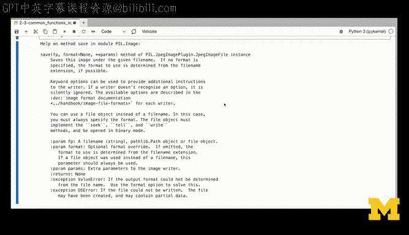

# 课程11：Python图像库常用函数 🖼️


在本节课中，我们将学习Python图像库（PIL/Pillow）的更多实用功能。我们将涵盖图像的保存、滤镜应用、裁剪以及基本绘图操作。这些功能将帮助你更灵活地处理和操作图像。

---

## 导入模块与加载图像

首先，我们需要导入必要的模块并加载一张示例图像。我们将使用Pillow库的`Image`模块，并借助IPython的显示功能来查看图像。

```python
from PIL import Image
from IPython.display import display

# 加载并显示图像
image = Image.open("North_quad.jpg")
display(image)
```

执行上述代码后，你将看到一张名为“North quad”的图像显示出来。

---

## 保存图像

上一节我们介绍了如何加载和显示图像，本节中我们来看看如何保存图像。Pillow库提供了`save`方法，允许我们将图像保存为不同格式的文件。



以下是`save`方法的基本用法：

```python
# 将图像保存为PNG格式
image.save("North_quad.png")
```

`save`方法接受两个主要参数：
- `fp`：目标文件名。
- `format`：图像格式（通常根据文件扩展名自动推断）。

例如，将JPEG图像保存为PNG格式后，重新加载该文件，你会发现图像对象的类型已从`JpegImageFile`变为`PngImageFile`。这展示了Pillow库如何根据文件扩展名自动处理图像格式转换。

```python
# 重新加载PNG图像并检查其类型
image_png = Image.open("North_quad.png")
print(type(image_png))
```

---

## 应用图像滤镜

Pillow库内置了多种图像滤镜，可以为图像添加各种效果。这些滤镜通过`ImageFilter`模块提供，并使用`filter`方法应用到图像上。

以下是应用模糊滤镜的示例：

```python
from PIL import ImageFilter

# 应用模糊滤镜
blurred_image = image.filter(ImageFilter.BLUR)
display(blurred_image)
```

执行上述代码后，你将看到原始图像变得模糊。Pillow库还提供了其他滤镜，如浮雕（`EMBOSS`）和锐化（`SHARPEN`）。建议你暂停视频，在笔记本中尝试这些滤镜，以熟悉它们的效果。

---

## 裁剪图像

裁剪是图像处理中的常见操作，它允许我们提取图像的特定区域。Pillow库的`crop`方法通过一个边界框（bounding box）来定义裁剪区域。

边界框是一个包含四个值的元组，格式为`(左上角x, 左上角y, 右下角x, 右下角y)`。例如，要从图像中提取密歇根大学标志，可以使用以下代码：

```python
# 定义边界框并裁剪图像
bbox = (570, 655, 626, 698)
cropped_image = image.crop(bbox)
display(cropped_image)
```

裁剪操作不会修改原始图像，而是返回一个新的图像对象。这种不可变性是许多图像处理库的常见设计模式。

---

## 绘制边界框

为了更精确地确定裁剪区域，我们可以在图像上绘制边界框。Pillow库的`ImageDraw`模块提供了绘图功能，允许我们在图像上添加形状、文本等。

以下是绘制红色矩形边界框的示例：

```python
from PIL import ImageDraw

# 创建绘图对象
draw = ImageDraw.Draw(image)

# 定义边界框并绘制矩形
bbox = (570, 655, 626, 698)
draw.rectangle(bbox, outline="red", width=5)

# 显示带有边界框的图像
display(image)
```

`ImageDraw`模块功能丰富，支持绘制多边形、修改像素值、添加文本等操作。它特别适用于需要高亮图像特定区域的任务。

---

## 总结

本节课中，我们一起学习了Python图像库（Pillow）的常用函数。我们涵盖了图像的保存、滤镜应用、裁剪以及基本绘图操作。这些功能为图像处理提供了强大的工具，帮助你更灵活地操作和优化图像。


在下一讲中，我们将探讨如何使用Pillow库处理多张图像及它们之间的操作。