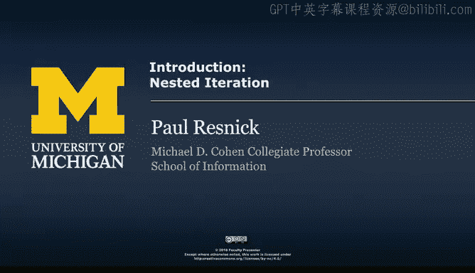

# 课程3：Python 3编程 - P12 🧩 嵌套迭代简介




在本节课中，我们将要学习如何处理嵌套的数据结构。具体来说，我们将探讨如何使用嵌套的`for`循环来遍历这些结构，理解嵌套对象共享可能带来的问题，并学习如何通过“理解、提取、重复”的方法来逐步从复杂结构中提取数据。

---

上一节我们介绍了如何通过多层方括号来访问嵌套数据结构中的深层元素。本节中我们来看看如何系统地遍历整个嵌套结构。

通常，您需要遍历嵌套数据结构中的所有内容，或者至少是其中的一部分。例如，您可能需要打印所有项目，或将它们累积到一个扁平的、非嵌套的列表中。在本课中，您将通过**嵌套迭代**来实现这一目标。

嵌套迭代指的是将一个`for`循环缩进在另一个`for`循环内部，根据需要的嵌套层级可以有多层。

以下是嵌套迭代的基本代码结构示例：
```python
for outer_item in outer_structure:
    for inner_item in outer_item:
        # 处理 inner_item
```

---

我们还将探讨列表或字典嵌套在其他列表或字典中时可能产生的混淆问题。这与我们之前见过的**别名**问题类似，即多个变量指向同一个对象。

如果您修改了一个列表（例如，通过追加一个额外项），那么实际上您就更改了所有包含该列表的列表和字典。为了避免这种意外的连带修改，我们需要区分**浅拷贝**和**深拷贝**。

*   **浅拷贝** (`list.copy()` 或 `list[:]`)：只复制最外层的容器，内部的嵌套对象仍然是共享的引用。
*   **深拷贝** (`copy.deepcopy()`)：递归地复制所有层级的对象，创建一个完全独立的新数据结构。

其核心区别可以用以下公式表示：
*   浅拷贝：`new_list = original_list[:]` (仅顶层独立)
*   深拷贝：`new_list = copy.deepcopy(original_list)` (完全独立)

---

最后，我们将介绍**理解、提取、重复**的方法，用于逐步找出从嵌套数据结构中提取所需数据的途径。

以下是该方法的步骤：
1.  **理解**：首先，理解数据结构的形状和层级。打印它或使用调试工具查看。
2.  **提取**：编写一小段代码，提取出您当前关注的那一层数据。
3.  **重复**：将提取出的数据作为新的起点，重复前两个步骤，直到获得最终目标数据。

---

本节课中我们一起学习了：
1.  如何编写嵌套的`for`循环来遍历嵌套数据结构。
2.  如何识别内部列表或字典在多个外部对象间共享的情况，并在必要时使用**深拷贝**而非浅拷贝来避免问题。
3.  如何运用**理解、提取、重复**的流程，逐步开发代码以从复杂的嵌套数据结构中提取所需数据。

掌握这些技能将使您能够自信地处理Python中更复杂的数据组织形式。