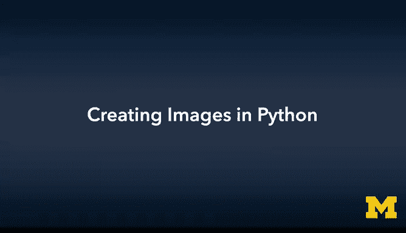
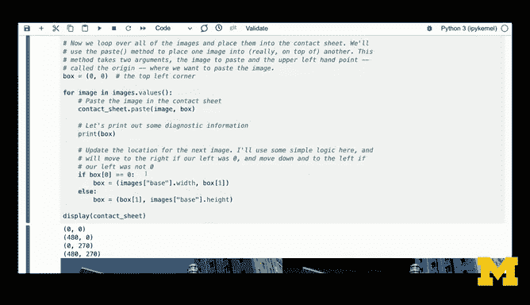
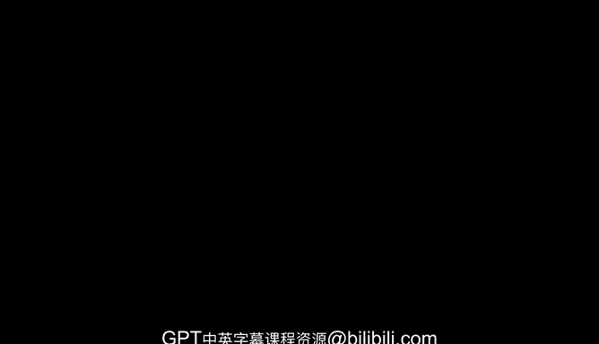

# 课程12：使用Python创建与处理图像 🖼️



在本节课中，我们将学习如何使用Python的PIL库（Pillow）来创建、处理和组合图像。我们将从加载和调整图像大小开始，然后创建包含原始图像及其不同灰度版本的“联系表”，最后学习如何在图像上添加文本。

---

## 导入库与加载图像

首先，我们需要导入必要的库并加载一张图像。我们将使用之前课程中用过的“北校区”图像。

```python
from PIL import Image, ImageDraw, ImageFont

# 加载图像
image = Image.open('north_quad.jpg')
```

为了便于演示，我们需要一个较小的图像。PIL提供了两种调整大小的方法：`resize`和`thumbnail`。

`thumbnail`方法接受一个包含宽度和高度的元组作为参数，它会**原地修改**图像并**保持宽高比**。
`resize`方法则**返回一个新图像**，并且你可以完全控制是否保持宽高比。

如果我们想使用`resize`方法并保持宽高比，需要根据原始尺寸计算新的宽度和高度。

```python
# 创建一个较小版本的图像，保持宽高比
base_width = 300
w_percent = base_width / float(image.size[0])
h_size = int(float(image.size[1]) * float(w_percent))
small_image = image.resize((base_width, h_size), Image.Resampling.LANCZOS)
```

现在，我们有了一个小尺寸的图像，而原始图像保持不变。

---

## 创建灰度图像与联系表

在上一节中，我们介绍了如何将图像从RGB色彩空间转换为L（亮度）空间，从而创建黑白图像。本节中，我们将使用这种方法来创建一个“联系表”。

联系表是一种传统的方法，用于在一张相纸上显示胶片的所有曝光缩略图。在我们的例子中，联系表将显示原始彩色图像以及分别基于红、绿、蓝通道的三个灰度图像。

以下是创建这四张图像的方法：

```python
# 创建包含不同版本图像的字典
images = {}
images['base'] = small_image  # 原始彩色图像

# 分离通道并创建灰度图像
r, g, b = small_image.split()
images['R'] = r.convert('L')  # 红色通道灰度图
images['G'] = g.convert('L')  # 绿色通道灰度图
images['B'] = b.convert('L')  # 蓝色通道灰度图
```

请注意，术语“颜色通道”和“颜色波段”在图像处理中经常互换使用，但在PIL库中也可能看到两者混用，这可能会让图像处理新手感到困惑。

---

## 组合图像创建联系表

现在，我们将把这四张图像组合成一个2x2网格的联系表。



首先，我们需要创建一个足够大的新画布来容纳所有小图像。

```python
# 计算联系表的总尺寸
img_width, img_height = small_image.size
contact_sheet_width = img_width * 2
contact_sheet_height = img_height * 2

# 创建新的空白图像作为联系表画布
contact_sheet = Image.new('RGB', (contact_sheet_width, contact_sheet_height))
```

接下来，我们遍历图像字典，并使用`paste`方法将每张图像粘贴到联系表的相应位置。

`paste`方法需要两个参数：要粘贴的图像，以及粘贴位置的左上角坐标（原点）。Pillow会自动从被粘贴的图像中获取宽度和高度。

```python
# 初始化粘贴的起始位置
x = 0
y = 0

# 遍历并粘贴图像
for img_name, img in images.items():
    contact_sheet.paste(img, (x, y))
    # 更新下一个图像的粘贴位置
    if x == 0:
        x = img_width  # 向右移动
    else:
        x = 0          # 回到最左侧
        y = img_height # 向下移动一行
```

以下是当前逻辑的简单说明：它适用于创建2x2的图像网格。你可以思考一下，如果需要处理任意数量的图像（例如创建一个3x3的网格），应该如何修改这段代码。建议你尝试在字典中添加更多图像，并修改逻辑来创建不同布局的联系表。

---

## 在图像上添加文本

PIL库也允许你在图像上渲染文本。这里需要了解**矢量图像**和**位图（栅格）图像**的区别。

在矢量图像中，文本以一系列绘图指令（如位置、大小、字体和文字内容）的形式存储。调整图像大小时，文本依然清晰可辨。
在位图图像中，文本被转换为像素。调整大小时，计算机会难以保持文本的清晰度，通常会导致文本出现像素化。

因此，在处理包含文本的位图时，最佳实践是在完成所有其他图像操作后，再添加文本。

我们将以创建好的联系表为基础，在上面添加文本标签。文本绘制功能在`ImageDraw`模块中，同时我们还需要`ImageFont`来加载系统字体。

```python
# 导入绘图和字体模块
from PIL import ImageDraw, ImageFont

# 加载字体
font = ImageFont.truetype('Roboto-Bold.ttf', 25)
```

我们将遍历之前定义的标签列表，为联系表中的每个子图创建一个带有黑色背景的文本标签，然后将其粘贴到对应位置。

```python
# 初始化文本标签的起始位置
label_x = 0
label_y = 0
labels = ['Base Image', 'Red Channel', 'Green Channel', 'Blue Channel']

for label in labels:
    # 为每个标签创建一个小的黑色背景图像
    label_bg = Image.new('RGB', (img_width, 30), color='black')
    draw = ImageDraw.Draw(label_bg)

    # 在背景中央绘制文本
    # 锚点参数‘mm’表示文本将水平和垂直居中于给定点
    draw.text((img_width//2, 15), label, font=font, fill='white', anchor='mm')

    # 将文本标签粘贴到联系表上
    contact_sheet.paste(label_bg, (label_x, label_y + img_height - 30))

    # 更新下一个标签的位置（与图像位置同步）
    if label_x == 0:
        label_x = img_width
    else:
        label_x = 0
        label_y = img_height
```

`draw.text`方法中，锚点参数是一个两字符的字符串，用于指定文本的锚定位置。`‘mm’`表示文本将围绕给定点**水平和垂直居中**。Pillow的文档对此有详细说明。

运行以上代码后，我们将得到一个带有清晰标签的联系表，显示了原始图像及其三个通道的灰度版本。

---

## 理解图像模式转换

最后，让我们了解一下图像模式转换的底层细节。我们的原始图像是RGB模式，而灰度图像是L（亮度）模式。当我们将L模式的图像粘贴到RGB模式的联系表上时，Pillow会自动进行转换。

这种转换是通过将单个通道的像素值**复制到所有三个RGB通道**来实现的。因为当一个RGB像素的三个通道值相等时，它呈现为灰色。

我们可以通过检查几个像素值来验证这一点：

```python
# 检查蓝色通道灰度图的一部分像素（避开文本标签区域）
blue_img = images['B']
# 选择图像中心下方的一些像素
for i in range(2):
    for j in range(2):
        pixel = blue_img.getpixel((i, 31))
        print(f"Pixel ({i}, 31): {pixel}")
# 输出可能是 (45, 45, 45) 这样的形式，表明三个通道值相同。
```

---

## 总结 🎯

在本节课中，我们一起学习了如何使用Python的PIL库进行多种图像操作：

1.  **加载与调整图像**：使用`resize`和`thumbnail`方法，并理解了保持宽高比的重要性。
2.  **提取颜色通道与创建灰度图像**：使用`split()`和`convert(‘L’)`方法。
3.  **创建图像联系表**：通过创建新画布并使用`paste`方法组合多个图像。
4.  **在图像上添加文本**：使用`ImageDraw`和`ImageFont`模块，理解了矢量与位图文本的区别，并学会了使用锚点参数居中文本。
5.  **理解模式转换**：看到了Pillow如何将L模式的灰度图像转换为视觉上相同的RGB模式图像。




图像处理是一个充满乐趣的领域，它结合了技术性与创造性。希望本教程能帮助你掌握这些基础技能，并自信地完成本周的作业。