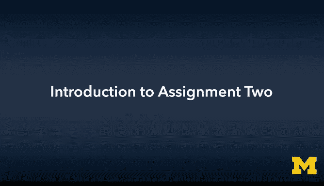
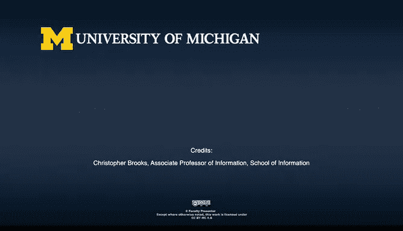

# 课程13：图像处理与Wordle游戏 🎮

在本节课中，我们将学习如何将图像处理技术应用于一个具体的项目——Wordle游戏。我们将了解如何从游戏引擎返回的图像中分析信息，并检测字母的位置是否正确。



---

## 概述 📋

本周我们学习了许多关于图像处理的知识。现在，是时候将这些技能应用到Wordle游戏中了。本次作业包含多个任务，课程提供的架构图会概述这些要点。此外，游戏引擎已更新为返回图像而非对象。这意味着，你需要从图像中检测字母是否处于正确位置。当然，所有课程代码都是开放的，你可以通过研究代码来了解Wordle游戏引擎的编写方式。

请记住，你必须通过单元测试才能完成作业。因此，当你认为自己准备就绪时，请将你的代码提交给自动评分系统。

我们正逐步接近编写一个功能完整的游戏和游戏代理。希望你和我一样，对开始深入并渲染一些Wordle游戏图像感到兴奋。

---

## 作业核心任务 🎯

上一节我们介绍了本次作业的背景和目标，本节中我们来看看具体的核心要求。

以下是本次作业你需要完成的主要任务：

*   游戏引擎现在返回**图像**，而非直接的数据对象。
*   你需要从返回的图像中**检测字母的位置**，并判断其正确性。
*   你可以**参考和利用**课程提供的完整游戏引擎代码。
*   作业通过与否取决于你的代码是否能通过**单元测试**。

---

## 关键概念与实现 💡

在理解了任务要求后，我们需要掌握几个关键概念。核心在于处理图像并提取文本信息。

一个基础的思路可能是使用图像处理库（如PIL或OpenCV）读取图像，然后进行二值化、字符分割，最后使用OCR（光学字符识别）技术或模板匹配来识别字母及其位置。伪代码示例如下：

```python
from PIL import Image
import pytesseract

def analyze_wordle_image(image_path):
    # 1. 打开并预处理图像
    img = Image.open(image_path)
    gray_img = img.convert('L')
    # 2. 此处可添加二值化、降噪等处理步骤
    # 3. 使用OCR识别字母
    text = pytesseract.image_to_string(gray_img, config='--psm 6')
    # 4. 分析字母位置（逻辑取决于游戏图像的具体布局）
    # ...
    return analysis_result
```

---

## 总结与下一步 🚀

本节课中，我们一起学习了如何将图像处理技能应用于Wordle游戏项目。我们明确了作业需要从图像中分析游戏状态，并了解了可以参考官方代码库。通过单元测试是完成作业的关键。



我们正在构建一个功能完整的游戏代理的道路上又前进了一步。接下来，就请你开始动手，尝试处理并分析Wordle游戏图像吧！