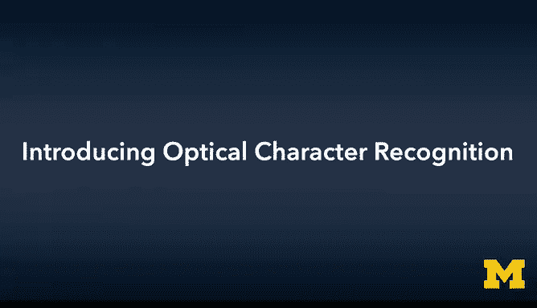
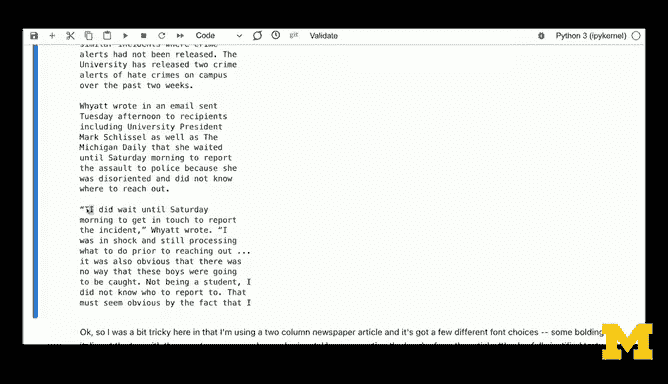
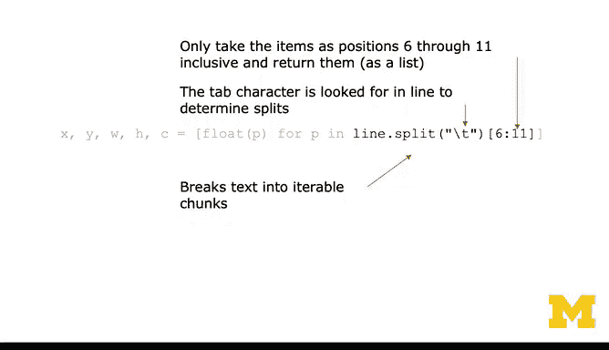
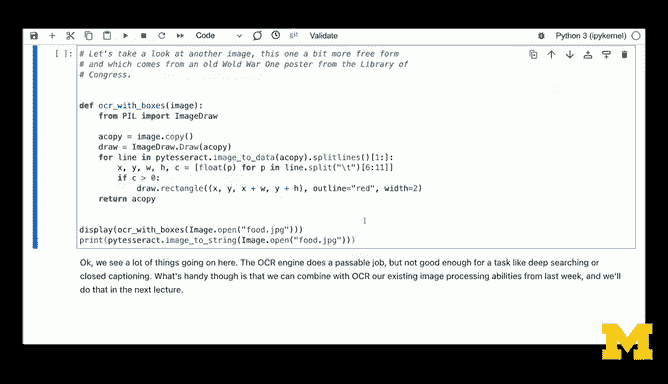
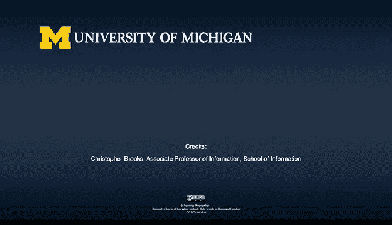

# 课程3：Python图像处理 - 第14课：光学字符识别（OCR）简介 🧾



在本节课中，我们将要学习光学字符识别（OCR）的基本概念，并了解如何在Python中使用PyTesseract库从图像中提取文本。我们将通过实际代码示例，展示如何读取图像、提取文本以及可视化OCR引擎识别的文本区域。

---

## 概述

光学字符识别（OCR）是一个具有挑战性的问题。其目标很简单：获取包含自然语言的图像，并将其转换为数字字符串表示，以便我们能够处理文本并对其进行操作。

然而，OCR面临诸多挑战。首先，图像中的字符可能不清晰。或者，字符可能清晰，但字体、大小、语言或图像中的方向各不相同。尽管OCR领域历史悠久，但深度学习领域的显著突破极大地推动了其发展。此外，基于Transformer的人工智能系统（如ChatGPT）也使得处理媒体输入变得更加容易。

不过，使用大型语言模型进行图像识别和处理是另一个课程的内容。因此，我们将重点讨论如何在Python中更直接地进行OCR工作。

---

## 准备工作：安装与导入库

与使用Python Imaging Library（PIL）类似，在Python中使用OCR需要外部库的支持。我们将使用PyTesseract库，它是Tesseract OCR引擎的Python封装。

需要注意的是，安装PyTesseract与安装PIL不同。我们首先需要安装Tesseract命令行工具，然后再安装Python封装库。这是一种在Python库中常见的模式，有时它们将繁重的计算任务交给一个可在多种不同环境中使用的工具来完成。

当然，在Coursera平台上，这些已经为我们安装好了。现在，让我们看看如何在Python中开始进行OCR。

PyTesseract基于并使用Python Imaging Library（PIL），因此我们需要导入这两个模块。

```python
from PIL import Image
import pytesseract
```



---

## 基础文本识别

我们可能想做的第一件事是尝试检测一些文本。我们可以使用`image_to_string`函数来实现。请注意，PyTesseract是一个非常简单的模块，只有几个函数，这里没有方法。

以下是如何打开图像、显示图像并提取文本的示例：

```python
# 打开图像
img = Image.open('newspaper_article.png')
img.show()  # 显示图像

# 提取文本
text = pytesseract.image_to_string(img)
print(text)
```

运行上述代码后，我们会看到图像以及检测到的文本。结果通常相当不错，但可能会因图像复杂性而出现一些错误。

---

## 进阶：获取文本数据与边界框

另一个有用的函数是`image_to_data`。这个函数将返回边界框坐标以及每个框中检测到的文本。这对于可视化OCR布局引擎的工作方式非常有用。

这也展示了使用Python封装C语言库时的一些挑战。`image_to_data`函数的返回值是一个字符串，格式为制表符分隔的值，因为它旨在便于人类在命令行上阅读。

让我们看一下如何使用它：

```python
# 获取文本数据
data = pytesseract.image_to_data(img)

# 打印每一行数据
for line in data.split('\n'):
    print(line)
```

Tesseract返回的数据包括每个检测到的单词（包括空格）的层级、页码、块号、段落号、行号、单词号。此外，它还包含文本左上角的像素坐标、文本的宽度和高度、文本本身以及识别的置信度。

置信度是一个有趣的指标。例如，错误识别的文本置信度可能很低（如27），而大多数其他单词的置信度则远高于90。

---

## 可视化边界框

为了更直观地理解Tesseract如何工作，我们可以在图像上绘制这些边界框。以下是绘制边界框的代码示例：

```python
from PIL import ImageDraw

# 创建图像副本用于绘制
img_copy = img.copy()
draw = ImageDraw.Draw(img_copy)

# 解析数据并绘制边界框
for line in data.split('\n')[1:]:  # 跳过标题行
    if line:
        parts = line.split('\t')
        if len(parts) >= 12:
            x, y, w, h, conf = map(int, parts[6:11])
            text = parts[11]
            if conf > 0:  # 只绘制置信度大于0的框
                draw.rectangle([x, y, x + w, y + h], outline='red')
                draw.text((x, y - 10), text, fill='blue')

# 显示带有边界框的图像
img_copy.show()
```

这段代码首先创建图像的一个副本，然后解析从`image_to_data`获取的数据。对于每一行，它提取边界框的坐标（x, y, 宽度, 高度）和置信度。如果置信度大于0（表示检测到文本），它就在图像上绘制一个红色矩形框，并在框上方用蓝色文字标注识别出的文本。

通过可视化，我们可以清楚地看到Tesseract是如何分割和识别图像中的文本区域的。

---

## 处理更复杂的图像

现在我们已经看了一个图像，让我们看看另一个更自由形式的图像。这个图像来自国会图书馆的一份旧世界大战海报。



我们可以使用之前编写的函数`ocr_with_boxes`来处理这个图像。这个函数接受一个图像，返回一个带有所有边界框的新图像。

```python
def ocr_with_boxes(image):
    """在图像上绘制OCR检测到的文本边界框。"""
    img_copy = image.copy()
    data = pytesseract.image_to_data(img_copy)
    draw = ImageDraw.Draw(img_copy)

    for line in data.split('\n')[1:]:
        if line:
            parts = line.split('\t')
            if len(parts) >= 12:
                x, y, w, h, conf = map(int, parts[6:11])
                if conf > 0:
                    draw.rectangle([x, y, x + w, y + h], outline='red')
    return img_copy

# 使用函数处理新图像
new_img = Image.open('wwi_poster.jpg')
boxed_img = ocr_with_boxes(new_img)
boxed_img.show()

# 提取文本
text = pytesseract.image_to_string(new_img)
print(text)
```

对于复杂的图像，OCR引擎可能只能勉强完成任务，但对于深度搜索或需要100%准确性的闭路字幕等任务来说，可能还不够好。不过，我们可以将OCR知识与上周学习的图像处理能力结合起来，这将在下一讲中详细介绍。

---



## 总结

在本节课中，我们一起学习了光学字符识别（OCR）的基本概念及其在Python中的应用。我们介绍了如何使用PyTesseract库从图像中提取文本，如何获取文本的详细数据（如边界框和置信度），以及如何可视化这些边界框以更好地理解OCR引擎的工作方式。



通过实际代码示例，我们看到了OCR在处理不同复杂度图像时的表现，并认识到结合图像处理技术可以进一步提升OCR的准确性。在接下来的课程中，我们将探索如何结合这些技术来处理更复杂的OCR任务。