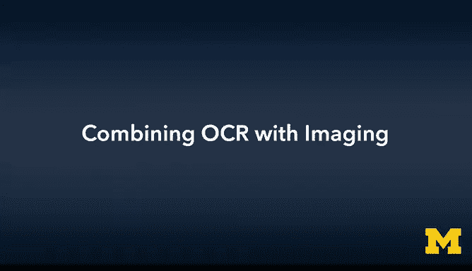
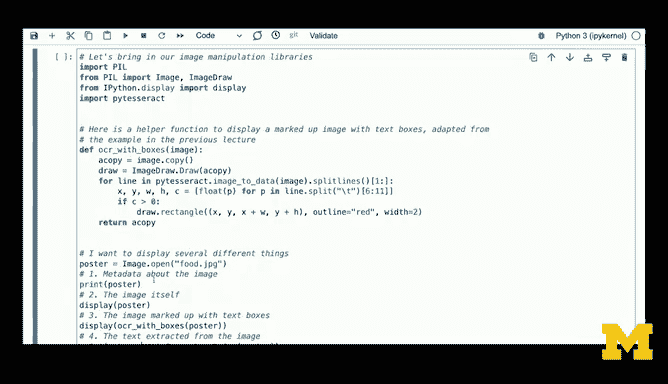
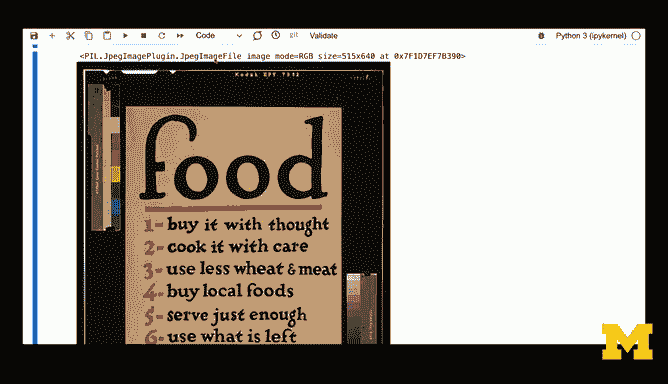
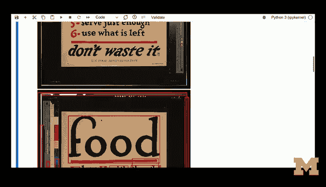
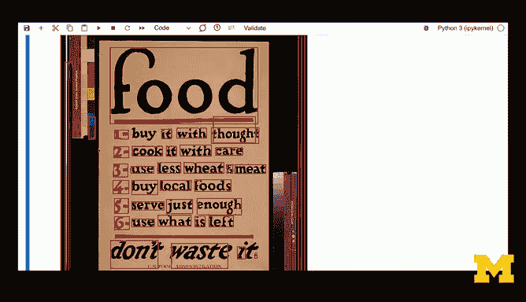
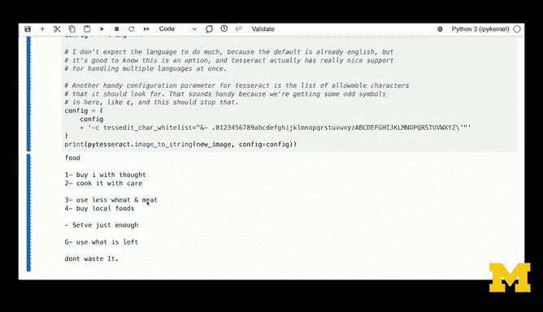
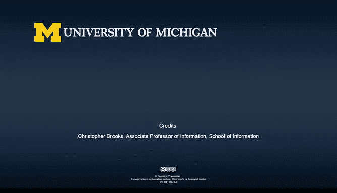

# 课程3：Python 3编程 - P123：15_03_02_OCR与图像处理结合 📸➡️🔤



在本节课中，我们将学习如何结合图像处理技术来提升光学字符识别的效果。我们将探讨一系列预处理步骤，并通过代码实践来优化从复杂图像中提取文本的准确性。

## 概述

在本周的课程中，我们初步接触了光学字符识别。虽然我们看到了OCR在清晰文本上表现良好的例子，但对于更真实的宣传海报图像，文本识别效果并不理想。我们可以通过一些图像处理技术来尝试提升识别字符的能力。

## 图像预处理步骤



为了改善OCR结果，我们可以对图像进行一系列处理。以下是五个关键步骤，我们将逐一探讨。







### 第一步：移除无关信息

无关信息是指那些我们知道不包含所需文本的像素。在这张图像中，裁剪掉海报周围的区域可能是有效的做法。请记住，Tesseract OCR引擎最初是为书籍扫描件优化的，因此在文本周围保留一些边距是合理的。

### 第二步：调整图像大小

Tesseract文档建议，更大的图像通常能获得更好的识别效果。我们可以尝试缩放图像来改善结果。在实践中，我发现Tesseract在处理更大图像时表现更好，而当前图像尺寸较小，仅为515x640像素。

### 第三步：转换为灰度图像

通常，OCR工具在彩色图像上表现不佳。实际上，Tesseract和其他OCR工具在进行文本检测前，会先将彩色图像转换为灰度图像。正如我们上周课程所见，将彩色图像转换为灰度图像的方式会影响保留的信息。如果我们在将图像发送给Tesseract之前先进行转换，可以确保保留最大信息量。

### 第四步：将灰度图像二值化为黑白图像

文本通常与背景有高对比度，例如白纸黑字。我们可以通过一个称为“二值化”的过程来进一步强化这种对比。在这个过程中，我们根据一个阈值将每个灰度像素变为纯黑或纯白。阈值的选择取决于你的源材料，我们需要用一个介于1到255之间的单字节数值来表示黑白之间的分界点。

### 第五步：使用Tesseract特定优化

Tesseract有许多不同的配置参数可以传递给它，以提高结果质量。这包括强制使用特定的页面分割算法，以及设置要查找的单词或字符的限制。我们可以尝试调整这些参数，看看是否能提高质量。

以上是我用来改善OCR结果的五个步骤，其效果取决于你处理的图像类型和你需要达到的质量水平。现在，让我们在代码中实践这些步骤。

## 代码实践：前三步处理

我们将一起处理前三个步骤，因为它们都可以使用PIL库完成。我喜欢先创建图像的副本，因为一些PIL函数会直接修改原图。

首先，我将裁剪掉图像顶部和侧面的一些无关信息。我通过实验找到了这些坐标值。请记住，原点在左上角，然后是宽度和高度。

```python
# 假设 `poster` 是原始的PIL图像对象
image = poster.copy()
# 裁剪图像：参数为 (左, 上, 右, 下)
cropped_image = image.crop((50, 100, 450, 550))
```

接下来，我将调整图像大小，简单地将其放大四倍。

```python
# 调整图像大小
new_size = (cropped_image.width * 4, cropped_image.height * 4)
resized_image = cropped_image.resize(new_size)
```

然后，我将图像转换为单通道灰度图像。这里有一个快捷方法。

```python
# 转换为灰度图像（‘L’模式代表亮度/灰度）
gray_image = resized_image.convert('L')
```

这样，我们就完成了前三步。现在我们需要进行二值化，有时也称为图像阈值处理。这意味着我们将把所有像素转换为纯黑或纯白。请记住，图像现在处于‘L’模式，因此每个像素都是一个单字节。我们可以设置阈值作为分界点，我将使用140作为阈值，但请随时在代码中尝试，看看改变这个阈值如何影响图像。

## 代码实践：图像二值化

在设置阈值后，我们需要处理图像数据。Python中的`bytes`对象是不可变的，但我们可以创建一个相同大小的新字节数组并复制字节进去。

```python
# 设置阈值
threshold = 140
# 获取灰度图像的字节数据
img_bytes = gray_image.tobytes()
# 创建可变的字节数组
new_bytes_array = bytearray(img_bytes)

# 应用阈值：低于阈值的设为0（黑），高于的设为255（白）
for i in range(len(new_bytes_array)):
    if new_bytes_array[i] < threshold:
        new_bytes_array[i] = 0
    else:
        new_bytes_array[i] = 255

# 从字节数组创建新图像
from PIL import Image
# 需要指定图像模式和尺寸
binarized_image = Image.frombytes('L', gray_image.size, bytes(new_bytes_array))
```

现在，我们得到了一个经过裁剪、放大和二值化处理的黑白大图。让我们查看它，并对其执行OCR。

## 评估与Tesseract配置优化

处理后，我们看到图像变大了，可以观察到二值化和裁剪的效果，OCR文本识别也略有改善。然而，这些结果与最初未经处理的结果相比，差异并不巨大。我们去除了一些无关字符，但仍然不完美，对于像字幕生成这样的任务来说还不够好。

我们可以继续调整，尝试不同的大小或阈值，也可以考虑Tesseract本身能为我们做什么。查看Tesseract的在线文档，你会发现有大量不同的参数可以通过在配置文件中设置其值来调整。Pytesseract库允许我们设置一些选项，我们将尝试其中几个。

以下是一些有用的配置项示例：

```python
import pytesseract
from PIL import Image

# 假设 binarized_image 是处理后的图像
# 配置Tesseract参数
custom_config = r'--oem 3 --psm 6'
# 添加语言和白名单配置
custom_config += r' -l eng'
# 设置字符白名单：只识别数字、大小写字母、空格和特定标点
custom_config += r' -c tessedit_char_whitelist="0123456789abcdefghijklmnopqrstuvwxyzABCDEFGHIJKLMNOPQRSTUVWXYZ .-\'&%"'
# 执行OCR
text = pytesseract.image_to_string(binarized_image, config=custom_config)
print(text)
```

第一个配置是关于语言的。默认情况下，Tesseract会尝试识别它知道的所有语言。你可以将语言设置为单一语言或语言列表。这里我指定为英语。虽然默认情况下它已经能识别出是英语，但这个选项很方便，因为Tesseract能很好地同时处理多种语言。

另一个方便的配置参数是“允许字符白名单”。这听起来很有用，因为我们在这里得到了一些奇怪的符号。我在这里放入了所有数字、大小写字母等字符。我们通过`-c tessedit_char_whitelist=`来传递这个配置，并在字符串中指明我们希望Tesseract在进行OCR时包含哪些字符。

运行后，我注意到一些改进。例如，数字后面的破折号被识别出来了，因为我把破折号加入了白名单。然而，识别仍然不完美，例如“G”和“6”的混淆是常见的OCR错误。添加撇号、百分号等字符到白名单中也能帮助捕获更多正确文本。

你可以看到，改变这个配置项非常强大。但这样做时必须非常小心，你必须确保包含了所有可能出现的字符。最初，我没有包含“&”和“-”，结果看起来很奇怪。实际上，在准备这次讲座时，我最初也没有包含空格，这导致了各种问题。

## 练习与探索

现在，我在下方提供了更多图像供你尝试和实验。我强烈建议你进入这个代码环境，看看是否能检测出这些图像中的文本。如果不能，思考如何运用你在Python图像处理库方面的能力来改进文本检测。

开放式的探索和实践是成为更好程序员的关键，所以请尝试一下吧。



## 总结



本节课中，我们一起学习了如何通过图像预处理来提升OCR的准确性。我们介绍了五个关键步骤：**裁剪无关区域**、**放大图像**、**转换为灰度图**、**二值化**以及**配置Tesseract参数**。通过代码实践，我们看到了每一步对最终文本识别结果的影响。记住，针对不同的图像，最佳的预处理方法和参数组合可能不同，需要根据实际情况进行实验和调整。