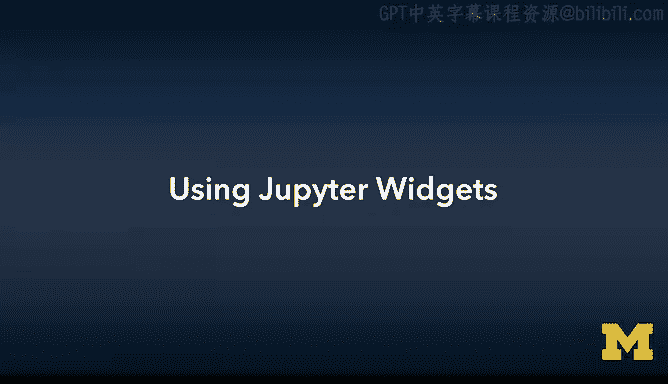
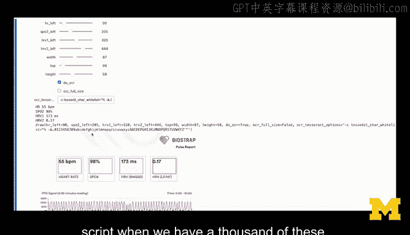
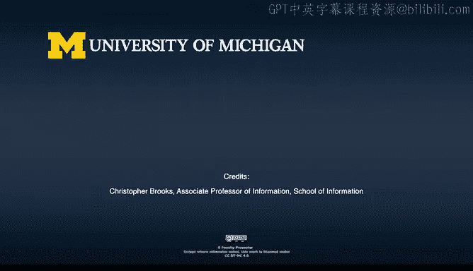

# 课程16：使用Jupyter交互组件 🎛️



在本节课中，我们将学习如何使用Jupyter Lab的交互式组件（Widgets）。我们将通过一个实际案例——从可穿戴设备报告中提取数据——来演示如何利用这些组件快速探索和调整代码参数，从而构建一个简单的用户界面。

---

## 概述

Jupyter Notebooks以其快速编辑和即时查看结果的特性而强大。然而，在处理图像等任务时，手动尝试不同的参数（如裁剪框的位置和大小）可能非常繁琐。Jupyter Widgets允许我们将函数的参数从代码中移出，并将其转化为直观的界面控件（如滑块、复选框），从而极大地简化探索过程。

上一节我们介绍了Tesseract库进行光学字符识别。本节中，我们来看看如何结合Jupyter Widgets来交互式地定位和提取图像中的特定信息。

---

## 项目背景：处理可穿戴设备报告

我最近在研究一种名为Bistrap的可穿戴设备（类似智能手表）。它会在用户睡眠时分析多项生理指标，并在醒来后生成一份PDF报告。我有50份来自不同受试者的报告需要分析。直接处理PDF文件很麻烦，因此我计划：
1.  将每份PDF报告转换为图像。
2.  使用PIL（Python Imaging Library）和Tesseract从图像中提取我感兴趣的信息。

首先，让我们查看一份报告图像。

```python
from PIL import Image
# 打开报告图像
img = Image.open('Bistrap.png')
print(f"图像尺寸: {img.size}")
print(f"图像模式: {img.mode}")

# 创建一个小尺寸版本以便在Notebook中显示
small_img = img.resize((img.width//4, img.height//4))
small_img.show()
```

**关键点分析：**
*   **图像尺寸很大**：这对OCR（光学字符识别）有利。
*   **RGBA模式**：除了红、绿、蓝（RGB）通道外，还有一个**A（Alpha）通道**，用于控制像素的透明度。值为255表示完全不透明，值为0表示完全透明。
*   **目标区域**：我们只对顶部的四个摘要框感兴趣，它们包含了关键的生理指标数据。

---

## 引入Jupyter Widgets

为了交互式地确定每个摘要框的精确位置和大小，我们将使用 `ipywidgets` 库中的 `interact` 装饰器。

以下是创建交互式裁剪工具的基本步骤：

```python
from ipywidgets import interact
import ipywidgets as widgets
from PIL import Image, ImageDraw

# 加载并创建小尺寸图像副本
img = Image.open('Bistrap.png')
small_img = img.resize((img.width//4, img.height//4))

# 使用@interact装饰器创建交互界面
@interact(left=(0, small_img.width, 5),
          top=(0, small_img.height, 5),
          width=(10, 200, 5),
          height=(10, 200, 5))
def draw_bounding_box(left=0, top=0, width=100, height=100):
    """
    根据给定的参数在图像上绘制红色矩形框并显示。
    """
    # 创建图像副本，避免修改原图
    img_copy = small_img.copy()
    draw = ImageDraw.Draw(img_copy)

    # 绘制矩形
    # 矩形坐标：(左上角x, 左上角y, 右下角x, 右下角y)
    draw.rectangle([left, top, left+width, top+height],
                   outline='red', width=2)
    display(img_copy)
```

**代码解析：**
1.  `@interact` 是一个**装饰器**，它“包装”了紧随其后的 `draw_bounding_box` 函数。
2.  装饰器的参数定义了界面上控件的类型和范围。例如，`left=(0, small_img.width, 5)` 会生成一个滑块，最小值0，最大值`small_img.width`，步长为5。
3.  被装饰的 `draw_bounding_box` 函数必须接收与装饰器参数同名的参数。函数内部根据这些参数值在图像上绘制矩形并显示。

运行这段代码后，Notebook中会出现四个滑块和一个图像。拖动滑块，图像上的红色框会实时更新位置和大小。这让我们能快速、直观地找到目标区域的坐标。

---

## 构建完整的交互式数据提取工具

现在，我们将扩展上述基础功能，构建一个更实用的工具，用于定位四个数据框并实时进行OCR。

以下是实现这一功能的完整代码结构：

```python
from ipywidgets import interact
import ipywidgets as widgets
from PIL import Image, ImageDraw
import pytesseract

# 初始化图像
img = Image.open('Bistrap.png')
small_img = img.resize((img.width//4, img.height//4))

# 定义交互控件
@interact(
    hr_left=(0, small_img.width, 1),   # 心率框左边界
    spo2_left=(0, small_img.width, 1), # 血氧框左边界
    hrv1_left=(0, small_img.width, 1), # 心率变异性1左边界
    hrv2_left=(0, small_img.width, 1), # 心率变异性2左边界
    top=(0, small_img.height, 1),      # 所有框的顶部边界（共享）
    width=(50, 300, 1),                # 框的宽度
    height=(50, 300, 1),               # 框的高度
    do_ocr=False,                      # 是否执行OCR的复选框
    ocr_full_size=False,               # 是否使用原图进行OCR的复选框
    ocr_config='--psm 7 -c tessedit_char_whitelist=0123456789%' # Tesseract配置
)
def draw_and_ocr(hr_left=0, spo2_left=0, hrv1_left=0, hrv2_left=0,
                 top=0, width=100, height=100,
                 do_ocr=False, ocr_full_size=False, ocr_config=''):
    """
    交互式绘制四个框并可选地进行OCR。
    """

    # 1. 准备用于显示的图像副本并绘制框
    display_img = small_img.copy()
    draw = ImageDraw.Draw(display_img)

    # 为不同框设置不同颜色
    boxes = [
        (hr_left, top, width, height, 'red'),    # 心率-红
        (spo2_left, top, width, height, 'blue'), # 血氧-蓝
        (hrv1_left, top, width, height, 'green'),# HRV1-绿
        (hrv2_left, top, width, height, 'black') # HRV2-黑
    ]

    for left, t, w, h, color in boxes:
        draw.rectangle([left, t, left+w, t+h], outline=color, width=2)

    display(display_img)

    # 2. 定义嵌套的OCR函数
    def run_ocr_on_box(left, t, w, h):
        """对指定区域进行OCR"""
        if not do_ocr:
            return ""  # 如果不执行OCR，返回空字符串

        # 选择使用原图还是小图进行OCR
        source_img = img if ocr_full_size else small_img
        # 裁剪区域
        box = (left, t, left + w, t + h)
        cropped_img = source_img.crop(box)
        # 转换为灰度图以提高OCR精度
        cropped_img = cropped_img.convert('L')
        # 执行OCR
        text = pytesseract.image_to_string(cropped_img, config=ocr_config)
        return text.strip().replace('\n', ' ')  # 清理文本

    # 3. 对每个框执行OCR并打印结果
    if do_ocr:
        print("=== OCR 结果 ===")
        print(f"心率: {run_ocr_on_box(hr_left, top, width, height)}")
        print(f"血氧: {run_ocr_on_box(spo2_left, top, width, height)}")
        print(f"HRV1: {run_ocr_on_box(hrv1_left, top, width, height)}")
        print(f"HRV2: {run_ocr_on_box(hrv2_left, top, width, height)}")
        print("================\n")

    # 4. 打印当前函数调用参数（便于复制）
    print("当前参数组合（可复制到脚本中）:")
    arg_str = f"hr_left={hr_left}, spo2_left={spo2_left}, hrv1_left={hrv1_left}, hrv2_left={hrv2_left}, top={top}, width={width}, height={height}"
    print(arg_str)
```

**功能亮点：**
*   **多个控件**：为四个数据框分别提供了左边界滑块，并共享顶部、宽度和高度滑块。
*   **复选框**：`do_ocr` 和 `ocr_full_size` 布尔参数自动生成了复选框。
*   **文本输入**：`ocr_config` 字符串参数生成了一个文本框，允许我们自定义Tesseract配置（例如，只识别数字和百分号）。
*   **嵌套函数**：`run_ocr_on_box` 函数定义在 `draw_and_ocr` 内部，利用了Python的**作用域**规则，可以访问外部函数的参数（如 `do_ocr`）。
*   **参数输出**：每次调整后，底部会打印出当前的参数值。一旦我们通过拖动滑块找到了完美的框位置，就可以直接复制这行参数，用于后续的自动化批处理脚本。

---

## 工作流程演示

1.  **调整框的位置和大小**：通过拖动滑块，将红、蓝、绿、黑四个框分别对准“心率”、“血氧”、“HRV1”、“HRV2”的数据区域。
2.  **启用OCR**：勾选 `do_ocr` 复选框。此时，下方会实时显示从每个框中识别出的文本。
3.  **微调以提高精度**：如果OCR结果包含了不需要的标签文字（如“Heart Rate”），可以减小框的 `height`，使其只框住数字部分。
4.  **优化Tesseract配置**：在 `ocr_config` 文本框中修改参数。例如，添加 `-c tessedit_char_whitelist=0123456789.%` 可以确保只识别数字、点和百分号，过滤掉无关文本。
5.  **复制参数**：当所有框都准确定位，且OCR结果正确时，复制底部打印的参数行。
6.  **自动化批处理**：将复制的参数用于一个循环脚本，自动处理所有50张图像。

```python
# 自动化脚本示例
final_params = {
    'hr_left': 245, 'spo2_left': 455, 'hrv1_left': 665, 'hrv2_left': 875,
    'top': 150, 'width': 180, 'height': 80
}

def extract_all_data(image_path):
    img = Image.open(image_path)
    data = {}
    # 对每个定义好的框进行裁剪和OCR
    # ... (具体实现逻辑)
    return data

# 处理所有报告
all_reports_data = []
for report_path in report_paths_list:
    data = extract_all_data(report_path)
    all_reports_data.append(data)
```

---

## 总结与拓展

本节课中我们一起学习了如何使用Jupyter Widgets，特别是 `@interact` 装饰器，来快速构建交互式工具。我们通过一个从图像报告中提取数据的真实案例，演示了如何：
*   将函数参数转化为图形界面控件。
*   实时可视化调整效果（如图像裁剪框）。
*   集成OCR功能并进行即时反馈。
*   获取优化后的参数以用于自动化脚本。



虽然我们不会在入门课程中深入探索所有Widgets，但 `ipywidgets` 库的功能非常丰富，还包括按钮、下拉菜单、标签页、布局管理器甚至视频流控件。如果你对此感兴趣，强烈建议查阅官方文档以了解更多高级功能。



这种方法不仅使数据探索过程变得高效有趣，还将我们本学期所学的软件工程图、面向对象编程、PIL图像处理和Tesseract OCR等知识串联起来，解决了一个实际的自动化问题。当未来需要处理成千上万份报告时，我们已经准备好了可扩展的Python解决方案。