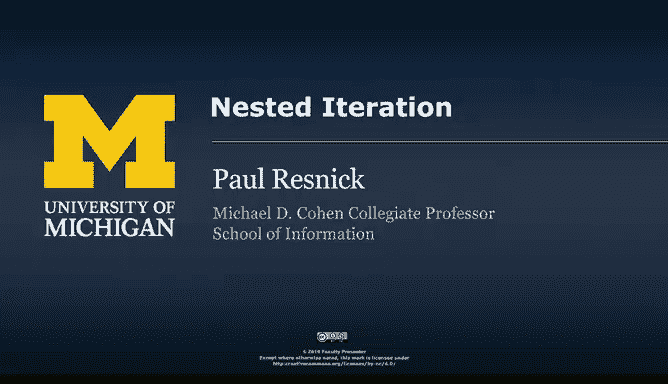
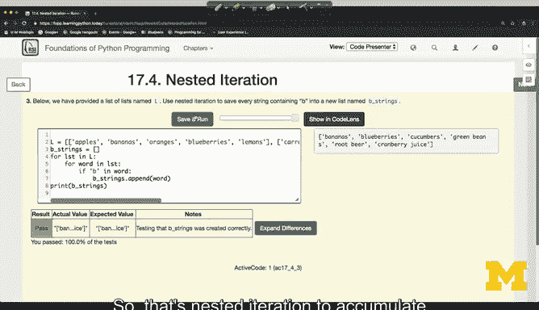

# 课程3：Python 3编程 - P13：嵌套迭代 🌀




在本节课中，我们将要学习如何处理嵌套数据结构。我们将重点探讨如何使用嵌套的 `for` 循环来遍历多层嵌套的列表，并从中提取或打印特定的数据项。

## 嵌套迭代的基本概念

上一节我们介绍了列表的基本遍历。本节中我们来看看当列表内部还包含其他列表时，我们该如何访问所有数据。这被称为嵌套数据结构，我们需要使用嵌套迭代来遍历它们。

嵌套迭代是指将一个 `for` 循环放在另一个 `for` 循环内部。外层的循环遍历主列表（我们称之为“外层列表”），内层的循环则遍历外层列表中的每一个子列表。

## 一个简单的嵌套迭代示例

让我们从一个具体的例子开始。假设我们有一个名为 `nested_one` 的列表，它包含两个子列表。

```python
nested_one = [['A', 'B', 'C'], ['D', 'E']]
```

为了遍历并打印出所有元素，我们使用嵌套的 `for` 循环：

```python
for x in nested_one:          # 外层循环
    print("Level 1:", x)
    for y in x:               # 内层循环
        print("  Level 2:", y)
```

以下是代码执行过程的分解：
1.  第一次外层循环：`x` 被赋值为子列表 `['A', 'B', 'C']`。
2.  进入内层循环：`y` 依次被赋值为 `'A'`、`'B'`、`'C'` 并打印。
3.  第二次外层循环：`x` 被赋值为子列表 `['D', 'E']`。
4.  再次进入内层循环：`y` 依次被赋值为 `'D'`、`'E'` 并打印。

**关键点**：必须为外层循环和内层循环使用不同的循环变量名（例如 `x` 和 `y`）。如果内外层循环都使用同一个变量名（如 `x`），代码将无法正确运行，因为内层循环会重新定义变量 `x`，破坏外层循环的逻辑。

## 从嵌套结构中提取数据

上一节我们学习了如何打印所有内容。本节中我们来看看如何从嵌套结构中提取特定数据，例如所有人的姓氏。

假设我们有一个包含名人信息的列表，每个子列表的结构是 `[名， 姓， 出生年份， 职业]`。

```python
info = [
    ['Tina', 'Turner', 1939, 'singer'],
    ['Matt', 'Damon', 1970, 'actor'],
    ['Kristen', 'Wiig', 1973, 'comedian'],
    ['Michael', 'Phelps', 1985, 'swimmer']
]
```

我们的任务是创建一个新列表，只包含所有人的姓氏。这需要使用**累积模式**。

以下是解决步骤：
1.  创建一个空列表用于累积结果。
2.  遍历外层列表（`info`）。
3.  对于每个内层列表（代表一个人），我们知道姓氏总是位于索引 `1` 的位置。
4.  将该姓氏添加到我们的结果列表中。

```python
last_names = []                     # 1. 创建空列表
for entertainer in info:            # 2. 遍历外层列表
    last_name = entertainer[1]      # 3. 提取索引1的元素（姓氏）
    last_names.append(last_name)    # 4. 添加到结果列表
print(last_names)
# 输出：['Turner', 'Damon', 'Wiig', 'Phelps']
```

**核心概念**：要从嵌套结构中提取数据，我们总是需要某种“两层”操作。这可以是：
*   两个 `for` 循环。
*   一个 `for` 循环加一次索引操作（如 `entertainer[1]`）。
*   两次索引操作（如 `info[1][0]` 可以提取 `'Matt'`）。

## 带条件判断的嵌套迭代

有时我们不仅需要遍历，还需要根据条件筛选数据。例如，从一个包含蔬菜和水果的嵌套列表中，找出所有包含字母 `‘b’` 的单词。

```python
nested_data = [
    ['apple', 'banana', 'cherry'],
    ['spinach', 'broccoli', 'green beans'],
    ['blueberry', 'lemon', 'lime']
]
```

任务：使用嵌套迭代，将所有包含字母 `‘b’` 的字符串保存到一个名为 `b_strings` 的新列表中。

思路：
1.  这仍然是一个累积模式，我们从一个空列表开始。
2.  遍历外层列表（每个子列表代表一组食物）。
3.  遍历内层列表（每个元素是一个食物单词）。
4.  检查该单词是否包含字母 `‘b’`，如果包含，则将其加入结果列表。

```python
b_strings = []                           # 1. 创建空列表
for food_list in nested_data:            # 2. 遍历外层列表
    for word in food_list:               # 3. 遍历内层列表
        if ‘b’ in word:                  # 4. 条件判断：检查是否包含‘b’
            b_strings.append(word)       #    如果包含，则累积
print(b_strings)
# 输出：['banana', 'broccoli', 'green beans', 'blueberry']
```

**重要提示**：
*   使用有意义的变量名（如 `food_list`, `word`）可以使代码更易读、易调试。
*   Python 提供了简洁的 `in` 操作符来检查一个字符串是否包含某个子串，这是最简单的方法。
*   避免不必要的复杂操作，例如尝试为每个字符再写一个循环来判断，这容易出错且效率低下。

## 总结

本节课中我们一起学习了嵌套迭代的核心概念和应用。
*   **嵌套迭代**是处理列表嵌套列表等多层数据结构的有效工具。
*   其基本形式是将一个 `for` 循环放在另一个 `for` 循环内部。
*   我们可以使用嵌套迭代来**遍历并打印**所有数据，也可以结合**累积模式**来**提取和筛选**特定数据。
*   从嵌套结构中获取数据通常需要两层操作，可以是循环和索引访问的组合。
*   编写代码时，使用清晰的变量名和 Python 内置的简便操作符（如 `in`）能让逻辑更清晰，代码更健壮。



通过掌握嵌套迭代，你将能够处理程序中更复杂、更有组织的数据集合。