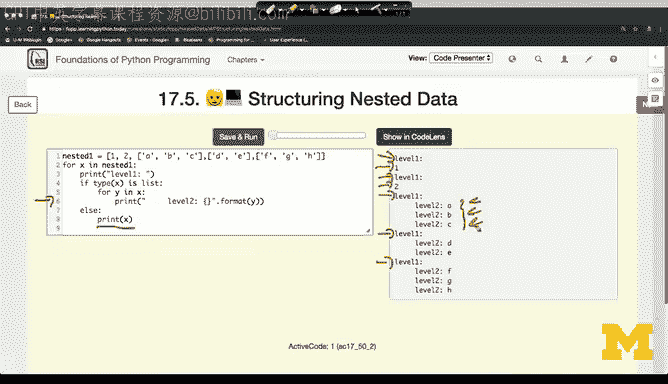

# 课程3：Python 3编程 - P14：13_02_03_结构化嵌套数据 📚


在本节课中，我们将要学习如何设计结构良好的嵌套数据结构，以及当数据结构不规则时，如何通过代码逻辑安全地遍历它们。理解这些概念对于处理复杂数据至关重要。

## 设计原则：保持一致性 ✨

上一节我们介绍了嵌套数据的基本概念，本节中我们来看看设计嵌套数据结构时的一个核心原则：保持一致性。

**核心原则**：在设计嵌套数据结构时，应保持其层级和元素类型的一致性。避免在同一层级混合不同类型的数据结构。

考虑以下不良设计的例子：

```python
nested_one = [1, 2, ['A', 'B', 'C']]
```

在这个列表中，前两个元素是整数（`1`和`2`），而第三个元素是一个子列表（`['A', 'B', 'C']`）。这种混合结构会使遍历变得困难。

## 遍历不规则结构的陷阱 ⚠️

以下是尝试遍历上述不规则数据结构时可能遇到的问题。

```python
nested_one = [1, 2, ['A', 'B', 'C']]
for x in nested_one:
    print('Level 1')
    for y in x:
        print('Level 2', y)
```

执行这段代码会导致错误。当`x`被绑定为整数`1`时，内层的`for y in x`循环试图迭代一个不可迭代的整数对象，从而引发`TypeError`。

## 解决方案：使用条件逻辑处理特殊情况 🛠️

当数据结构不规则时，解决方案是在代码中加入特殊情况的处理逻辑。我们可以检查每个元素的类型，并根据其类型决定如何处理。

以下是修改后的安全遍历代码：

```python
nested_one = [1, 2, ['A', 'B', 'C']]
for x in nested_one:
    print('Level 1')
    if type(x) is list:
        for y in x:
            print('Level 2', y)
    else:
        print(x)
```

这段代码的工作原理如下：
1.  外层循环遍历`nested_one`中的每个元素`x`。
2.  打印“Level 1”表示进入一层迭代。
3.  使用`if`语句检查`x`的类型是否为`list`。
    *   如果`x`是列表，则进入内层循环，遍历并打印其中的每个元素`y`，并标记为“Level 2”。
    *   如果`x`不是列表（例如是整数），则直接打印`x`的值。

执行此代码将得到预期输出，而不会报错。

## 最佳实践与总结 📝

本节课中我们一起学习了处理嵌套数据的关键点。

**核心建议**：
*   **设计时**：尽可能创建规则、一致的嵌套数据结构。避免在同一列表或字典中混合整数、列表、字典等不同类型。
*   **处理外部数据时**：当数据来自外部且结构不规则时，必须使用条件判断（如`if`语句）来安全地处理不同类型的数据。

简而言之，自己设计数据时要“铺平道路”，避免陷阱；处理他人数据时要“眼观六路”，用逻辑跳过陷阱。



我们下次再见。