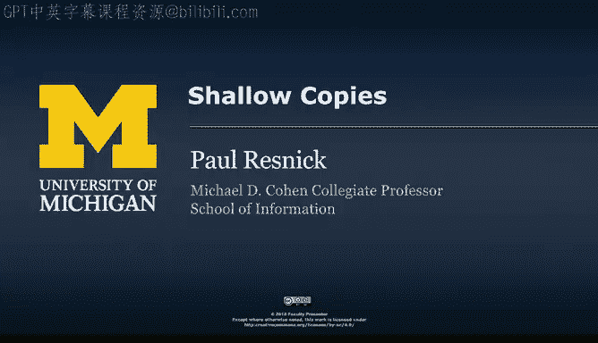
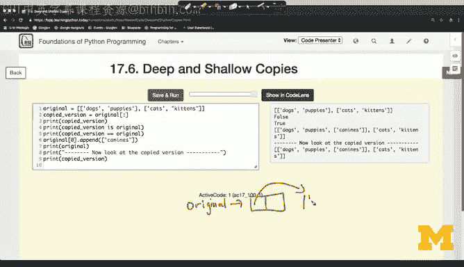

# 课程15：Python 3编程 - 14_02_04_浅拷贝 🧩




## 概述
在本节课中，我们将要学习Python中一个重要的概念——**浅拷贝**。我们将通过一个具体的例子，理解当复制一个包含嵌套列表的列表时，为什么修改其中一个列表会影响到另一个看似独立的列表。掌握这个概念对于避免程序中出现意外的数据修改至关重要。

---

## 回顾：别名与可变对象
在之前的课程中，我们深入探讨了**别名**的概念，以及当你修改一个拥有多个别名的列表或字典时可能产生的混淆。这种情况同样适用于一个列表作为元素被包含在多个其他列表中的场景。如果你修改了那个被多个外层列表共享的内层列表，所有外层列表的内容看起来都会发生变化。跟踪这些复杂情况的最佳方式，当然是使用**引用关系图**。

## 浅拷贝示例分析
让我们来看一个例子。一种可能无意中将一个列表包含在多个列表中，从而导致这种混淆情况的方式，就是在复制列表时。

以下是示例代码片段：

```python
original = [['dogs', 'puppies'], ['cats', 'kittens']]
copied_version = original[:]
print(copied_version)
print(copied_version is original)
print(copied_version == original)
original[0].append(['canines'])
print(original)
print(copied_version)
```



### 代码逐步解析
首先，我们通过引用关系图来理解代码的执行过程。

**第1行：** 我们创建了一个名为 `original` 的列表。它的值是一个嵌套列表。外层列表有两个内层列表作为其元素。
*   `original` 是一个变量名，其值是一个列表。
*   该列表有两个元素：
    1.  第一个元素本身是一个列表 `['dogs', 'puppies']`。
    2.  第二个元素是另一个列表 `['cats', 'kittens']`。

**第2行：** 我们创建了 `original` 的一个**拷贝**。我们使用了切片操作符 `[:]`。你可能记得，切片操作总是会创建一个新的列表。`original[:]` 表示从 `original` 的开头到结尾创建一个切片，从而生成一个包含相同元素的新列表。我们将这个新列表赋值给变量 `copied_version`。
*   `copied_version` 指向一个新创建的对象。
*   这个新列表的元素与 `original` 的元素相同：第一个元素是列表 `['dogs', 'puppies']`，第二个元素是列表 `['cats', 'kittens']`。

**第3-5行：** 我们打印并比较两个列表。
*   打印 `copied_version`，它看起来和 `original` 的内容完全一样。
*   `copied_version is original` 的结果是 `False`。这说明 `copied_version` 和 `original` 指向的是两个不同的对象。
*   `copied_version == original` 的结果是 `True`。这说明这两个列表对象的内容是相等的。

所以，`original` 和 `copied_version` 不是同一个对象，但它们是相等的，拥有相同的内容。

### 问题的关键：共享内层列表
现在，我们来看看当多个外层列表指向同一个内层列表时，混淆是如何发生的。

**第6行：** `original[0]` 指的是第一个内层列表 `['dogs', 'puppies']`。在这行代码中，我们向这个列表的末尾**追加**了一个新元素 `['canines']`。注意，`['canines']` 本身是一个列表（包含一个字符串元素），而不仅仅是一个字符串。

**第7行：** 当我们打印 `original` 时，得到的结果是：第一个元素变成了 `['dogs', 'puppies', ['canines']]`，第二个元素仍然是 `['cats', 'kittens']`。这符合预期。

**第9行：** 我们打印 `copied_version`。关键点来了：在第6行，我们只说了要修改 `original`，并没有说要修改 `copied_version`。但是，在第9行的输出中，你可以看到 `['canines']` 这个列表也“神奇地”出现在了 `copied_version` 的第一个元素（即 `['dogs', 'puppies']`）的末尾。

### 原因解析
为什么会这样？这就是**浅拷贝**的本质。
*   虽然 `copied_version` 是一个新创建的外层列表对象，但它的元素（即那两个内层列表 `['dogs', 'puppies']` 和 `['cats', 'kittens']`）并没有被创建新的副本。浅拷贝只复制了外层列表的结构，而列表内的元素（如果它们是可变对象，如列表）则只是复制了**引用**（可以理解为地址）。
*   因此，`original[0]` 和 `copied_version[0]` 实际上指向的是内存中**同一个**列表对象 `['dogs', 'puppies']`。
*   当我们通过 `original[0].append(...)` 修改这个共享的内层列表时，无论通过 `original` 还是 `copied_version` 去访问它，看到的都是被修改后的状态。

## 核心概念总结
以下是关于浅拷贝需要记住的要点：

*   **浅拷贝**：使用切片 `[:]` 或 `list.copy()` 方法创建列表副本时，只复制最外层容器，容器内的元素（如果是可变对象）仍然是原始元素的引用。
*   **影响**：修改浅拷贝得到的列表中的可变元素（如嵌套列表），会影响到原始列表中对应的元素，因为它们共享同一个子对象。
*   **判断方法**：使用 `is` 操作符可以检查两个变量是否指向同一个对象。使用 `==` 操作符检查两个对象的内容是否相等。

## 如何避免混淆？
如果你需要创建一个完全独立的副本，包括所有嵌套层次的可变对象，你需要使用**深拷贝**。Python 的 `copy` 模块提供了 `deepcopy` 函数来实现这一功能。

```python
import copy
original = [['dogs', 'puppies'], ['cats', 'kittens']]
deep_copied_version = copy.deepcopy(original)
original[0].append(['canines'])
print(original)        # 输出: [['dogs', 'puppies', ['canines']], ['cats', 'kittens']]
print(deep_copied_version) # 输出: [['dogs', 'puppies'], ['cats', 'kittens']] (未受影响)
```

---

## 总结
本节课中，我们一起学习了 **浅拷贝** 的概念及其可能带来的陷阱。我们通过一个具体的代码示例，看到了当复制包含嵌套列表的列表时，修改内层列表会同时影响原始列表和它的浅拷贝副本，因为它们共享了内层列表的引用。理解浅拷贝和深拷贝的区别，对于编写正确、可预测的Python程序非常重要。在需要完全独立的数据副本时，请记得使用 `copy.deepcopy()`。