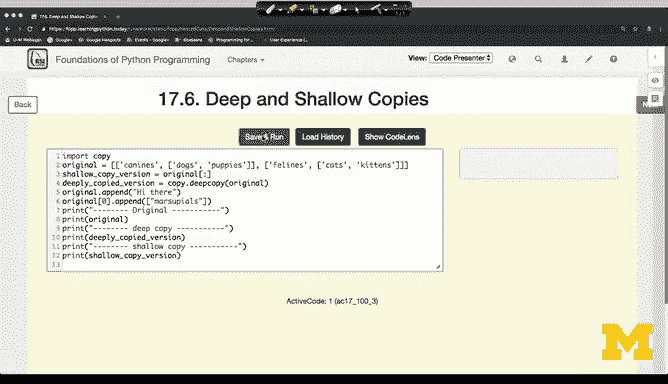

# Python 3 编程课程 16：深拷贝详解 🧬


在本节课中，我们将要学习“深拷贝”的概念。上一节我们介绍了浅拷贝可能带来的问题，本节中我们来看看如何创建一个完全独立于原始列表的副本，即使修改原始列表的内部嵌套列表，也不会影响副本。

## 概述

浅拷贝可能导致混淆，因为多个外层列表可能共享同一个内层列表。深拷贝则创建一个完全独立的副本，所有层级的数据都是新的，与原始数据无任何关联。

## 创建深拷贝的方法

我们可以通过嵌套迭代来手动创建深拷贝。

以下是手动创建深拷贝的代码示例：

```python
original = [['dogs', 'puppies'], ['cats', 'kittens']]
copied_outer_list = []
for inner_list in original:
    copied_inner_list = []
    for item in inner_list:
        copied_inner_list.append(item)
    copied_outer_list.append(copied_inner_list)
```

这段代码使用累积模式。首先，`copied_outer_list` 作为累加器变量被初始化为空列表。然后，我们遍历 `original` 中的每个内层列表。对于每个内层列表，我们再创建一个新的累加器变量 `copied_inner_list`，并通过迭代将其所有元素添加进去。最后，将这个复制好的内层列表添加到外层列表中。

运行此代码后，`copied_outer_list` 是 `original` 的一个深拷贝。即使我们修改原始列表的内层列表，深拷贝也不会受到影响。

```python
original[0].append('canines')
print(original)        # 输出：[['dogs', 'puppies', 'canines'], ['cats', 'kittens']]
print(copied_outer_list) # 输出：[['dogs', 'puppies'], ['cats', 'kittens']]
```

## 简化深拷贝代码

你可能已经注意到，手动累积内层列表的代码有些复杂。我们可以利用切片操作符来简化它。

以下是使用切片操作符简化后的代码：

```python
original = [['dogs', 'puppies'], ['cats', 'kittens']]
copied_outer_list = []
for inner_list in original:
    copied_inner_list = inner_list[:]  # 使用切片创建内层列表的副本
    copied_outer_list.append(copied_inner_list)
```

切片操作符 `[:]` 会创建列表的一个副本。这段代码与之前手动迭代的效果完全相同，但更加简洁易读。

## 处理复杂嵌套结构

当列表具有不规则的多层嵌套时，手动编写深拷贝代码会变得非常繁琐。

考虑以下结构：

```python
original = [['canines', ['dogs', 'puppies']], ['felines', ['cats', 'kittens']]]
```

在这种情况下，一种称为“递归”的技术可以编写出优雅的代码。不过，本专项课程暂不教授递归。幸运的是，在大多数常见场景中，Python 内置的模块提供了现成的函数来在幕后处理递归。

## 使用 `copy` 模块进行深拷贝

Python 的 `copy` 模块中有一个 `deepcopy` 函数，它可以为任意嵌套层级的序列创建深拷贝。

以下是使用 `deepcopy` 的示例：

```python
import copy

original = [['canines', ['dogs', 'puppies']], ['felines', ['cats', 'kittens']]]
shallow_copy = original[:]          # 浅拷贝
deep_copy = copy.deepcopy(original) # 深拷贝



# 修改原始数据
original.append('hi there')
original[0].append(['marsupials'])

print("Original:", original)
print("Shallow Copy:", shallow_copy)
print("Deep Copy:", deep_copy)
```

运行结果将展示三者之间的区别：
*   **原始列表**：被完全修改。
*   **浅拷贝**：共享的内层列表被修改，但外层追加操作不影响它。
*   **深拷贝**：完全不受任何修改的影响。

我鼓励你详细研究这个例子，绘制引用关系图，或在代码可视化工具中运行，以确保理解为何最终会输出三个不同的结果。掌握这一点将帮助你推理许多令人困惑的问题，并有效调试代码。

## 总结

本节课中我们一起学习了深拷贝。
*   列表的深拷贝不仅复制外层列表，还会递归地复制所有内层列表，直至最底层。
*   深拷贝与原始数据完全解耦，互不影响。
*   对于结构简单的列表，可以编写自己的代码（如使用切片）来创建深拷贝。
*   对于复杂的、不规则嵌套的结构，最简便的方法是使用 `copy` 模块中的 `deepcopy` 内置函数。


下次见。