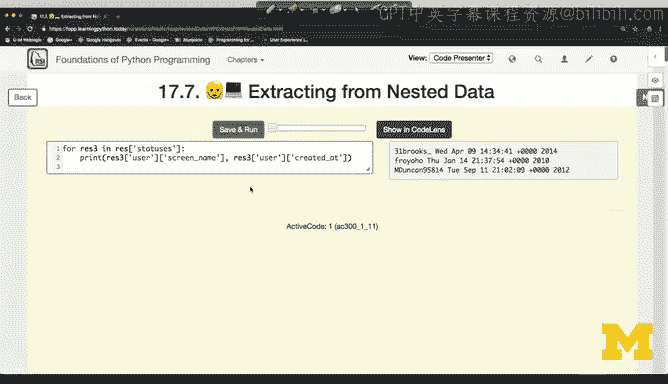

# 课程17：从嵌套数据结构中提取信息 🧩


在本节课中，我们将学习如何系统地处理一个庞大且复杂的嵌套数据结构。核心方法是**逐步深入**，遵循“理解、提取、重复”的步骤。我们将以从Twitter API返回的嵌套字典数据中提取推文作者信息为例，演示这一过程。

---

## 理解数据结构

上一节我们介绍了处理复杂数据的核心理念。本节中，我们来看看如何开始理解一个嵌套数据结构。

首先，我们面对的是一个从Twitter API查询返回的嵌套字典。即使经过缩进美化，这个结构看起来也非常复杂，可能包含五到六层嵌套。

为了理解它，我们可以先打印出数据的前几个字符，以了解其顶层结构。

```python
import json
# 假设 `res` 是API返回的响应数据
print(json.dumps(res, indent=2)[:100])
print(type(res))
```

输出会显示 `res` 是一个字典。理解字典的第一步是查看它的键。

```python
print(res.keys())
```

输出可能类似于：
```
dict_keys(['search_metadata', 'statuses'])
```

此时我们理解了顶层结构：它包含两个键：`search_metadata` 和 `statuses`。

---

## 使用工具辅助理解

为了获得整个数据结构的概览，我们可以使用在线JSON查看器。将数据复制到类似 [jsoneditoronline.org](https://jsoneditoronline.org) 的网站，可以以大纲视图浏览嵌套结构。

以下是使用该工具的步骤：
1.  将完整的JSON字符串打印出来并复制。
2.  访问 JSON Editor Online 网站。
3.  将字符串粘贴到左侧面板，点击“复制”按钮将其移至右侧。
4.  在右侧面板点击“Tree”视图，即可展开和折叠查看嵌套层级。

通过大纲视图，我们可以看到 `statuses` 对应一个包含3个元素的列表，每个元素是一个代表单条推文的字典，其中包含 `user` 等信息。

---

## 逐步提取信息

现在我们已经对结构有了基本了解，接下来开始一层层提取我们想要的信息——推文作者。

**第一步提取：** 从顶层字典中获取 `statuses` 对应的列表。

```python
res2 = res['statuses']
print("Level 2 type:", type(res2))
print("Level 2 length:", len(res2))
```

输出确认 `res2` 是一个包含3个元素的列表，对应3条推文。

**第二步提取：** 为了便于开发和调试，我们先处理列表中的第一条推文。

```python
# 先只取第一个元素进行开发
for res3 in res2[:1]:
    print("Level 3 (first 30 chars):", json.dumps(res3)[:30])
    print("Level 3 type:", type(res3))
    # 理解当前层级：打印字典的键
    print("Level 3 keys:", res3.keys())
```

查看键列表后，我们发现 `user` 键可能包含作者信息。

**第三步提取：** 从单条推文数据中提取 `user` 字典。

```python
    res4 = res3['user']
    print("Level 4 type:", type(res4))
    print("Level 4 keys:", res4.keys())
```

**第四步提取：** 从 `user` 字典中提取我们最终需要的信息：`screen_name`（作者昵称）。同时，我们也可以提取 `created_at`（推文创建时间）。

```python
    screen_name = res4['screen_name']
    created_at = res4['created_at']
    print("Screen Name:", screen_name)
    print("Created At:", created_at)
```

至此，我们已经成功地从嵌套数据中提取出了第一条推文的作者和发布时间。

---

## 泛化与简化代码

在成功提取单条数据后，我们可以将代码泛化以处理所有推文。

以下是循环处理所有推文的代码：

```python
for tweet in res['statuses']:
    screen_name = tweet['user']['screen_name']
    created_at = tweet['user']['created_at']
    print(screen_name, created_at)
```

通过将多步提取合并成更复杂的表达式（如 `tweet['user']['screen_name']`），我们得到了简洁而功能完整的代码。但请记住，**从简单的、一步步的代码开始构建，是调试和确保理解的关键**。

---

## 总结

本节课中我们一起学习了从复杂嵌套数据结构中提取信息的系统方法。核心步骤是 **“理解、提取、重复”**：
1.  **理解**当前层级的数据类型（字典或列表）和内容（键或长度）。
2.  **提取**下一层需要的数据。
3.  **重复**以上步骤，直到获取目标信息。



建议始终采用逐步深入的方式开发代码，并在每一步使用 `print` 语句或类型检查来验证你的理解。在代码最终工作后，再将其简化和压缩。这种方法能有效管理复杂度，并帮助初学者清晰地构建解决方案。