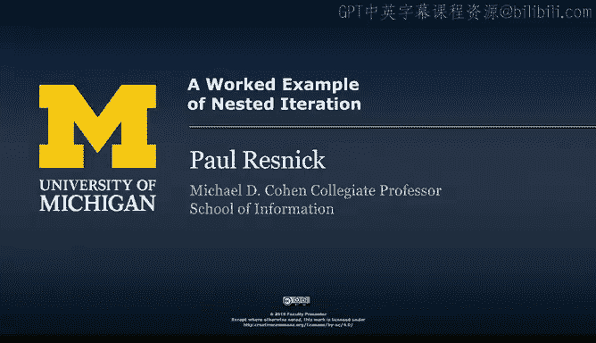
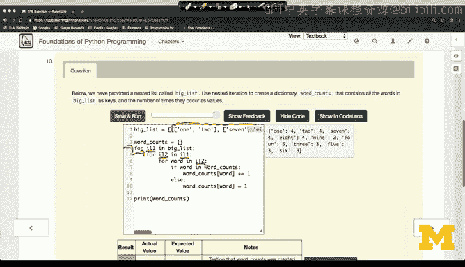

# 课程18：嵌套迭代实例分析 🧩




在本节课中，我们将学习如何遍历一个嵌套的数据结构（例如，包含列表的列表），并从中累计数值，最终构建一个词频统计字典。

上一节我们介绍了迭代的基本概念，本节中我们来看看如何处理多层嵌套的数据。

## 概述

我们有一个名为 `big_list` 的变量，它是一个多层嵌套的列表。我们的目标是遍历这个结构，找出其中所有的单词（数字在此上下文中被视为“单词”），并统计每个单词出现的次数，最终结果存储在一个名为 `word_counts` 的字典中。

## 初始设置

首先，我们创建一个空字典来累计结果，并在最后打印它以检查工作。

```python
word_counts = {}
print(word_counts)
```

运行这段代码会输出一个空字典 `{}`，这是我们工作的起点。

## 遍历嵌套结构

由于数据嵌套了三层，我们需要使用三层 `for` 循环来深入访问每一个单词。

以下是遍历过程的步骤：

1.  第一层循环遍历 `big_list` 中的每个子列表。
2.  第二层循环遍历每个第一层子列表中的嵌套列表。
3.  第三层循环遍历每个第二层列表中的最终元素（即“单词”）。

对应的代码如下：

```python
for inner_list_L1 in big_list:        # 第一层
    for inner_list_L2 in inner_list_L1: # 第二层
        for word in inner_list_L2:      # 第三层
            # 现在我们可以访问到每一个单词
            print(word)
```

将变量名 `inner_list_L3` 改为 `word` 有助于提醒我们当前处理的是最终数据。

## 更新词频字典

现在，我们不再打印单词，而是用它们来更新 `word_counts` 字典。

更新逻辑遵循一个常见模式：
*   如果单词**已经**在字典中，则将其计数加1。
*   如果单词**不在**字典中，则将其加入字典，并设置初始计数为1。

以下是实现此逻辑的代码：

```python
for inner_list_L1 in big_list:
    for inner_list_L2 in inner_list_L1:
        for word in inner_list_L2:
            if word in word_counts:
                word_counts[word] += 1  # 计数加一
            else:
                word_counts[word] = 1   # 初始计数为一
print(word_counts)
```

运行后，字典会显示每个单词及其出现次数，例如 `‘1’: 4` 表示数字“1”在嵌套结构中出现了四次。

## 关键点总结

本节课中我们一起学习了如何处理多层嵌套数据的迭代问题。核心要点是：**你需要遍历的嵌套层级数，决定了你代码中需要的循环或索引层级数**。

在这个例子中，数据嵌套了三层，因此我们使用了三层嵌套的 `for` 循环。请注意循环之间的关联：第一层循环的迭代变量（`inner_list_L1`）成为了第二层循环要遍历的序列；同理，第二层的迭代变量（`inner_list_L2`）成为了第三层循环的序列。

希望你能运用这个思路，独立完成本章节练习页上的其他题目。



下次见！