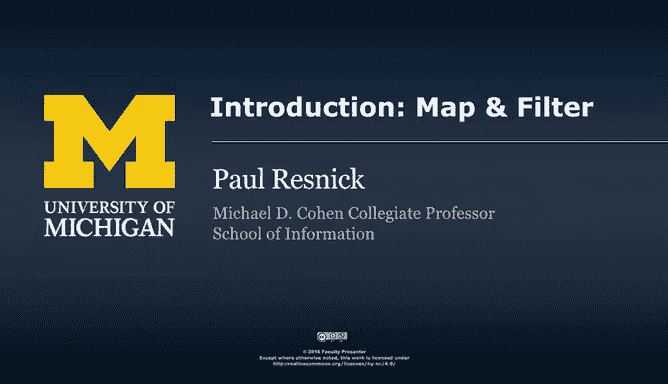

# 课程20：Python中的`map`与`filter`函数简介 🗺️➡️🧹

在本节课中，我们将学习Python中两种非常常见且强大的数据处理模式：**映射（map）** 和**过滤（filter）**。我们将了解它们的概念，并学习如何使用Python内置的`map()`和`filter()`函数来实现它们。

---

## 概述

在本系列课程中，我们已经多次见到**累加模式**。其基本思想是：你有一个列表，然后逐个遍历其中的元素，并更新一个累加器变量。最终，这个累加器变量就是你的结果。


有两种特殊的累加操作非常普遍，以至于Python专门提供了语言特性来表达它们。一种是**映射（map）** 操作，它转换原列表中的每个元素，并将转换后的结果累积成一个新的、长度相同的列表。另一种是**过滤（filter）** 操作，它从原列表中筛选出一个子集。

本周，你将学习如何抽象地思考这两种累加操作。本节课，你将学习使用Python内置的`map`和`filter`函数。在下一课中，你将学习Python的**列表推导式**，它提供了一种优雅的语法来组合进行映射和过滤操作。



学完本课后，你将能够阅读和编写使用`map`和`filter`函数的代码。特别是，你将能够编写作为参数传递给`map`和`filter`函数的函数。

---

## 映射（Map）操作

上一节我们概述了两种核心的累加模式。本节中，我们首先来详细看看**映射（map）**。

映射操作的核心思想是**对序列中的每个元素应用同一个转换函数**，并收集所有转换后的结果，从而生成一个新的序列。新序列的长度与原序列相同。

在Python中，我们使用内置的`map()`函数来实现映射。其基本语法如下：

```python
map(function, iterable)
```

*   `function`：一个函数，它接受一个参数（对应原序列中的一个元素）并返回一个值。
*   `iterable`：一个可迭代对象，例如列表、元组等。
*   返回值：一个`map`对象（一个迭代器），其中包含了将`function`应用于`iterable`中每个元素后的结果。

### 映射操作示例

为了更好地理解，让我们看一个具体的例子。假设我们有一个数字列表，想要得到每个数字的平方组成的新列表。

**不使用`map`的传统方法（累加模式）：**
```python
numbers = [1, 2, 3, 4, 5]
squares = []
for num in numbers:
    squares.append(num ** 2)
print(squares)  # 输出：[1, 4, 9, 16, 25]
```

**使用`map`函数的方法：**
首先，我们需要定义一个进行平方计算的函数。
```python
def square(x):
    return x ** 2

numbers = [1, 2, 3, 4, 5]
# 使用map函数
squares_map = map(square, numbers)
# map对象是一个迭代器，可以转换为列表查看
squares_list = list(squares_map)
print(squares_list)  # 输出：[1, 4, 9, 16, 25]
```
可以看到，`map(square, numbers)`将`square`函数依次应用于`numbers`列表中的`1`, `2`, `3`, `4`, `5`，并收集返回值，最终生成了对应的平方数列表。

---

## 过滤（Filter）操作

了解了如何转换所有元素后，我们来看看如何根据条件选择元素，这就是**过滤（filter）**。

过滤操作的核心思想是**根据一个判断条件（函数），从序列中筛选出使该条件为真的元素**，从而生成一个新的、通常更短的序列。

在Python中，我们使用内置的`filter()`函数来实现过滤。其基本语法如下：

```python
filter(function, iterable)
```

*   `function`：一个判断函数，它接受一个参数并返回`True`或`False`。
*   `iterable`：一个可迭代对象。
*   返回值：一个`filter`对象（一个迭代器），其中包含了`iterable`中所有使得`function`返回`True`的元素。

### 过滤操作示例

假设我们有一个数字列表，想要筛选出其中的所有偶数。

**不使用`filter`的传统方法（累加模式）：**
```python
numbers = [1, 2, 3, 4, 5, 6, 7, 8]
evens = []
for num in numbers:
    if num % 2 == 0:  # 检查是否为偶数
        evens.append(num)
print(evens)  # 输出：[2, 4, 6, 8]
```

**使用`filter`函数的方法：**
首先，我们需要定义一个判断是否为偶数的函数。
```python
def is_even(x):
    return x % 2 == 0

numbers = [1, 2, 3, 4, 5, 6, 7, 8]
# 使用filter函数
evens_filter = filter(is_even, numbers)
# filter对象是一个迭代器，可以转换为列表查看
evens_list = list(evens_filter)
print(evens_list)  # 输出：[2, 4, 6, 8]
```
这里，`filter(is_even, numbers)`用`is_even`函数测试`numbers`中的每个数字。只有当`is_even(num)`返回`True`（即`num`是偶数）时，该数字才会被包含在结果中。

---

## `map`与`filter`结合使用

`map`和`filter`可以链式调用，以实现先过滤再映射，或先映射再过滤等复杂操作。由于它们返回的都是迭代器，我们可以直接将一个函数的结果作为另一个函数的输入。

以下是结合使用的示例：我们想先过滤出偶数，然后计算它们的平方。

```python
def is_even(x):
    return x % 2 == 0

def square(x):
    return x ** 2

numbers = [1, 2, 3, 4, 5, 6, 7, 8]

# 先过滤，再映射
even_numbers = filter(is_even, numbers)
squared_evens = map(square, even_numbers)

result = list(squared_evens)
print(result)  # 输出：[4, 16, 36, 64]
```
这段代码的执行流程是：
1.  `filter(is_even, numbers)` 生成迭代器 `[2, 4, 6, 8]`。
2.  `map(square, ...)` 将`square`函数应用于上一步得到的每个偶数，生成迭代器 `[4, 16, 36, 64]`。

我们也可以将步骤写在一行内：
```python
result = list(map(square, filter(is_even, numbers)))
print(result)  # 输出：[4, 16, 36, 64]
```

---

## 使用匿名函数（Lambda）

传递给`map`和`filter`的函数通常很简单，有时只使用一次。为此，Python提供了**匿名函数（lambda表达式）**，允许我们在一行内定义简单的函数，而无需使用`def`关键字。

lambda表达式的基本语法是：
```python
lambda arguments: expression
```
`expression`的值就是该lambda函数的返回值。

现在，让我们用lambda表达式重写之前的例子：

**使用`map`和lambda计算平方：**
```python
numbers = [1, 2, 3, 4, 5]
squares = list(map(lambda x: x ** 2, numbers))
print(squares)  # 输出：[1, 4, 9, 16, 25]
```
这里，`lambda x: x ** 2` 等价于之前定义的`square`函数。

**使用`filter`和lambda筛选偶数：**
```python
numbers = [1, 2, 3, 4, 5, 6, 7, 8]
evens = list(filter(lambda x: x % 2 == 0, numbers))
print(evens)  # 输出：[2, 4, 6, 8]
```
这里，`lambda x: x % 2 == 0` 等价于之前定义的`is_even`函数。

**结合使用`map`、`filter`和lambda：**
```python
numbers = [1, 2, 3, 4, 5, 6, 7, 8]
result = list(map(lambda x: x**2, filter(lambda x: x%2==0, numbers)))
print(result)  # 输出：[4, 16, 36, 64]
```
使用lambda可以让代码更加紧凑，尤其适合处理简单的逻辑。

---

## 总结

本节课中，我们一起学习了Python中两种重要的高阶函数：`map`和`filter`。

*   **`map(function, iterable)`**：对可迭代对象中的**每个元素**应用指定的函数，生成一个由所有结果构成的新迭代器。其核心公式可抽象为：`map(f, [x1, x2, ..., xn]) -> [f(x1), f(x2), ..., f(xn)]`。
*   **`filter(function, iterable)`**：使用指定的判断函数过滤可迭代对象，生成一个仅包含使函数返回`True`的元素的新迭代器。其核心公式可抽象为：`filter(p, [x1, x2, ..., xn]) -> [xi for which p(xi) is True]`。

我们还学习了如何使用**lambda表达式**来简洁地定义传递给`map`和`filter`的简单函数。掌握`map`和`filter`能帮助你以更声明式、更函数式的风格编写Python代码，专注于“做什么”而非“怎么做”。在下一课中，我们将学习**列表推导式**，它提供了另一种通常更易读的方式来实现映射和过滤操作。

现在，你已经能够阅读和编写使用`map`和`filter`函数的代码，并可以编写作为参数传递给它们的函数了。