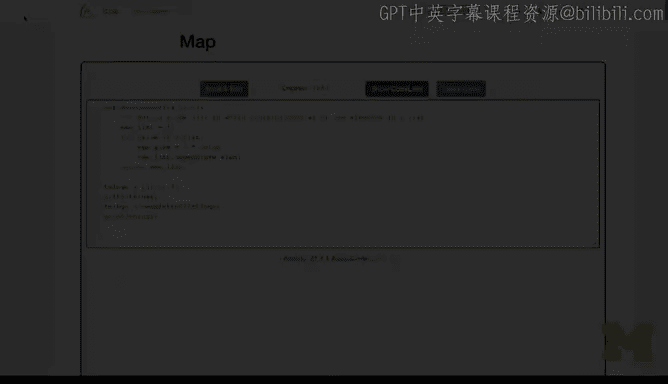
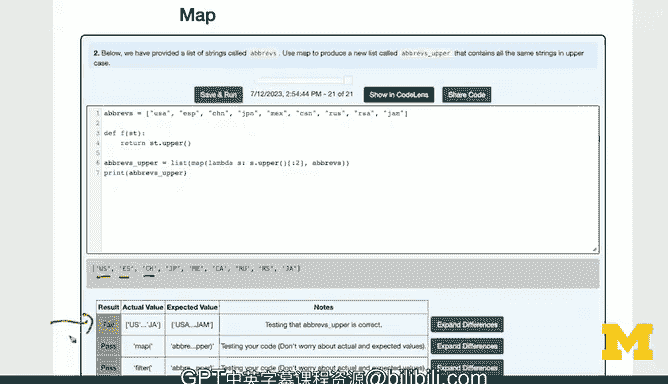

# 课程3：Python 3 编程 - P21：20_03_02_map函数 🗺️




在本节课中，我们将要学习Python中一个非常实用的内置函数——`map`函数。它可以帮助我们以一种更简洁、更清晰的方式，对列表（或任何序列）中的每个元素进行转换操作，而无需手动编写循环。

---

## 概述

`map`函数的核心功能是创建一个新列表，其中原始列表中的每个元素都按照某种方式进行转换。例如，将列表中的每个数字加倍，或者将每个字符串转换为大写。通过使用`map`，我们可以避免编写冗长的循环代码，使逻辑更加清晰。

---

## 手动转换的示例

在深入了解`map`函数之前，我们先回顾一下如何通过手动累加的方式实现元素转换。

以下是手动将列表中每个元素加倍的过程：

```python
def double_stuff(a_list):
    new_list = []  # 初始化累加器
    for value in a_list:  # 遍历原始列表
        new_elem = value * 2  # 转换每个元素
        new_list.append(new_elem)  # 将新元素添加到新列表
    return new_list  # 返回转换后的新列表

things = [2, 5, 9]
print(things)
print(double_stuff(things))
```

运行上述代码，原始列表`[2, 5, 9]`会被转换为`[4, 10, 18]`。每个元素都变成了原来的两倍。

这种“对每个元素进行转换并累加”的模式在编程中非常常见。因此，Python提供了`map`函数，让我们可以用更紧凑、更易读的方式来表达它。

---

## 使用 `map` 函数

`map`函数接受两个主要参数：
1.  第一个参数是一个**函数**，我们称之为**转换函数**。
2.  第二个参数是一个**序列**（如列表）。

`map`函数会在内部自动将转换函数应用到序列的每一个元素上，并将所有结果收集起来。

让我们看一个使用命名函数作为转换器的例子：

```python
def triple(value):
    return 3 * value

seq = [2, 5, 9]
new_seq = map(triple, seq)  # 应用转换函数
print(list(new_seq))  # 输出: [6, 15, 27]
```

在上面的代码中：
*   `triple`是转换函数，它接收一个值并返回其三倍。
*   `seq`是待转换的序列。
*   `map(triple, seq)`会生成一个**迭代器**，其中包含了应用`triple`函数后的结果。
*   为了像普通列表一样查看结果，我们使用`list()`函数将迭代器转换为列表。

注意，我们并没有显式地调用`triple`函数或编写`for`循环。`map`函数在背后为我们处理了这一切。

---

## 使用 Lambda 表达式

除了使用预定义的命名函数，我们还可以在调用`map`时，直接使用**lambda表达式**来定义转换函数。这使得代码更加紧凑。

例如，使用lambda表达式将列表中的每个元素乘以4：

```python
seq = [2, 5, 9]
new_seq = map(lambda value: 4 * value, seq)
print(list(new_seq))  # 输出: [8, 20, 36]
```

这里，`lambda value: 4 * value`就是一个匿名函数，它接受一个参数`value`并返回`4 * value`。这个函数被直接传递给了`map`。

---

## 实践练习：转换国家缩写

现在，让我们通过一个练习来巩固对`map`函数的理解。假设我们有一个国家缩写列表，需要将其中的每个缩写转换为大写形式。

**目标**：将列表 `[‘usa‘, ‘esp‘, ‘chn‘]` 转换为 `[‘USA‘, ‘ESP‘, ‘CHN‘]`。

我们可以遵循以下步骤来思考：

1.  **确定序列**：我们要转换的序列是`abbrevs`列表。
2.  **确定转换函数**：我们需要一个函数，它接收一个字符串（如`’usa‘`），并返回其大写形式（`’USA‘`）。Python中可以使用字符串的`.upper()`方法实现。

首先，我们从一个模板开始，逐步填充：

```python
abbrevs = [“usa“, “esp“, “chn“]

# 步骤1：定义转换函数
def transform(abbrev):
    return abbrev.upper()

# 步骤2：应用map函数
abbrevs_upper = map(transform, abbrevs)
print(list(abbrevs_upper))  # 输出: [‘USA‘, ‘ESP‘, ‘CHN‘]
```

运行上述代码，我们得到了期望的大写列表。

**重要提示**：`map`函数返回的是一个迭代器（map object），而不是列表。为了得到列表形式的结果，或者为了后续方便使用，我们通常需要用`list()`函数将其转换。

---

## 使用 Lambda 表达式简化

在上面的练习中，我们也可以不使用单独的`transform`函数，而是直接用lambda表达式：

```python
abbrevs = [“usa“, “esp“, “chn“]
abbrevs_upper = map(lambda s: s.upper(), abbrevs)
print(list(abbrevs_upper))  # 输出: [‘USA‘, ‘ESP‘, ‘CHN‘]
```

这样代码更加简洁。lambda表达式`lambda s: s.upper()`定义了一个接收参数`s`并返回`s.upper()`的函数。

你还可以轻松修改转换逻辑。例如，如果我们只想获取每个缩写的前两个字母并大写：

```python
abbrevs = [“usa“, “esp“, “chn“]
abbrevs_upper = map(lambda s: s[:2].upper(), abbrevs)
print(list(abbrevs_upper))  # 输出: [‘US‘, ‘ES‘, ‘CH‘]
```

只需改变lambda表达式内部的逻辑，所有元素都会按照新的方式转换。

---

## 使用 `map` 的思维模板

总结一下，使用`map`函数时，我推荐遵循以下思维模板：

1.  **从模板开始**：先写下 `result = map(?, ?)`。
2.  **填充简单部分**：先确定第二个参数，即你要转换的**序列**。
3.  **解决核心部分**：最后构思第一个参数，即**转换函数**。这个函数需要：
    *   接收**一个**序列元素作为输入。
    *   返回该元素转换后的结果。
    *   可以是已定义的函数名，也可以是lambda表达式。

将最复杂的转换逻辑留到最后思考，可以帮助你更清晰地构建代码。

---

## 总结

本节课中我们一起学习了Python的`map`函数。我们了解到：

*   `map(func, sequence)` 用于将函数`func`应用到`sequence`的每个元素上。
*   它可以避免手动编写循环，使“对序列中每个元素进行转换”的意图更加明确。
*   转换函数可以是预定义的函数，也可以是使用lambda表达式定义的匿名函数。
*   `map`的返回值是一个迭代器，通常需要调用`list()`来获取列表形式的结果。



通过掌握`map`函数，你可以写出更简洁、更“Pythonic”的代码来处理数据转换任务。