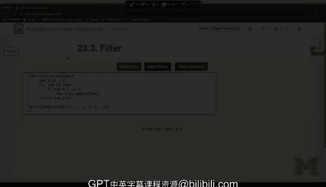
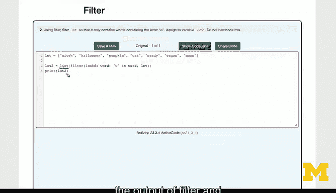

# Python3编程（课程3、4、5）｜第22课：filter函数 🧹




在本节课中，我们将要学习Python中另一个强大的内置函数：`filter`函数。我们将了解它的工作原理、语法，并通过具体示例学习如何使用它来从序列中筛选出符合条件的元素。

---

## 概述

我们之前已经见过一种常见的处理模式：过滤一个序列。你从一个包含若干元素的序列开始，最终得到一个元素更少的序列。例如，从一个数字序列中筛选出所有的偶数。本节课将介绍如何使用Python的`filter`函数来简洁高效地实现这种过滤操作。

## 手动过滤模式回顾

在学习`filter`函数之前，我们先回顾一下如何使用手动累加的方式实现过滤。

以下是手动过滤偶数的一个示例：

```python
def keep_evens(nums):
    new_list = []
    for num in nums:
        if num % 2 == 0:
            new_list.append(num)
    return new_list

print(keep_evens([3, 4, 6, 7, 0, 1]))
```

**代码解析：**
1.  我们创建了一个累加器变量`new_list`，初始化为空列表。
2.  我们遍历传入的数字序列`nums`。
3.  对于每个数字`num`，我们使用过滤表达式 `num % 2 == 0` 进行检查。
    *   `%` 是取余运算符。`num % 2` 的结果是`num`除以2的余数。
    *   所有偶数的余数都为0，因此 `num % 2 == 0` 对偶数求值为`True`。
4.  如果当前数字是偶数（即过滤表达式为`True`），我们将其追加到`new_list`中；否则，我们不做任何操作，将其过滤掉。
5.  最后，函数返回过滤后的新列表。

运行上述代码，输出结果为 `[4, 6, 0]`。数字3、7和1被成功过滤掉了。

这是我们在学习本课之前实现过滤操作的方式。接下来，我们将看到Python提供了一个函数，可以用更紧凑的方式完成所有这些累加工作。

## 引入filter函数

Python提供的这个抽象称为`filter`函数。它能够以更简洁的代码完成与上述手动操作相同的功能。

以下是使用`filter`函数实现相同偶数过滤的代码：

```python
lst = [3, 4, 6, 7, 0, 1]
result = list(filter(lambda num: num % 2 == 0, lst))
print(result)  # 输出: [4, 6, 0]
```

**代码解析：**
1.  我们调用`filter`函数，它接受两个参数：
    *   第一个参数是**过滤函数**。这里我们使用一个`lambda`表达式 `lambda num: num % 2 == 0` 来创建这个函数。
    *   第二个参数是需要被过滤的**序列**，即列表`lst`。
2.  与`map`函数类似，`filter`函数返回一个**列表类对象（迭代器）**。为了得到一个标准的列表，我们使用`list()`函数将其包裹起来。
3.  运行这段代码，我们得到与手动过滤相同的输出：`[4, 6, 0]`。

### 过滤函数的作用

与`map`函数中的转换函数不同，传递给`filter`的过滤函数是一个**判断函数**。
*   它接收一个输入元素。
*   它返回一个布尔值：`True` 或 `False`。
*   如果对某个元素，该函数返回`True`，则该元素被保留在新序列中。
*   如果返回`False`，则该元素被过滤掉。

在上面的例子中，`lambda num: num % 2 == 0` 就是一个判断函数，它检查输入的数字`num`是否为偶数。

所有过滤操作都在幕后自动进行。`filter`函数会自动对列表中的每个数字调用一次这个判断函数。

## 实践练习：筛选包含特定字母的单词

让我们尝试一个需要自己构造`filter`函数的例子。

**任务：** 我们有一个原始单词列表`lst`。需要创建一个新变量`lst2`，它只包含原始列表中那些含有字母“o”的单词。

以下是解决步骤：

首先，我们创建一个代码模板：

```python
lst = ["pumpkin", "wagon", "apple", "basket"]
lst2 = filter(一些过滤函数, lst)
```

当然，直接运行上述代码会失败，因为“一些过滤函数”不是有效的Python代码。我们需要定义这个函数。

**思考过程：**
我们需要一个函数，它以单词（如“pumpkin”或“wagon”）作为输入。
*   对于“wagon”（包含字母‘o’），它应该返回`True`。
*   对于“pumpkin”（不包含字母‘o’），它应该返回`False`。

我们可以使用`lambda`表达式来创建这个函数。Python提供了方便的`in`操作符来检查一个字符是否存在于字符串中。

**解决方案：**

```python
lst = ["pumpkin", "wagon", "apple", "basket"]
lst2 = list(filter(lambda word: 'o' in word, lst))
print(lst2)  # 输出: ['wagon']
```

**代码解析：**
1.  `lambda word: 'o' in word` 创建了一个匿名函数。
2.  该函数接收一个参数`word`（列表中的一个单词）。
3.  函数体 `'o' in word` 检查字母‘o’是否存在于`word`中，并返回布尔结果。
4.  `filter`函数应用这个判断函数到`lst`的每个元素上。
5.  最后，`list()`将`filter`返回的迭代器转换为列表。

运行代码，我们成功得到了只包含“wagon”的列表。

> **注意：** 本视频使用的Runestone环境会自动将`filter`返回的迭代器转换为列表。为了在当前的Runestone环境或完整的Python解释器中使代码正常工作，你需要像示例中一样，将`filter`的结果传递给`list()`函数以进行转换。

---



## 总结

本节课我们一起学习了Python中的`filter`函数。它是描述一种常见编程模式（遍历列表并累积一个可能更短的、过滤掉某些项的新列表）的抽象方法。

其核心要点是：
*   你传入一个**过滤（判断）函数**，该函数在幕后被逐一调用于序列的每个元素上。
*   过滤函数应返回`True`（如果该元素应被保留）或`False`（如果该元素应被过滤掉）。
*   `filter`函数返回一个迭代器，通常需要将其转换为列表以便使用。

通过使用`filter`函数，我们可以用更简洁、更易读的代码来实现复杂的过滤逻辑。