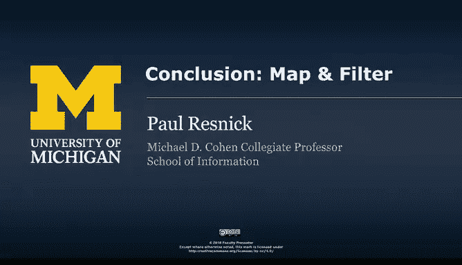

# 课程23：Python 3编程 - 第22章03节04讲：`map`与`filter`总结 🧠📊


在本节课中，我们将总结Python中两个重要的内置函数：`map`和`filter`。这两个函数专门用于处理序列数据，并实现两种非常常见的“累积”模式。我们将通过一个经典的故事来加深理解，并学习如何在实际编程中应用它们。




## `map`函数：转换数据

上一节我们介绍了`map`函数的基本概念。本节中我们来看看它的具体工作机制。

`map`函数接受一个**转换函数**和一个可迭代对象（如列表）作为输入。它会将转换函数依次应用到可迭代对象的每一个元素上，并返回一个包含所有转换后结果的`map`对象（通常转换为列表使用）。

其核心行为可以用以下伪代码描述：
```python
# 概念性描述
result = []
for item in iterable:
    new_value = transformer_function(item)
    result.append(new_value)
```
或者更简洁地，用公式表示其作用：
**`map(f, [x1, x2, ..., xn]) -> [f(x1), f(x2), ..., f(xn)]`**

转换函数`f`接收一个元素，并返回该元素转换后的新值。


## `filter`函数：筛选数据

了解了`map`用于转换后，我们再来看看`filter`函数，它用于根据条件筛选数据。

`filter`函数接受一个**判断函数**和一个可迭代对象。它会将判断函数应用到每个元素上，并仅保留那些使函数返回`True`的元素，过滤掉返回`False`的元素。

其核心逻辑如下：
```python
# 概念性描述
result = []
for item in iterable:
    if filtration_function(item) is True:
        result.append(item)
```
用公式可以表示为：
**`filter(f, [x1, x2, ..., xn]) -> [xi for which f(xi) is True]`**

判断函数`f`接收一个元素，并返回一个布尔值（`True`或`False`），以决定该元素是否应该被包含在结果中。


## 苏格拉底的“三重过滤”故事

为了更生动地理解`filter`的思想，我们可以参考一个关于哲学家苏格拉底的轶事。这个故事完美诠释了基于多重条件进行筛选的过程。

在古希腊，苏格拉底因其智慧而广受赞誉。有一天，一位熟人兴奋地跑来找他。


熟人说道：“苏格拉底，你知道我刚刚听说关于你的学生柏拉图的事吗？”

“且慢，”苏格拉底回答，“在你告诉我之前，我想请你通过一个小测试。我称之为‘三重过滤’测试。”


以下是苏格拉底应用的三重过滤条件，我们可以将其视为三个连续的`filter`操作：

**第一重过滤：真实性**
*   **判断函数**：`lambda x: x is True` （信息是否为真？）
*   **熟人的回答**：“不，其实我也是刚听说的。”
*   **结果**：信息未通过第一层筛选。

**第二重过滤：善意性**
*   **判断函数**：`lambda x: x is Good` （信息是好事吗？）
*   **熟人的回答**：“不，正相反。”
*   **结果**：信息也未通过第二层筛选。

**第三重过滤：实用性**
*   **判断函数**：`lambda x: x is Useful` （信息对我有用吗？）
*   **熟人的回答**：“不，并没有。”
*   **结果**：信息同样未通过第三层筛选。


最终，苏格拉底总结道：“既然你想告诉我的事，既不真实，也非善意，甚至毫无用处，那你又何必告诉我呢？” 此人哑口无言，羞愧地离开了。

这个故事说明了苏格拉底为何被视为伟大的哲学家。当然，这也解释了为什么他从未发现柏拉图与他的妻子有染。


## 课程总结

本节课中我们一起学习了Python中`map`和`filter`两个核心函数的总结。

*   `map`函数用于**转换**序列中的每个元素，它需要一个转换函数来定义如何改变每个值。
*   `filter`函数用于**筛选**序列中的元素，它需要一个判断函数来决定哪些元素应该被保留。

通过苏格拉底“三重过滤”的故事，我们看到了多重条件筛选在逻辑上的连续应用，这与编程中链式使用`filter`或组合复杂判断函数的思路是相通的。掌握这两个函数，能帮助你更简洁、更高效地处理列表等可迭代对象中的数据。

我们下次课再见。