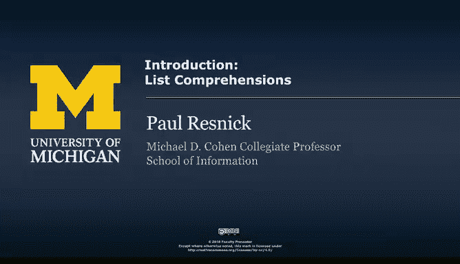

# 课程3：Python 3编程 🐍 | 第24讲：列表推导式简介 📝


在本节课中，我们将学习Python中一个强大且常用的特性——列表推导式。我们将了解它如何简化映射和过滤操作，并掌握其基本语法和用法。



---

上一节我们介绍了使用`map`和`filter`函数进行数据转换和过滤的概念。虽然它们有助于理解编程模式，但在实际Python编程中，我们很少直接使用它们。

本节中，我们来看看Python为这些操作提供的一种更简洁的语法：列表推导式。理解了它的目的后，你会发现它非常实用。

列表推导式的语法可能初看有些令人困惑，因为它复用了`for`循环的语法元素。但基于我们对映射和过滤的理解，你会发现它相当直观。列表推导式是Python程序员通常用来编写数据转换和过滤代码的方式。

以下是列表推导式的基本结构：

```python
[expression for item in iterable if condition]
```

这个结构包含三个主要部分：
*   **`expression`**：对每个元素进行转换或操作的表达式。
*   **`for item in iterable`**：循环部分，用于遍历可迭代对象。
*   **`if condition`**：可选的过滤条件，用于筛选元素。

让我们通过一个例子来看看它是如何工作的。假设我们有一个数字列表，想要得到其中所有偶数的平方。

使用之前学到的`map`和`filter`，代码可能如下：

```python
numbers = [1, 2, 3, 4, 5]
# 先过滤出偶数，再对每个偶数求平方
evens = filter(lambda x: x % 2 == 0, numbers)
squares = map(lambda x: x ** 2, evens)
result = list(squares)
```

而使用列表推导式，我们可以将映射和过滤操作合并到一行清晰易读的代码中：

```python
numbers = [1, 2, 3, 4, 5]
result = [x ** 2 for x in numbers if x % 2 == 0]
```

这行代码完成了以下操作：
1.  `for x in numbers`：遍历`numbers`列表中的每个元素。
2.  `if x % 2 == 0`：检查元素是否为偶数（过滤操作）。
3.  `x ** 2`：对满足条件的每个元素计算其平方（映射操作）。
4.  将所有结果收集到一个新列表中。

---

本节课中我们一起学习了列表推导式。我们了解到，列表推导式提供了一种更符合Python风格的简洁语法，用于替代`map`和`filter`函数，实现数据的转换和过滤。通过掌握其`[表达式 for 项 in 可迭代对象 if 条件]`的基本结构，你将能够编写出更高效、更易读的Python代码。