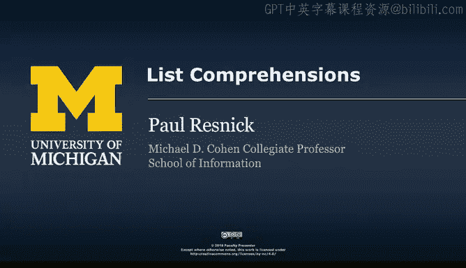
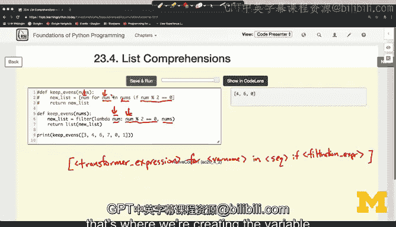

# 课程3：Python 3编程 - P25：24_03_02_列表推导式 📝




在本节课中，我们将要学习Python中一个非常强大且简洁的语法特性——**列表推导式**。列表推导式提供了一种便捷的方式来进行映射（map）和过滤（filter）操作，其语法比直接使用`map`和`filter`函数更为直观。我们将通过分解其语法结构，并与传统的函数式方法进行对比，来帮助你彻底掌握它。

## 概述

列表推导式是用于创建新列表的简洁语法。它允许你通过一个表达式和一个循环来生成列表元素，并且可以包含条件语句进行过滤。理解列表推导式将极大地提升你编写Python代码的效率和可读性。

## 列表推导式的基本语法

上一节我们介绍了列表推导式的概念，本节中我们来看看它的基本语法结构。

一个简单的列表推导式示例如下，它执行了一个映射操作，将列表中的每个元素都加倍：

```python
things = [2, 5, 9]
your_list = [value * 2 for value in things]
print(your_list)  # 输出：[4, 10, 18]
```

在这个例子中，原始列表`[2, 5, 9]`中的每个元素都被乘以2，生成了新列表`[4, 10, 18]`。

让我们分解第3行的语法，它构成了列表推导式：

*   首先，我们使用**方括号 `[]`**。这与创建普通列表的方式相同，但括号内放置的不是具体的对象，而是一个能生成列表所有内容的Python表达式。
*   接着是 `for value in things`。这类似于我们之前写`for`循环的方式。
*   不同之处在于：末尾**没有冒号**，下方也**没有缩进的代码块**。
*   取而代之的是，在`for`关键字**之前**有一段代码。我们称之为**转换表达式**。

因此，列表推导式的一般格式可以总结为：

`[转换表达式 for 变量 in 序列]`

## 与 `map` 函数对比

为了更清晰地理解列表推导式，我们可以将其与使用`map`函数的版本进行对比。

以下是使用`map`函数实现相同功能的代码：

```python
things = [2, 5, 9]
your_list = list(map(lambda value: value * 2, things))
print(your_list)  # 输出：[4, 10, 18]
```

你可以看到这两种方法之间的对应关系：
*   列表推导式中的转换表达式 `value * 2`，对应着`map`函数中`lambda`表达式所定义的转换函数。
*   两者都将这个转换操作应用到了序列`things`上。

## 在列表推导式中进行过滤

列表推导式不仅能进行映射，还能方便地进行过滤操作。

以下是一个使用列表推导式过滤出偶数的函数示例：

```python
def keep_evens(nums):
    new_list = [num for num in nums if num % 2 == 0]
    return new_list

print(keep_evens([3, 4, 6, 7, 0, 1]))  # 输出：[4, 6, 0]
```

在这个列表推导式中，我们在末尾增加了一个额外的**`if`子句**。在`for 变量 in 序列`之后，我们使用`if`关键字，然后跟上**过滤表达式**。这里，只有当数字除以2的余数为0（即为偶数）时，该数字才会被保留。

需要注意的是，在进行过滤操作时，我们通常不希望改变被保留的项本身。因此，转换表达式部分我们直接写`num`，而不是像`num * 2`这样的变换。真正的操作发生在`if`子句中，我们在那里过滤掉非偶数的项。

所以，列表推导式的完整格式可以扩展为：

`[转换表达式 for 变量 in 序列 if 过滤表达式]`

## 与 `filter` 函数对比

同样地，我们可以将列表推导式的过滤版本与使用`filter`函数的版本进行比较。

以下是使用`filter`函数实现相同`keep_evens`功能的代码：

```python
def keep_evens(nums):
    new_list = list(filter(lambda num: num % 2 == 0, nums))
    return new_list

print(keep_evens([3, 4, 6, 7, 0, 1]))  # 输出：[4, 6, 0]
```

让我们比较这两个版本：
*   在列表推导式版本中，过滤表达式 `num % 2 == 0` 位于`if`关键字之后。
*   在`filter`函数版本中，相同的过滤表达式是`lambda`函数的一部分。
*   两种方法都将过滤操作应用到了同一个序列`nums`上。

关于变量名需要特别注意：在`lambda`表达式中，第一次出现的`num`是定义变量（作为匿名函数的参数），第二次出现的`num`是引用这个变量（在函数被调用时，它会被赋予具体的值）。而在列表推导式中，第一次出现的`num`是引用变量（在转换表达式中），第二次出现在`for`和`in`之间的`num`才是创建该变量名。

## 总结

本节课中我们一起学习了Python的**列表推导式**。我们了解到：
1.  列表推导式是一种通过 `[表达式 for 变量 in 序列]` 格式快速生成新列表的语法。
2.  它能够优雅地替代`map`函数，实现元素的转换操作。
3.  通过添加 `if` 子句，它可以替代`filter`函数，实现元素的过滤操作。
4.  列表推导式使代码更加简洁、直观，是Python编程中值得掌握的重要技巧。



通过理解其语法结构并与传统函数式方法对比，你现在应该能够阅读和编写自己的列表推导式了。