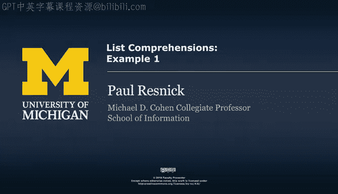
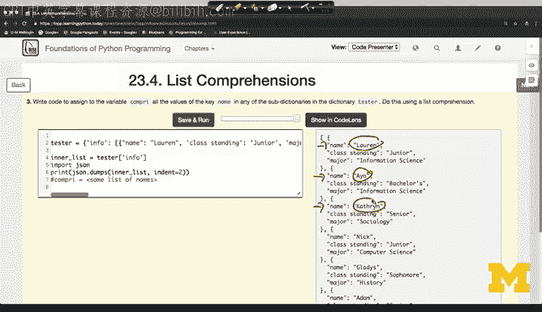

# 课程3：Python 3编程 - P26 🧠 列表推导式实战：从嵌套数据中提取信息




在本节课中，我们将通过一个具体的编程练习来学习列表推导式的应用。我们将从一个包含嵌套数据的字典中，提取出所有与“name”键相关联的值，并最终生成一个名字列表。

---

## 理解数据结构与任务目标

首先，我们被赋予了一个名为 `tester` 的字典，其内部包含嵌套数据。我们的任务是提取所有嵌套字典中与键 `‘name’` 相关联的值，最终形成一个名字列表，例如 `[‘Lauren’， ‘I O’， …]`。

为了清晰地理解任务，我们首先明确最终需要输出的结果。虽然目前代码无法运行，但我们可以先设定一个目标列表作为参考。

## 第一步：提取嵌套列表

面对嵌套数据结构，我们遵循“理解、提取、重复”的过程。观察数据，名字并不在顶层。顶层字典有一个键 `‘info’`，其值是一个列表，而我们需要的数据就在这个列表内的各个字典里。

因此，第一步是提取这个内部列表：
```python
inner_list = tester['info']
```
提取后，最好验证一下是否正确获取了数据。我们可以打印 `inner_list` 来查看其内容。为了便于阅读，可以使用 `json.dumps` 方法进行格式化输出：
```python
import json
print(json.dumps(inner_list, indent=2))
```
格式化后，我们可以清晰地看到 `inner_list` 是一个字典列表，每个字典都包含如 `name`、`class standing` 和 `major` 等键。

## 第二步：构思列表推导式

现在，我们已经有了包含目标字典的列表 `inner_list`。接下来，我们需要遍历这些字典，并从中提取出 `‘name’` 对应的值。



列表推导式的基本模板是：
```python
[ transformer_expression for variable in sequence if filter_expression ]
```
- **`transformer_expression`**：对每个元素进行转换的表达式。
- **`variable`**：代表序列中每个元素的变量名。
- **`sequence`**：要遍历的序列。
- **`filter_expression`**（可选）：用于过滤元素的表达式。

在我们的例子中：
- **`sequence`** 就是 `inner_list`。
- 我们将遍历的每个字典命名为 `d`。
- 本次任务没有过滤条件，因此可以省略 `if` 子句。
- **`transformer_expression`** 需要从字典 `d` 中提取 `‘name’` 的值，即 `d[‘name’]`。

## 第三步：编写并验证列表推导式

综合以上分析，完整的列表推导式如下：
```python
result = [ d['name'] for d in inner_list ]
```
编写完成后，我们打印 `result` 来验证结果。不出所料，我们成功得到了包含 `‘Lauren’`、`‘I O’`、`‘Catherine’` 等名字的列表，并且通过了所有内置测试。

---

## 总结

本节课我们一起完成了一个列表推导式的实战练习。我们学习了如何从复杂的嵌套数据结构中，逐步提取目标数据，并最终使用列表推导式高效地生成结果列表。

记住列表推导式的基本结构：**`[ 转换表达式 for 变量 in 序列 if 过滤条件 ]`**。它提供了一种简洁、高效的方式来处理和转换列表数据。

我们下次再见！