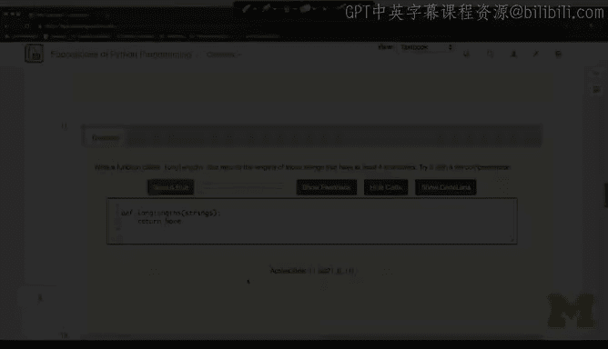
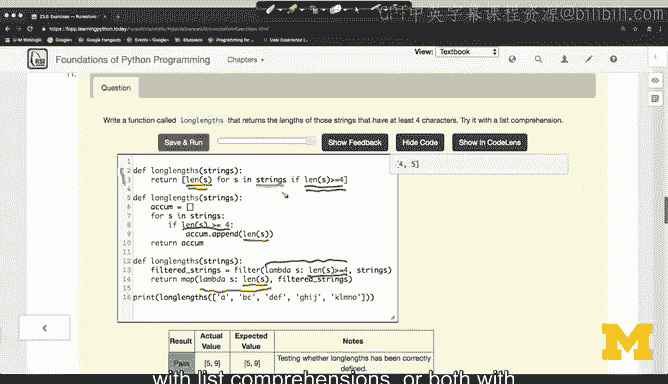

# 课程27：列表推导式示例2 📝




在本节课中，我们将学习如何通过三种不同的方式来实现一个名为 `long_lengths` 的函数。这个函数的核心任务是：从一个字符串列表中，筛选出长度至少为4的字符串，并返回这些字符串的长度列表。我们将分别使用**手动累加**、**map和filter函数**以及**列表推导式**这三种方法来实现它，并比较它们的异同。

---

## 概述

我们将定义一个函数 `long_lengths`，它接收一个字符串列表作为输入，并返回一个新列表。新列表中的元素是原列表中**长度至少为4**的字符串的**长度值**。这涉及两个操作：**过滤**（筛选出符合条件的字符串）和**映射**（将字符串转换为其长度值）。

为了验证函数是否正确，我们先创建一个测试用例：
```python
print(long_lengths(['abc', 'def', 'ghij', 'klmno']))
```
对于这个输入，我们期望的输出是 `[4, 5]`，因为只有 `'ghij'`（长度4）和 `'klmno'`（长度5）符合条件。

---

## 方法一：使用列表推导式

列表推导式是Python中一种简洁且高效的方法，可以在一行代码内同时完成过滤和映射操作。

以下是使用列表推导式实现 `long_lengths` 函数的代码：
```python
def long_lengths(strings):
    return [len(s) for s in strings if len(s) >= 4]
```
在这行代码中：
*   `len(s)` 是**映射表达式**，负责将字符串转换为长度。
*   `for s in strings` 指定了操作的序列。
*   `if len(s) >= 4` 是**过滤表达式**，确保只处理长度大于等于4的字符串。

运行测试，我们得到了预期的结果 `[4, 5]`。

---

## 方法二：使用手动累加

上一节我们介绍了如何使用列表推导式简洁地完成任务。本节中，我们来看看更基础的手动累加方法。这种方法步骤更明确，适合理解底层逻辑。

手动累加需要我们显式地初始化一个空列表，然后通过循环遍历原列表，根据条件决定是否将处理后的元素添加到新列表中。

以下是使用手动累加的实现代码：
```python
def long_lengths(strings):
    accumulator = []  # 初始化累加器
    for s in strings: # 遍历输入列表
        if len(s) >= 4: # 过滤条件
            accumulator.append(len(s)) # 映射操作并添加结果
    return accumulator # 返回最终列表
```
在这个实现中：
*   `len(s) >= 4` 同样是**过滤表达式**。
*   `len(s)` 是**映射表达式**，其结果被 `append` 到累加列表中。

---

## 方法三：使用map和filter函数

我们也可以使用Python内置的 `map` 和 `filter` 函数来组合实现。`filter` 函数负责筛选，`map` 函数负责转换。

以下是使用 `map` 和 `filter` 的实现代码：
```python
def long_lengths(strings):
    # 先过滤：筛选出长度>=4的字符串
    filtered_strings = filter(lambda s: len(s) >= 4, strings)
    # 再映射：将过滤后的字符串转换为长度
    lengths = map(lambda s: len(s), filtered_strings)
    # 将map对象转换为列表并返回
    return list(lengths)
```
在这个版本中：
*   `lambda s: len(s) >= 4` 定义了**过滤函数**。
*   `lambda s: len(s)` 定义了**映射函数**。实际上，这里的映射函数就是内置的 `len` 函数，因此可以简写为 `map(len, filtered_strings)`。

---

## 三种方法的对比

现在，我们已经用三种方式实现了相同的功能。让我们来总结一下它们的核心异同。

无论采用哪种方式，以下核心部分都必须出现：
1.  **映射表达式**：`len(s)`，用于计算长度。
2.  **过滤表达式**：`len(s) >= 4`，用于判断是否保留。
3.  **操作序列**：即输入的 `strings` 列表。

它们的主要区别在于组织代码的语法：
*   **列表推导式**将映射、过滤和序列整合在一个简洁的表达式 `[len(s) for s in strings if len(s) >= 4]` 中，一目了然，是Python风格的首选。
*   **手动累加**步骤清晰，易于理解每一步的过程，但代码行数较多。
*   **map和filter** 将两个操作分离，逻辑分明，但需要理解函数式编程的概念，并且最终需要将 `map` 对象转换为列表。

对于Python编程，**列表推导式**因其可读性和简洁性而被广泛推荐和使用。

---

## 总结



本节课中，我们一起学习了如何通过**列表推导式**、**手动累加**和**map/filter函数组合**这三种方式来实现同一个数据转换任务。我们看到了相同的核心逻辑（映射和过滤）如何以不同的语法结构来表达。其中，列表推导式以其简洁和直观的特点，成为了完成这类任务最“Pythonic”的方式。建议你通过更多练习来熟练掌握这种方法。