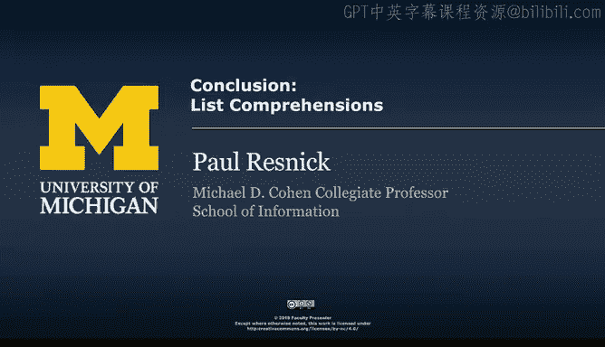

# 密歇根大学《Python3编程》课程3、4、5｜第28课：列表推导式总结 📝

在本节课中，我们将对列表推导式这一核心概念进行总结。我们将回顾如何读写列表推导式，理解其背后的转换与过滤操作，并学习如何将其与`map`和`filter`函数进行等价转换。




## 回顾列表推导式

上一节我们介绍了列表推导式的具体应用。本节中，我们来看看如何全面理解并掌握这一工具。

列表推导式是Python中一种简洁、高效地创建新列表的方法。其核心思想是对一个可迭代对象中的元素进行**转换**或**过滤**，从而生成一个新列表。

### 核心操作：转换与过滤

列表推导式主要执行两种操作：
1.  **转换**：对原序列中的每个元素应用一个表达式，将结果放入新列表。
2.  **过滤**：使用`if`条件语句，只将满足条件的元素（或其转换结果）放入新列表。

其基本语法结构可以用以下**公式**表示：
```python
[expression for item in iterable if condition]
```
其中，`if condition`部分是可选的。

以下是理解列表推导式关键点的列表：
*   **可读性**：对于简单的转换和过滤，列表推导式通常比传统的`for`循环更清晰、更简洁。
*   **效率**：在多数情况下，列表推导式的执行效率与等效的`for`循环相近或更优。
*   **功能**：它集成了`map`（转换）和`filter`（过滤）函数的功能于一体。

### 与`map`和`filter`的等价转换

如果需要，你可以将任何一个列表推导式翻译成使用`map`和`filter`函数的等效形式。这有助于理解其底层逻辑。

例如，以下列表推导式：
```python
new_list = [x*2 for x in old_list if x > 5]
```
可以等价地转换为：
```python
filtered = filter(lambda x: x > 5, old_list)
new_list = list(map(lambda x: x*2, filtered))
```
可以看到，列表推导式在一行代码中完成了过滤和映射两个步骤。

## 总结

本节课中我们一起学习了列表推导式的总结。你现在应该能够：
1.  熟练地阅读和编写列表推导式。
2.  用**转换**和**过滤**来描述列表推导式所执行的操作。
3.  在需要时，将列表推导式转换为等价的`map`和`filter`函数调用。

掌握列表推导式能让你的Python代码更加“Pythonic”（具有Python风格），更简洁，也更具可读性。