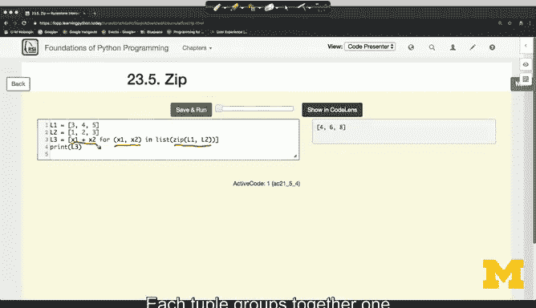
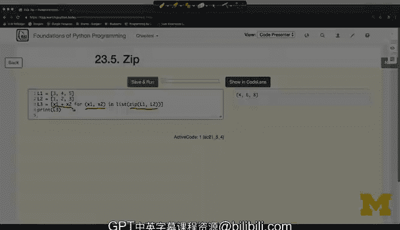

# 密歇根大学《Python3编程》课程3、4、5｜第30课：`zip`函数详解 🧵


在本节课中，我们将要学习Python中一个非常实用的内置函数——`zip`。`zip`函数允许我们按位置将多个序列中的元素配对组合，从而方便地对这些元素进行并行处理。我们将通过一个向量相加的例子，从基础实现开始，逐步过渡到使用`zip`函数的“Pythonic”写法，并最终结合列表推导式写出简洁高效的代码。

## 理解`zip`函数的需求

假设我们有两个向量（在Python中可以用列表表示），例如 `[3, 4, 5]` 和 `[1, 2, 3]`。我们的目标是将这两个向量相加，得到一个新的向量 `[4, 6, 8]`。这里的计算规则是：将第一个列表的第一个元素与第二个列表的第一个元素相加，然后是第二个元素相加，依此类推。

我们可以通过迭代索引（位置）来实现这个功能。

以下是使用索引迭代的传统方法：

```python
L1 = [3, 4, 5]
L2 = [1, 2, 3]
L3 = []  # 用于累积结果的列表

for i in range(len(L1)):
    L3.append(L1[i] + L2[i])

print(L3)  # 输出: [4, 6, 8]
```

在这段代码中，`range(len(L1))` 生成了一个从0到2的序列。在循环中，变量 `i` 依次被绑定为0、1、2。每次迭代，我们通过索引 `i` 访问两个列表中对应位置的元素，将它们相加后添加到结果列表 `L3` 中。

虽然这种方法可行，但它并没有清晰地表达“将两个列表按位置配对”这个核心意图。代码更多地关注于索引的遍历，而不是数据本身的结构。

## 引入`zip`函数

Python提供了`zip`函数，它让“按位置配对”这个操作变得一目了然。`zip`函数接收两个或多个序列作为参数，并返回一个迭代器。这个迭代器会生成一系列元组，每个元组包含了来自所有输入序列中相同位置的元素。

让我们先看看`zip`函数本身做了什么：

```python
L1 = [3, 4, 5]
L2 = [1, 2, 3]
zipped_list = list(zip(L1, L2))
print(zipped_list)  # 输出: [(3, 1), (4, 2), (5, 3)]
```

`zip(L1, L2)` 返回了一个迭代器。为了直观地看到结果，我们使用 `list()` 函数将其转换为列表。可以看到，结果是一个包含三个元组的列表：第一个元组是 `(3, 1)`，它组合了 `L1` 和 `L2` 中位置0的元素；第二个元组是 `(4, 2)`，组合了位置1的元素；第三个元组是 `(5, 3)`，组合了位置2的元素。

现在，我们有了这个“拉链”在一起的列表，接下来就可以轻松地对每个元组中的元素进行操作了。

## 使用`zip`函数进行向量相加

上一节我们看到了`zip`函数如何将列表配对。本节中，我们来看看如何利用这个配对结果来完成向量相加。

我们可以遍历`zip`函数生成的元组列表，在循环中将每个元组解包为两个变量，然后相加：

```python
L1 = [3, 4, 5]
L2 = [1, 2, 3]
L3 = []

for pair in zip(L1, L2):
    x1, x2 = pair  # 解包元组
    L3.append(x1 + x2)

print(L3)  # 输出: [4, 6, 8]
```

在循环的第一次迭代中，`pair` 是 `(3, 1)`。通过 `x1, x2 = pair` 这行代码，我们将元组解包，使得 `x1` 绑定为 `3`，`x2` 绑定为 `1`。然后将它们相加得到 `4`，并添加到 `L3` 中。这个过程对后续的元组 `(4, 2)` 和 `(5, 3)` 重复进行。

我们甚至可以将解包操作直接写在`for`循环中，使代码更加简洁：

```python
for x1, x2 in zip(L1, L2):
    L3.append(x1 + x2)
```

## 结合列表推导式写出Pythonic代码

Python推崇简洁、可读性高的代码。列表推导式（List Comprehension）正是实现这一目标的强大工具。结合`zip`函数，我们可以用一行代码完成整个向量相加的操作。

以下是使用列表推导式的最终版本：

```python
L1 = [3, 4, 5]
L2 = [1, 2, 3]
L3 = [x1 + x2 for x1, x2 in zip(L1, L2)]
print(L3)  # 输出: [4, 6, 8]
```

这行代码是典型的“Pythonic”写法。它的结构非常清晰：
1.  `zip(L1, L2)`：将两个列表按位置配对。
2.  `for x1, x2 in ...`：遍历每个配对元组，并直接解包到变量 `x1` 和 `x2`。
3.  `x1 + x2`：对解包后的两个元素进行相加，作为要累积的值。
4.  外层的方括号 `[...]` 表示这是一个列表推导式，它会自动将所有 `x1 + x2` 的结果收集起来，形成最终的结果列表 `L3`。

这种方法完全避免了手动创建空列表和调用 `append` 方法，代码意图一目了然。

## 总结

本节课中我们一起学习了Python的`zip`函数。我们从一个具体的需求——两个向量相加——出发，首先了解了通过索引迭代的传统方法。然后，我们引入了`zip`函数，它能够将多个序列按位置配对，生成一个元组迭代器，这使得并行处理数据变得非常直观。最后，我们结合列表推导式，写出了一行简洁、高效且符合Python风格的代码。

**核心概念总结：**
*   `zip`函数：用于将多个可迭代对象中对应的元素打包成一个个元组，然后返回由这些元组组成的迭代器。公式可表示为：`zip(iter1, iter2, ...) -> iterator of tuples`。
*   列表推导式：一种快速创建列表的语法，形式为 `[expression for item in iterable]`。
*   “Pythonic”写法：指充分利用Python语言特性，写出简洁、清晰、可读性高的代码风格。





掌握`zip`函数及其与列表推导式的结合使用，是编写高效Python代码的重要一步。