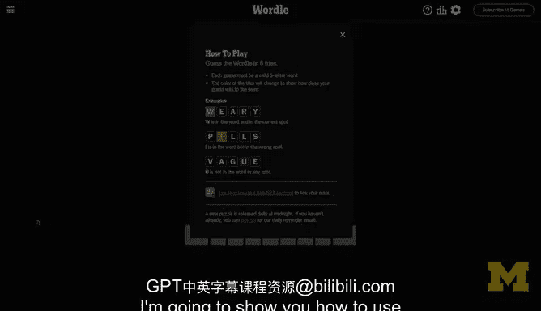
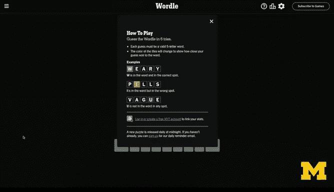
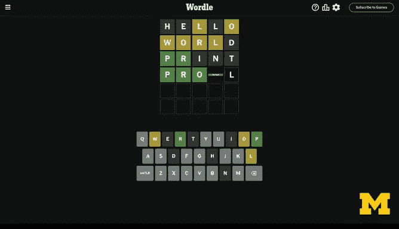
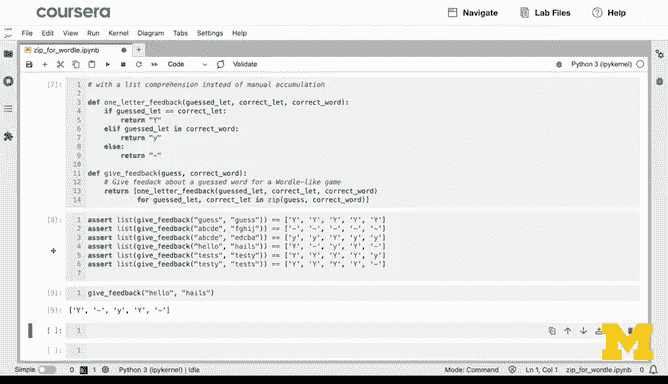

# 课程3：Python 3编程 - P31：使用zip函数与列表推导式 🧩




## 概述

在本节课中，我们将学习如何使用Python的`zip`函数和列表推导式，来模拟实现一个类似流行在线文字游戏Wordle的反馈功能。我们将编写一个函数，它能根据玩家的猜测和正确答案，生成相应的文本反馈。



---

## Wordle游戏规则简介

上一节我们介绍了课程目标，本节中我们来看看Wordle游戏的基本规则。

Wordle是一个猜词游戏，玩家需要猜出一个五个字母的单词，最多有六次尝试机会。每次猜测后，游戏会提供颜色反馈：
*   **绿色**：字母在单词中且位置正确。
*   **黄色**：字母在单词中但位置错误。
*   **灰色**：字母不在单词中。



由于我们使用纯文本，我们将用以下符号代替颜色：
*   **大写字母 `Y`**：表示绿色（字母正确且位置正确）。
*   **小写字母 `y`**：表示黄色（字母在单词中但位置错误）。
*   **连字符 `-`**：表示灰色（字母不在单词中）。

---

## 函数目标与测试用例

在开始编码前，我们先明确函数`give_feedback`的目标，并定义一些测试用例。

函数将接收两个参数：`guess`（猜测的单词）和`correct_word`（正确答案）。它需要返回一个由`Y`、`y`、`-`组成的字符串作为反馈。

以下是函数需要通过的测试用例：

*   如果猜测完全正确（例如 `guess` = `"guess"`, `correct_word` = `"guess"`），应返回 `"YYYYY"`。
*   如果猜测完全错误（例如 `guess` = `"abcde"`, `correct_word` = `"fghij"`），应返回 `"-----"`。
*   如果字母位置完全颠倒（例如 `guess` = `"abcde"`, `correct_word` = `"edcba"`），应返回 `"yyYyy"`（第三个字母`c`位置正确）。
*   需要特别注意，反馈逻辑**不是对称的**。例如：
    *   `give_feedback("tests", "testy")` 返回 `"YYYYy"`（最后一个`s`在`testy`中，但不在末尾，所以是`y`）。
    *   `give_feedback("testy", "tests")` 返回 `"YYYY-"`（最后一个`y`不在`tests`中，所以是`-`）。

---

## 版本一：不使用zip的基础实现

首先，我们来看一个不使用`zip`函数的基础实现版本。这个版本通过迭代索引来同时访问两个字符串的对应字符。

以下是该版本的核心逻辑步骤：

1.  初始化一个空列表`result`用于存放反馈字符。
2.  使用`for i in range(len(guess)):`循环遍历猜测单词的每个索引`i`。
3.  在每次循环中，分别获取`guess[i]`（猜测字母）和`correct_word[i]`（正确字母）。
4.  进行条件判断：
    *   如果 `guess[i] == correct_word[i]`，向`result`添加`'Y'`。
    *   否则，如果 `guess[i] in correct_word`，向`result`添加`'y'`。
    *   否则，向`result`添加`'-'`。
5.  循环结束后，使用`''.join(result)`将列表连接成字符串并返回。

**代码示例：**
```python
def give_feedback_v1(guess, correct_word):
    result = []
    for i in range(len(guess)):
        guess_letter = guess[i]
        correct_letter = correct_word[i]
        if guess_letter == correct_letter:
            result.append('Y')
        elif guess_letter in correct_word:
            result.append('y')
        else:
            result.append('-')
    return ''.join(result)
```
这个版本逻辑清晰，但通过索引访问两个序列对应元素的方式略显繁琐。

---

## 版本二：使用zip函数优化

上一节我们介绍了通过索引访问对应元素的方法，本节中我们来看看如何使用`zip`函数让代码更简洁、更“Pythonic”。

`zip`函数可以将多个可迭代对象（如字符串、列表）“打包”成一个个元组。例如，`zip("hello", "hails")`会产生一个迭代器，其元素依次是`('h', 'h')`, `('e', 'a')`, `('l', 'i')`...。

以下是使用`zip`的优化版本：

**代码示例：**
```python
def give_feedback_v2(guess, correct_word):
    result = []
    for guess_letter, correct_letter in zip(guess, correct_word):
        if guess_letter == correct_letter:
            result.append('Y')
        elif guess_letter in correct_word:
            result.append('y')
        else:
            result.append('-')
    return ''.join(result)
```
**核心改进：**
`for guess_letter, correct_letter in zip(guess, correct_word):` 这行代码直接同时遍历两个字符串的对应字符对，并利用元组解包将两个字母分别赋值给变量。这比使用索引访问更加直观和优雅。

---

## 版本三：结合列表推导式

我们已经用`zip`简化了遍历过程，现在可以更进一步，使用列表推导式来替代手动构建结果列表的循环，使代码更加紧凑。

首先，我们将判断单个字母反馈的逻辑提取成一个独立的函数`one_letter_feedback`。

**代码示例：**
```python
def one_letter_feedback(guess_letter, correct_letter, correct_word):
    if guess_letter == correct_letter:
        return 'Y'
    elif guess_letter in correct_word:
        return 'y'
    else:
        return '-'

def give_feedback_v3(guess, correct_word):
    feedback_list = [one_letter_feedback(g, c, correct_word) for g, c in zip(guess, correct_word)]
    return ''.join(feedback_list)
```
**核心改进：**
`[one_letter_feedback(g, c, correct_word) for g, c in zip(guess, correct_word)]` 这行列表推导式完成了所有工作：
1.  `zip(guess, correct_word)`生成字母对。
2.  对每个字母对`(g, c)`，调用`one_letter_feedback`函数计算反馈字符。
3.  将所有结果自动收集到一个新列表中。

这使主函数变得非常简洁易读。

---

## 总结

本节课中我们一起学习了如何逐步优化一个Python函数。
1.  我们从基础的索引遍历版本开始，明确了函数逻辑。
2.  接着，我们引入了`zip`函数，它让我们能够更优雅地同时遍历多个序列的对应元素。
3.  最后，我们结合列表推导式，将循环和结果构建过程浓缩成一行清晰、高效的代码。

通过这个模拟Wordle游戏反馈的实例，你不仅掌握了`zip`和列表推导式的实用技巧，也体会到了编写简洁、高效、易读的“Pythonic”代码的过程。希望这个示例对你有所帮助。



我们下次课再见。