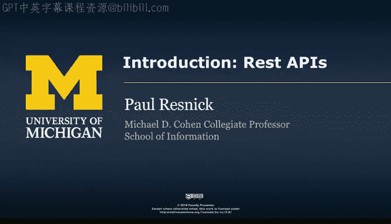

# 课程33：Python 3编程（课程3、4、5）｜第32.04.01讲：REST API简介 🌐


在本节课中，我们将要学习REST API的基本概念。我们将了解什么是API，什么是REST，以及如何通过Python程序与网络上的其他程序进行交互。课程最后，你将能够解析URL的组成部分，并使用Python的`requests`模块获取网络内容。



---

## 什么是API？

API是“应用程序编程接口”的英文缩写。它是一个接口，允许一个计算机程序与另一个计算机程序进行交互。

## 什么是REST？

REST是“表述性状态转移”的英文缩写。这个术语本身可能不那么直观，其更抽象的含义可以详细解释。但在日常用语中，**REST API**通常指代一种网站，它产生的数据是供其他计算机程序使用的，而不是供人在浏览器中查看的。

一个REST API会以特定的格式响应请求。许多API在格式上有一些共通之处，但具体细节则因API而异。

---

## 本周学习目标

本周，你将学习如何编写与REST API交互的Python程序。你将学会阅读API文档，以理解API期望的具体请求格式。你还将学习如何使用Python的`requests`模块来发起API调用。最后，你将了解缓存技术，以减少需要向API发起的调用总数。

---

## 网络通信基础

在深入探讨REST API的细节之前，我们需要先了解一下背景知识：当两台计算机通过互联网进行通信时，幕后发生了什么。这将帮助你建立一个心智模型。这样，当第一次尝试不顺利时（实际情况往往如此），你就知道该如何思考可能出错的地方，并找到解决问题的好方法。

在本节课结束时，你将能够：

1.  将URL解析为其组成部分：**协议**（HTTP或HTTPS）、**主机**（通常是域名）和**路径**。
2.  使用Python的`requests`模块获取URL的内容。

---

## 核心概念与工具

以下是本课程涉及的核心概念和工具：

*   **API**：应用程序编程接口。
*   **REST**：表述性状态转移，一种设计Web服务的架构风格。
*   **`requests`模块**：Python中用于发送HTTP请求的库。

其基本使用代码如下：
```python
import requests
response = requests.get('https://api.example.com/data')
```

---

## 总结

本节课中，我们一起学习了REST API的基础知识。我们了解了API和REST的定义，明确了本周的学习目标，并简要探讨了网络通信的背景。接下来，我们将开始学习如何具体使用Python来与这些API进行交互。

让我们开始吧。课程结束时再见。