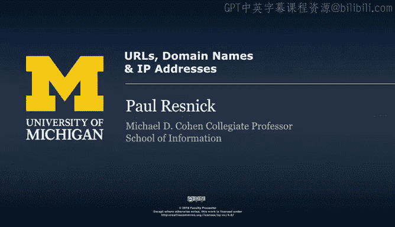
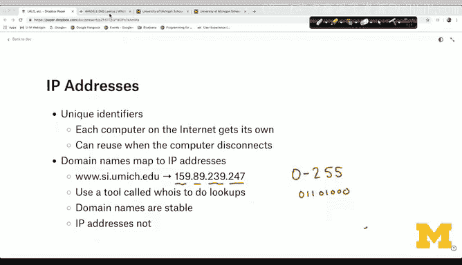
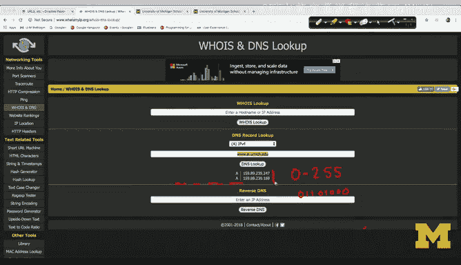
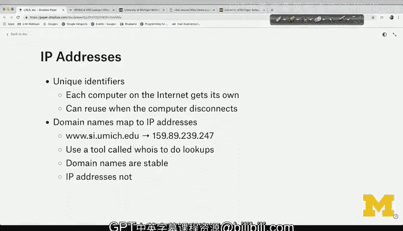

# 课程3：Python网络基础 🕸️ - P34：URL、域名与IP地址

在本节课中，我们将要学习互联网通信的基础知识，包括URL的构成、域名系统以及IP地址的工作原理。理解这些概念是后续编写程序从网络API获取数据的关键。

## 概述：互联网如何工作

在展示如何编写程序从网络API获取数据之前，我们需要先了解互联网的基本工作原理，以及URL、域名等概念的含义。

## URL的组成部分

我们通常使用网页浏览器访问网站。浏览器地址栏中的字符串就是URL。以下是一个URL示例：
`http://www.si.umich.edu/about`

我们可以将URL解析为几个部分：

*   **协议**：冒号前的部分。它定义了与远程服务器通信的规则。本例中，`http` 就是协议。
*   **分隔符**：`://` 是协议与后续内容的分隔符。
*   **域名/服务器**：分隔符之后，到下一个正斜杠 `/` 之前的部分。它指明了从哪个远程服务器获取资源。本例中是 `www.si.umich.edu`。
*   **路径/参数**：域名后的 `/about` 部分。它指明了要从远程服务器获取的具体资源。

简单来说，**协议**规定如何通信，**服务器**指明通信对象，而**参数**则指定要获取的具体内容。

## 域名与服务器

上一节我们介绍了URL的结构，本节中我们来看看“服务器”部分的具体含义。

那些服务器通常通过名称来引用，例如 `umich.edu`、`www.si.umich.edu` 或 `www.google.com`。这些名称被称为**域名**，它们代表了你试图与之通信的远程计算机。

连接到互联网的每一台计算机都有一个唯一的标识符，称为**IP地址**。IP代表互联网协议。在同一时间，任何两台连接到互联网的计算机都不会拥有相同的IP地址。当一台计算机断开连接后，其IP地址可能会被其他计算机重新使用。

像 `www.si.umich.edu` 这样的域名是一个相对固定的名称，但实际响应这个名称的服务器可能会随时间变化，而每台服务器都会有一个IP地址。

## IP地址详解

那么，像 `www.si.umich.edu` 这样的域名如何转换成IP地址呢？这依赖于互联网的**域名系统**。

DNS的作用就是将人类可读的域名（如 `www.si.umich.edu`）解析成唯一的数字标识符——IP地址。

一个IP地址看起来类似这样：`159.89.239.247`。其中的点号是为了方便我们将它分为四个部分。每个部分的数字范围必须在 **0 到 255** 之间。如果你看到一个IP地址的某部分数字大于255，那它就不是有效的IP地址。

从技术上讲，每个部分可以用8位二进制数（8个0或1）表示，因此整个IP地址由4组8位二进制数构成，总计32位。所以IP地址有时也被称为**32位地址**。我们看到的带点号的十进制表示法（如159.89.239.247）只是为了便于人们读写和记忆。

## 域名解析过程

那么，`www.si.umich.edu` 是如何转换成 `159.89.239.247` 这个数字的呢？互联网上的计算机在需要与 `www.si.umich.edu` 通信时，又如何找到这个数字？

这依靠一个分布式的查询系统——**域名系统**。你的电脑在后台会与一个DNS服务器通信来完成查询。此外，也有公开的网站可以提供查询服务。

例如，在一个DNS查询工具中查找 `www.si.umich.edu`，可能会返回两个可能的IP地址，其中主要的IP地址就是第一个：`159.89.239.247`。

## 总结

本节课中我们一起学习了互联网通信的核心基础。我们了解了**URL**的三大组成部分：协议、域名和路径。我们探讨了**域名**作为服务器易记名称的作用，以及**IP地址**作为计算机在网络上唯一数字标识符的本质。最后，我们明白了**域名系统** 是如何充当“电话簿”，将域名自动翻译成IP地址，从而让我们的程序能够找到并连接到正确的服务器。理解这些概念是进行网络编程的第一步。