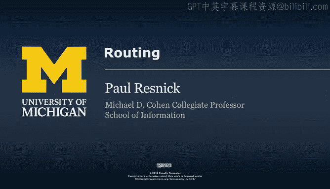
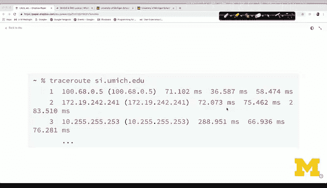

# 课程3：Python网络基础 - P35：34_04_03_路由机制 🌐

## 概述
在本节课中，我们将要学习互联网数据如何从一台计算机传输到另一台计算机。我们将探讨数据包、路由器以及路由机制的基本概念，帮助你理解网络通信背后的基本原理。

---

## 互联网路由基础

上一节我们介绍了网络连接的基本概念，本节中我们来看看数据在互联网上是如何传输的。

当你的浏览器与某个远程服务器（例如 `www.si.umich.edu`）通信时，它会建立一个连接，然后发送一些数据。这些数据可以是文本片段或其他格式化的内容。

每个数据内容块都会被分割成一系列的数据包。

每个小数据包都会被发送到这个由大量路由器组成的大型路由系统中。

路由器是一种专门的计算机，其唯一职责就是接收这些数据包并将其转发出去。

每个数据包都会从一个路由器跳转到下一个路由器。

每个路由器都维护着一个大型的查找表。该表指示：如果接收到的数据包目标是某个特定地址，那么下一个“跳转点”或下一个应该发送到的路由器是哪个。

神奇的是，所有这些路由器都协调了它们的路由表，使得当一个数据包从这里发送出去时，它最终能够到达目的地。这是一个相当卓越的系统，每天有数万亿的数据包被路由，并且它们大多都能成功到达目的地。

偶尔也会出现问题，数据包可能无法到达。

---

## 路由追踪示例

以下是路由追踪程序输出的前几行内容。这个程序提供了一些诊断信息，用于显示当我尝试从我的计算机向 `si.umich.edu` 发送数据包时，这些数据包经历了什么。

第一行告诉我，数据包首先去了哪里。首先，它去往一个地址为 `100.68.0.5` 的计算机，到达那里花费了 71 毫秒。

实际上，当我运行这个追踪程序时，它会执行三次测试。一次花费了 71 毫秒，下一次花费的时间稍短，第三次则介于中间，为 58.4 毫秒。

第二行说明，如果一个最终目标是 `si.umich.edu` 的数据包，它的下一站是哪里。它从地址 `100.68.0.5` 的计算机去往了地址 `172.19.242.241` 的计算机。

我们可以看到这被称为“两跳”。第一跳是 `100.68.0.5`，第二跳是 `172.19.242.241`。

第三跳是另一个路由器，地址为 `10.255.255.253`，依此类推。我并未展示完整的路径，但在经过 8 到 10 跳之后，数据包最终到达了 `si.umich.edu`。

通常，完成两跳所花费的时间会比完成一跳稍长一些。

这让你对幕后发生的事情有了一点了解。我们不需要处理所有这些技术细节，我只是想让你了解当一台计算机与另一台计算机通信时发生了什么。

---

## 总结
本节课中我们一起学习了互联网路由的基础知识，即一台计算机如何通过中间路由器将数据发送到另一台计算机。我们了解了数据包、路由器的作用以及路由表的基本工作原理。

我们下次再见。