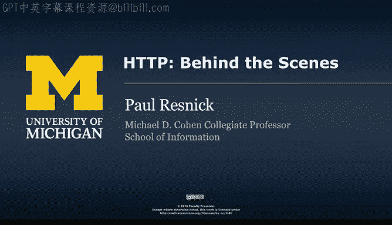
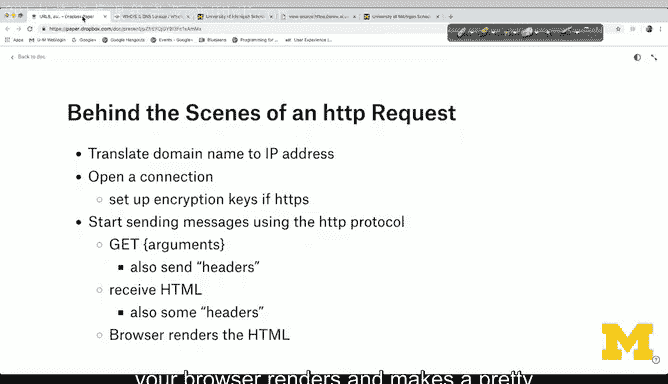

# 课程3：Python网络编程基础 - P36：HTTP协议幕后原理 🌐

在本节课中，我们将要学习当浏览器从远程服务器获取数据时，幕后究竟发生了什么。我们将重点关注计算机之间通信的一种特定方式：HTTP协议。

---

## 连接建立与域名解析

上一节我们介绍了网络通信的基本概念，本节中我们来看看具体的HTTP请求过程。

当你在浏览器中输入一个以 `http://` 或 `https://` 开头的URL时，例如 `http://www.si.umich.edu`，一系列后台操作便会启动。

首先，你的计算机会将这个域名（如 `www.si.umich.edu`）转换成一个IP地址。这个过程就是之前提到的域名解析。

接着，你的计算机会与远程计算机建立连接。如果你使用的是HTTPS（即安全版本），你的计算机会首先与服务器交换一些信息，以建立加密密钥。这样，后续所有的通信都会被加密，任何截获通信的人都无法解读内容。

## 发送请求与接收响应

连接建立后，你的浏览器开始发送消息。这些消息实际上是文本。

以下是浏览器发送的核心内容：
*   **请求方法**：浏览器会发送单词 `GET`。
*   **路径**：浏览器会发送URL中斜杠 `/` 之后的部分，指明要访问的资源路径。
*   **请求头**：浏览器会发送一些头部信息，例如声明自己是Chrome浏览器、当前时间等。

随后，服务器会返回响应。响应也包含两部分：
*   **响应头**：服务器会返回一些头部信息，例如声明发送的内容类型是HTML、当前时间戳等。
*   **响应体（最重要）**：服务器会发送HTML代码。你的浏览器会接收这些HTML，并将其渲染成我们通常在浏览器中看到的漂亮网页。

## 实战观察：使用浏览器开发者工具

理论听起来可能有些抽象，让我们通过一个实际例子来观察这个过程。

这里我打开了密歇根大学SI学院的网站（`https://www.si.umich.edu`），并在屏幕上使用了Chrome浏览器的开发者工具。

当我发起那个请求时，我的浏览器建立了一个连接，并首先发送了一个GET请求。我们可以在这里看到完整的请求URL和所有的请求头。我们请求的路径是 `/`，因为我没在域名后加任何东西。协议是HTTPS。用户代理显示我使用的是Chrome浏览器。这些都是我的浏览器发送给服务器的信息。

服务器通过发回一大堆响应头来回应。这里有时间戳、一些其他信息（例如显示网站后端使用PHP），以及内容类型是UTF-8编码的 `text/html` 等。这些都是我的浏览器需要使用的信息。

而最重要的，我们实际收到的是所有这些HTML代码。所有这些内容都被发送回来，浏览器负责解析这一切。这仅仅是文本，通常不会直接显示在网页上。显示在网页上的是这个漂亮的界面，这就是浏览器渲染所有HTML的结果。

如果你不知道如何使用Chrome开发者工具，它可能有点令人困惑。但如果你只是想查看任何页面的HTML代码，你可以右键点击页面，然后选择“查看网页源代码”，就能看到从服务器发回的所有内容。

---

## 总结

本节课中我们一起学习了HTTP协议的基本工作原理。

当你的浏览器从远程网络服务器获取数据时，它会建立一个连接，发送一些头部信息并请求特定的路径和参数。随后，它会收到一些响应头，最重要的是收到HTML代码。你的浏览器会渲染这些HTML，并将其变成一个漂亮的网页。

我们下次再见。👋