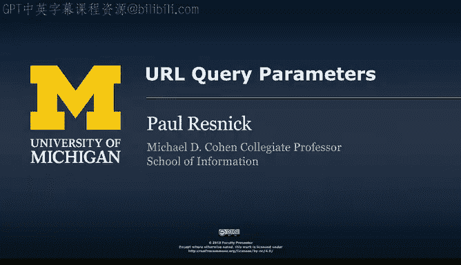
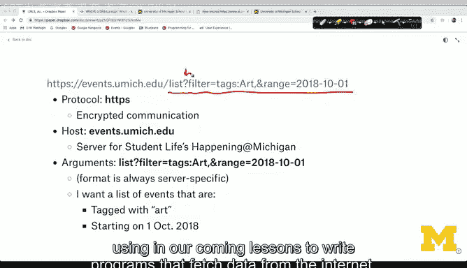

# 课程3、4、5：Python 3编程 - P37：URL查询参数 📚


在本节课中，我们将学习URL（统一资源定位符）中一种非常常见的结构——查询参数。我们将了解查询参数的格式、作用，以及如何在Python编程中利用它们从互联网上获取数据。



---

## 欢迎回来 👋

上一节我们讨论了URL的基本组成部分。本节中，我们来看看URL中斜杠（`/`）之后的一种特定且非常常见的结构。

---

## 查询参数的结构 🔍

一种非常常见的URL格式是：在路径名之后，会出现一个问号（`?`）字符。问号之后的内容被称为**查询参数**。

以下是一个URL示例：
```
https://events.umich.edu/list?filter=tags:art&range=20181001
```

与之前一样，这个URL包含：
*   **协议**：`https`
*   **主机**：`events.umich.edu`
*   **参数**：斜杠之后的所有内容（`/list?filter=tags:art&range=20181001`）

任何网络服务器都可以决定它接受何种格式的参数，但“路径名 + 问号 + 查询参数”是一种非常通用的格式。

---

## 键值对格式 📝

查询参数通常以“键=值”的格式进行组织。

以下是查询参数的格式：
```
key1=value1&key2=value2&...
```

在我们的示例URL中：
*   第一个键是 `filter`，其值为 `tags:art`
*   第二个键是 `range`，其值为 `20181001`
*   它们之间用 `&` 符号连接

因此，完整的查询参数字符串是：
```
filter=tags:art&range=20181001
```

服务器会将此请求解释为：在服务器上搜索从2018年10月1日开始、并且标签中含有“art”（艺术）的活动。

如果我们访问这个URL，网络服务器会将其视为一个查询请求，并返回从10月1日前后开始的、校园内与艺术相关的活动信息。

---

## 查询参数的应用 💡

这种“路径 + 问号 + 键值对”的URL结构是一种非常常见的模式。

在接下来的课程中，我们将使用这种模式来编写从互联网获取数据的程序。理解查询参数是使用Python进行网络数据抓取和API调用的基础。

---

## 总结 ✨

本节课我们一起学习了URL查询参数。
*   我们了解了查询参数位于URL路径后的问号（`?`）之后。
*   我们学习了查询参数的标准格式是`key=value`，多个参数之间用`&`连接。
*   我们看到了一个实际示例，理解了服务器如何根据这些参数值来返回特定的数据。



掌握查询参数的结构和含义，是迈向使用Python自动化处理网络请求的重要一步。我们下次课再见！