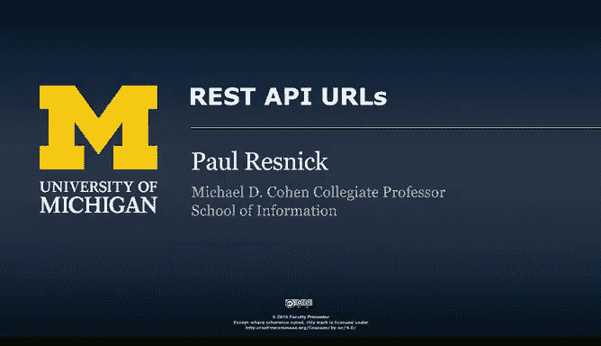
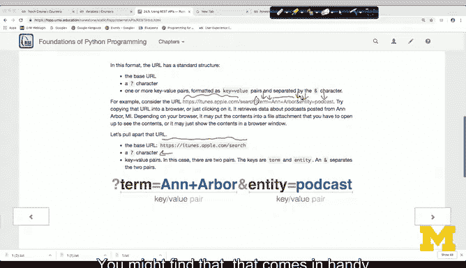

# 课程38：REST API URL设计详解 🧩




在本节课中，我们将学习如何设计一个用于向REST API发起请求的URL。我们将以苹果公司的iTunes API为例，解析其URL的各个组成部分，并理解如何通过URL编码完整的请求信息。

## 概述

向API发起请求通常通过访问一个特定的URL来完成。虽然有些API会使用HTTP协议中称为POST机制的其他部分，在这种情况下，并非所有请求信息都直接编码在URL中，但本节课我们将专注于最简单的机制——HTTP GET请求，即整个请求都编码在URL里。

## URL结构解析

上一节我们提到了通过URL发起GET请求。本节中，我们来看看一个典型的、用于向REST API（此处是苹果运营的iTunes API）请求数据的URL结构。该API允许你在iTunes内容中搜索歌曲、播客和视频等。

以下是一个示例URL：
`https://itunes.apple.com/search?term=ann+arbor&entity=podcast`

访问此URL后，返回的数据是一串文本，其格式看起来非常像一个Python字典。实际上，这是JSON格式的文本，正如我们之前所见，可以轻松地使用 `json.loads()` 函数将其转换为Python字典。

## 分解URL组成部分

现在，让我们详细分解这个URL的结构。

首先，第一部分我们称之为**基础URL**。这包括域名和路径的第一部分，直到 `/search`。

```
https://itunes.apple.com/search
```

接着，我们会看到问号字符 `?`。问号之后是**键值对**参数。

以下是构成请求参数的键值对列表：
*   `term=ann+arbor`：其中 `term` 是键，`ann+arbor` 是值。
*   `entity=podcast`：其中 `entity` 是键，`podcast` 是值。

在这些键值对中，键和值之间总是用等号 `=` 连接。而不同的键值对之间，则用和号 `&` 分隔。

## 请求编码与调试

这就是向REST API发起请求的基本结构，其中所有关于请求的信息都直接编码在URL中。在我们的例子中，我们在URL中编码了以下信息：
1.  请求发送到iTunes服务器（`itunes.apple.com`）。
2.  我们想要执行搜索操作（`/search` 部分）。
3.  我们想要搜索“Ann Arbor”（`term=ann+arbor` 部分）。
4.  我们只想要播客，而不是书籍或歌曲（`entity=podcast` 部分）。

由于所有请求信息都编码在URL中，这使得调试REST API请求变得相对容易。因为你总是可以像我之前做的那样，在单独的浏览器窗口中打开URL，并立即查看网站返回的内容。你可能会发现这在调试时非常方便。

## 总结



本节课我们一起学习了REST API URL的设计。我们解析了URL的各个组成部分，包括基础URL、问号后的查询参数，以及用等号和与号连接的键值对。理解这种结构是使用和调试基于GET请求的REST API的关键。我们下次再见。