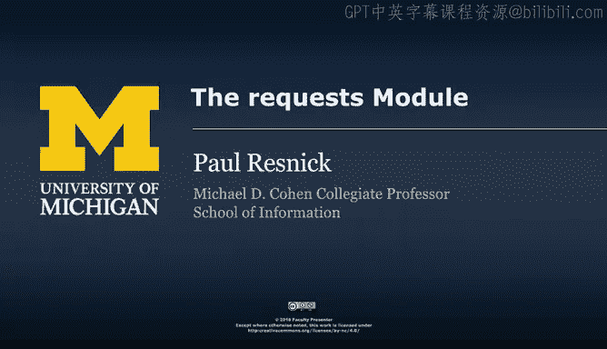
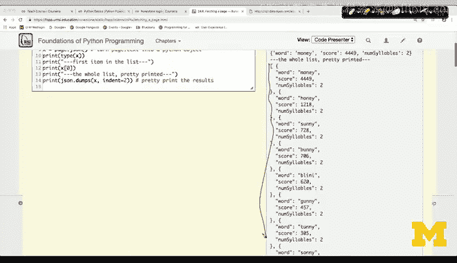

# Python 3 编程课程 39：使用 `requests` 模块获取网络数据 📡




在本节课中，我们将要学习如何使用 Python 的 `requests` 模块来获取网页内容。我们将从一个简单的例子开始，了解如何发送请求并处理返回的数据。

---

## 概述

`requests` 模块提供了一个名为 `get` 的函数，它允许你的 Python 程序获取网页的内容。我们将通过一个实际的 API 调用来演示其基本用法。

---

## 导入 `requests` 模块

首先，我们需要导入 `requests` 模块。这通过 `import` 语句完成。

```python
import requests
```

这行代码使得 `requests` 模块在当前程序中可用。

---

## 使用 `requests.get` 函数

上一节我们介绍了如何导入模块，本节中我们来看看如何使用其核心函数。`requests.get` 函数接收一个 URL 作为参数，并返回一个包含该 URL 页面源代码的响应对象。

```python
page = requests.get('https://api.datamuse.com/words?rel_rhy=funny')
```

在这个例子中，我们向一个提供单词押韵数据的 API 发送了请求。

---

## 理解响应对象

调用 `requests.get` 后返回的是一个响应对象。这个对象包含了服务器返回的数据和一些有用的属性。

以下是响应对象的一些基本属性：

*   **`page.text`**： 以字符串形式返回网页的完整内容。
*   **`page.url`**： 返回实际请求的 URL。在我们这个简单例子中，它与传入的 URL 相同，但在更复杂的请求中，`requests` 模块可能会为我们构造 URL，这时查看这个属性就很有用。
*   **`page.json()`**： 这是一个方法。如果响应内容是 JSON 格式，调用此方法可以将其直接解析为 Python 对象（如列表或字典）。

---

## 从浏览器到 Python 程序

为了理解我们获取的数据，可以先在浏览器中查看 API 的返回结果。访问 URL `https://api.datamuse.com/words?rel_rhy=funny`，你会看到返回一个 JSON 格式的列表，其中每个条目都是一个包含与“funny”押韵的单词（如 money, honey, sunny 等）的字典。

现在，让我们在 Python 程序中获取相同的数据。

```python
import requests

page = requests.get('https://api.datamuse.com/words?rel_rhy=funny')
print(type(page))  # 输出：<class 'requests.models.Response'>
print(page.text[:150])  # 打印前150个字符
```

运行这段代码，你会看到 `page` 的类型是响应对象，并且 `page.text` 的前150个字符包含了我们在浏览器中看到的 JSON 数据。

---

## 解析 JSON 数据

直接处理文本字符串可能不方便。如果知道返回的是 JSON 格式，我们可以使用 `.json()` 方法将其转换为 Python 数据结构。

```python
# 将响应的文本内容解析为Python对象
word_list = page.json()
print(type(word_list))  # 输出：<class 'list'>
print(word_list[0])     # 输出列表中的第一个字典
```

`.json()` 方法本质上是 `json.loads(page.text)` 的快捷方式。它会将 JSON 字符串转换为对应的 Python 列表或字典。

为了让输出更易读，我们可以使用 `json.dumps` 并设置缩进。

```python
import json
pretty_output = json.dumps(word_list, indent=2)
print(pretty_output)
```

---

## 关于运行环境的说明

需要注意的是，在某些特定的学习环境（如视频中提到的 Runestone 环境）中，`requests` 模块的功能可能被简化。它可能只支持从特定网站（尤其是设计用于提供数据的 API 站点）获取数据，并且返回的响应对象可能不具备完整 Python 实现中的所有属性。这是出于跨站脚本安全限制的考虑。

---

## 总结



本节课中我们一起学习了 `requests` 模块的基础知识。我们了解到，通过向 `requests.get()` 函数传入一个 URL，我们可以获得一个响应对象。利用这个对象的 `.text` 属性可以获取原始文本内容，而调用 `.json()` 方法则可以将 JSON 格式的响应内容便捷地转换为 Python 的列表或字典。在后续课程中，我们还将看到 `requests` 模块更高级的用法，例如如何帮助我们从多个部分构造 URL。