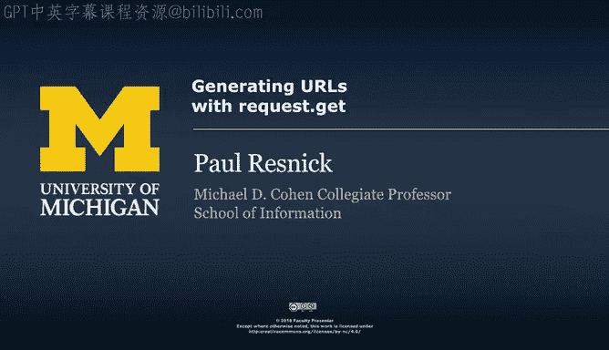
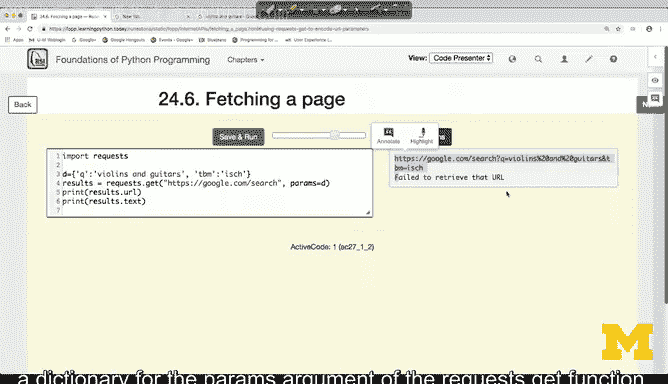

# 课程3、4、5：Python 3编程｜P40：使用requests.get构建URL 🔗




## 概述
在本节课中，我们将学习如何使用Python的`requests`模块，通过传递参数字典来动态构建复杂的URL，从而简化向REST API发送请求的过程。我们将重点介绍`requests.get()`函数的`params`参数用法。

---

## URL编码的复杂性
上一节我们介绍了直接向API发送请求。当构建REST API请求时，需要将大量信息编码到URL中。你必须正确放置等号（`=`）和与号（`&`）。如果URL中包含冒号等有特殊含义的字符，必须用其他字符序列替换它们。这个过程可能变得有些复杂。

## requests模块的简化方案
但是，`requests`模块让这一切变得简单。以下是我们之前使用过的、用于从Data Muse API查找与“funny”押韵的单词的URL（已被注释掉）：
```python
# url = "https://api.datamuse.com/words?rel_rhy=funny"
```
你可以手动构建这个URL。然而，与其全部手动完成，我们可以向`requests`模块提供额外信息来自动生成URL的最后部分。

## 使用参数字典
我们只需提供URL的基础部分，然后让模块自动构建其余部分。我们传入一个称为“键值对”的字典。在这个字典中，只有一个键值对：`rel_rhy`和`funny`。`requests`模块会自动将其转换成我们需要的格式。

以下是具体做法：
```python
import requests

base_url = "https://api.datamuse.com/words"
params_dict = {"rel_rhy": "funny"}

response = requests.get(base_url, params=params_dict)
print(response.url)  # 查看生成的完整URL
print(response.json())  # 查看返回的数据
```
运行这段代码，我们得到了与手动构建完整URL相同的结果。你可以看到，`requests.get()`为我们生成了相同的URL。我们传入了基础部分和一个参数字典，它为我们构建了这个URL。这当然与我们之前手动构建的URL相同，但它自动为我们插入了等号。

我们之所以能看到这个URL，是因为我们打印了从`requests.get()`调用返回的响应对象的`.url`属性。

## 处理更复杂的URL
这个特定的URL实际上并不复杂，也许像第3行那样直接构建整个URL同样简单。但有时我们需要创建更复杂的URL，那时你真的会希望依靠`requests.get()`函数来为你完成。

让我加载一个更复杂的例子。它已经在我的执行历史中了。现在，我将创建一个包含两个键值对的字典：
*   键 `q` 对应值 `violins and guitars`
*   键 `tbm` 对应值 `isch`（代表图片搜索）

然后，在调用`requests.get()`时，我将这个参数字典作为`params`参数的值传入，并打印结果的文本内容。
```python
import requests

url = "https://www.google.com/search"
my_params = {"q": "violins and guitars", "tbm": "isch"}
result = requests.get(url, params=my_params)

print(result.url)  # 查看生成的URL
# 注意：在浏览器环境中，可能无法直接获取某些网站的文本内容
# print(result.text)
```
运行这段代码，它告诉我们生成了一个URL。它以`google.com/search?`开头，然后是`q=violins%20and%20guitars`和`tbm=isch`。

它为我们做了一些很好的处理：
1.  它用`%20`替换了空格。
2.  它自动在第一个参数`q`和第二个参数`tbm`之间放置了与号（`&`）。
3.  它在需要的地方都加上了等号。

你本可以手动完成这些，但当你尝试构建如此复杂的URL时，很容易开始出错。

## 关于请求限制的说明
另外需要注意的一点是，如果我请求打印`result.text`，可能会得到获取该URL失败的信息。原因是，在这个浏览器环境中，我们只能向某些特定的网站发出请求。存在各种跨站脚本安全措施，使得我们只能在浏览器中使用`requests`模块向那些基本上被设置为API的特定网站发出请求。

不过，我可以复制生成的这个URL（虽然比我想要的多了点东西），粘贴到新标签页中。我们会发现它是一个真实的URL。当我查询这个URL时，它实际上是一个指向Google的搜索查询：
*   `q=violin%20and%20guitars`让我们搜索“violins and guitars”。
*   `tbm=isch`意味着转到图片标签页，而不是购物或视频标签页。
我们可以看到搜索结果。这只是一个编码了一些查询参数的URL，我们可以像这里一样，通过调用`requests.get()`并传入一个参数字典来生成它。

## 总结
本节课中我们一起学习了如何使用`requests.get()`函数的`params`参数来动态构建URL。你看到了一些替换，例如用`%20`表示空格等等。这样的替换规则有很多，你并不需要知道将查询值转换为适合URL内容的完整替换集合。因此，只需将键值对作为字典传递给`requests.get()`函数的`params`参数，一切都会顺利进行。

---



下次见。