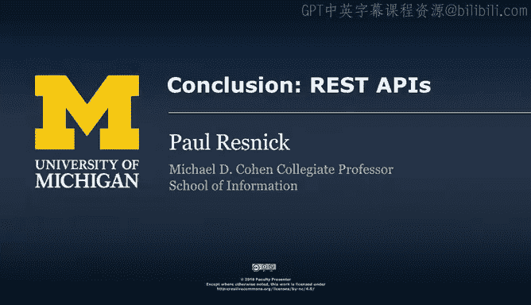

# 课程3、4、5：Python 3 编程 - P41：REST API 总结 🧩




在本节课中，我们将总结关于REST API的关键概念，包括如何解析URL、使用Python的`requests`模块获取数据，以及理解HTTP状态码的含义。

---

## 解析URL与使用Requests模块

上一节我们介绍了网络通信的基础。本节中，我们来看看如何分解一个URL并使用Python获取其内容。

你应该能够将一个URL解析为其组成部分：
*   **协议**：如 `HTTP` 或 `HTTPS`。
*   **主机**：通常是一个域名。
*   **路径**：资源在服务器上的位置。

同时，你应该能够使用Python的`requests`模块来获取一个URL的内容。以下是基本用法：

```python
import requests
response = requests.get('https://api.example.com/data')
```

---

## 理解HTTP状态码

当你获取一个网页时，服务器会返回一个包含状态码的响应。状态码是HTTP头部信息的一部分，用于指示请求的结果。

以下是几个常见的HTTP状态码及其含义：
*   **200**：请求成功。
*   **404**：文件未找到。表示服务器无法识别你请求的路径。
*   **401**：未授权。表示你无权访问该内容。
*   **301**：内容已永久移动到另一个URL。

---

## 其他有趣的HTTP状态码故事

除了标准状态码，互联网上还有一些有趣或特殊的状态码。

以下是两个相关的故事：
*   **错误码 451**：“因法律原因不可用”。此状态码旨在用于因法律原因（如审查或政府强制封锁）拒绝访问资源的情况。它引用了小说《华氏451度》，在书中书籍被禁止并焚烧，而纸张的燃点约为华氏451度。
*   **错误码 418**：“我是一个茶壶”。这源于1998年4月1日的一个愚人节玩笑，Larry Masinter发布了一份描述HTCPCP（超文本咖啡壶控制协议）的文档，该协议用于计算机程序控制、监控和诊断咖啡壶。文档中定义了状态码418，用于当你错误地连接到一个茶壶而非咖啡壶时。文档指出，返回的实体正文（发送回来的文本）可能“矮胖结实”。

你可以搜索 **RFC 2324** 来找到这份完整的文档。

---

本节课中，我们一起学习了如何解析URL、使用`requests`模块进行网络请求，并理解了包括200、404、401、301以及有趣的451和418在内的多种HTTP状态码的含义。这些是使用REST API进行网络编程的基础知识。

下次再见。