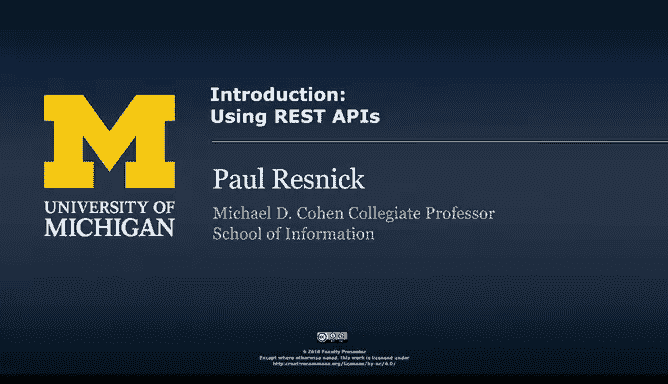

# 课程3：Python 3编程 - P42 🚀 REST API应用简介

在本节课中，我们将深入学习如何使用REST API。我们将从构建带查询参数的URL开始，逐步讲解如何查阅API文档、调试请求，并最终介绍缓存模式，以帮助您高效、稳定地与API进行交互。

---


## 构建URL与查询参数 🔗

上一节我们介绍了REST API的基本概念，本节中我们来看看如何实际构建请求。首先，我们需要使用`requests`模块来生成包含查询参数的长URL，并自动替换URL中不允许的字符。



以下是构建URL的关键步骤：

1.  使用`requests`模块的`params`参数来自动处理查询参数。
2.  确保特殊字符（如空格、中文）被正确编码为`%20`等形式。
3.  示例代码：`response = requests.get('https://api.example.com/data', params={'key': 'value', 'q': '搜索词'})`

通过这种方式，我们可以避免手动拼接URL字符串的繁琐和错误。

---

## 如何阅读API文档 📖

了解了如何发送请求后，我们需要知道请求发送到哪里以及发送什么内容。这需要通过阅读API文档来获取关键信息。

以下是查阅API文档时需要关注的核心要素：

*   **端点（Endpoint）**：API服务的具体URL地址。
*   **请求方法（Method）**：如`GET`、`POST`、`PUT`、`DELETE`。
*   **必需参数（Required Parameters）**：调用接口必须提供的参数。
*   **认证方式（Authentication）**：如何获取并使用API密钥或令牌。
*   **响应格式（Response Format）**：通常是JSON，需了解其数据结构。

掌握这些信息是成功调用任何API的基础。

---

## 调试请求操作 🐛

即使按照文档操作，请求也可能首次运行失败。因此，掌握调试技巧至关重要。

以下是当请求未按预期工作时，可以采取的调试步骤：

1.  **检查状态码**：使用`response.status_code`确认请求是否成功（例如，200表示成功，404表示未找到）。
2.  **打印URL**：使用`response.url`查看实际发送的完整URL，验证参数是否正确。
3.  **查看响应内容**：使用`response.text`或`response.json()`查看服务器返回的原始信息或错误详情。
4.  **使用Try-Except**：将请求代码包裹在`try-except`块中，捕获`requests.exceptions`中的异常。

这些方法能帮助您快速定位并解决问题。

---

## 引入缓存模式 💾

频繁地向同一API发送重复请求可能会触发速率限制，或在服务器不可用时导致程序中断。为了解决这个问题，我们将引入缓存模式。

缓存模式的核心思想是将获取到的数据临时存储在本地（如文件或内存中），当再次需要相同数据时，优先从本地读取，避免重复的网络请求。

以下是`requests_with_caching`模块的一个简化工作流程：

```python
# 伪代码逻辑
if 请求的URL在缓存中:
    从缓存加载数据
else:
    发送网络请求获取数据
    将数据保存到缓存中
返回数据
```

这种模式特别适用于从Runestone教科书等资源获取数据，能显著提升程序的效率和健壮性。

---

## 课程总结 🎯

本节课中我们一起学习了REST API的实践应用。我们掌握了使用`requests`模块构建URL与处理参数的方法，了解了阅读API文档的要点，练习了调试请求的实用技巧，并最终引入了缓存模式来优化程序性能。

至此，您应该能够阅读API文档，提取关键信息，使用`requests`模块与API交互，调试请求过程，并理解缓存模块的工作原理。