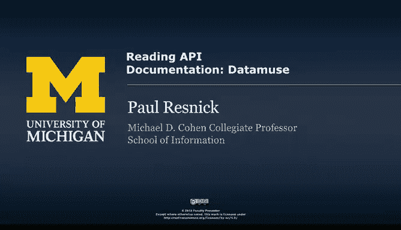
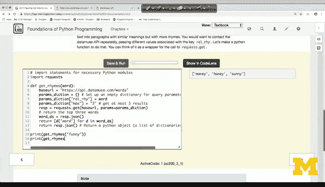

# 课程3：Python 3编程 - P43 📖 如何阅读API文档：Datamuse案例

在本节课中，我们将学习如何阅读和理解API文档，并以Datamuse API为例，演示如何根据文档构建请求。我们还将学习如何将重复的API调用封装成函数，以提高代码的复用性和可读性。

---

## 回顾与引入

上一节我们使用了特定的URL来查找与“funny”押韵的单词。这个URL包含一个基础部分，后跟一个问号和键值对参数。

那么，我们是如何知道该在基础部分放入什么内容，以及如何使用`REL_RHY`参数来请求押韵词的呢？

答案是：**查阅该API的文档**。

---

## 查阅API文档

让我们查看Datamuse API的文档。文档中包含了大量信息。

在文档中，它告诉我们：
*   主URL是 `api.datamuse.com`。
*   之后可以添加路径，例如 `/words?something`。
*   我们稍后会看到，除了`/words`之外还有其他端点。我们可以将`/words`视为一个**端点**，而问号后面的部分称为**查询参数**。

例如，如果你想查找含义与“ringing in the ears”相似的单词，你可以按照文档右侧的示例提供查询。

向下滚动，我们可以看到许多其他可用的查询参数，提供了丰富的功能。其中就包括我之前用到的`rel_rhy`，用于查找与“forgetful”押韵的单词。

文档首先提供了一系列示例。但在下方，它会给出更详细的信息。它说明：
*   大多数功能可以通过 `datamuse.com/words` 访问，这就是我们的**基础URL**。
*   我们需要确定将什么放入`params`参数字典中。

我们可以参考上面的示例，或者查看下方提供更详细信息的列表。例如，键可以是`ml`（表示含义相似），`sl`（表示发音相似），或者一系列以`rel_`开头的参数，如`rel_jja`、`rel_trg`，以及我们使用的`rel_rhy`（表示与...押韵）。

我就是这样找出可以在`params`字典中使用的可能键的。

至于**值**，我是从示例中得知的：值就是我想要查询的单词本身，例如“forgetful”或“funny”。

这样，文档就告诉了我们能向这个REST API发起哪些类型的查询。在文档底部，它还提供了更多关于**解析响应结果**的信息。

我跳过了另一个端点`/sug`，找到了关于响应格式的描述：响应将是一个**列表**（由方括号表示），并且始终是**JSON格式**。

这个列表由**字典**组成。每个字典都提供了与查询相关的一个单词的信息。如果我们的查询是寻找与“funny”押韵的词，那么列表中的每个字典就对应一个合适的押韵词。

这是一个相对简单的API，其文档也非常清晰，很容易理解如何使用。

---

## 封装API调用为函数

关于这个API，我想展示的另一点是一个很好的实践：如果你知道自己需要多次调用此API来获取大量押韵词（例如为你的下一首说唱歌曲寻找灵感），那么将调用封装成函数会非常方便。

因此，我在这里定义了一个小函数，可以多次调用。我可以调用`get_rhymes`并传入一个单词，然后得到一个包含其他押韵词的列表。

例如，对于“funny”，我得到了三个结果。对于“dash”，我得到了“cash”、“flash”和“crash”。

那么，我是如何实现这个`get_rhymes`函数的呢？

以下是实现思路：
1.  `get_rhymes`函数接收一个单词（如“funny”或“dash”）作为输入参数。
2.  它返回一个包含三个押韵词的列表。
3.  但实际从API返回的并不是一个简单的单词列表，而是一个包含信息的字典列表。每个字典都描述了一个押韵词。

**基础URL**始终相同。在函数内部：
*   我创建一个空的参数字典。
*   然后填充它：`rel_rhy` 键的值设为传入的单词，`max` 键的值设为3（表示只返回三个结果）。
*   接着，我调用 `requests.get`，传入基础URL和参数字典，得到一个响应对象。
*   通过调用响应对象的 `.json()` 方法，将其转换为Python对象（一个字典列表）。
*   最后，我使用**列表推导式**（这是你最近学到的知识）来遍历这个字典列表，并仅从每个字典中提取出`word`字段。

这样就生成了一个我们想要的单词列表，然后将其返回。

我注意到代码中第13行有另一个`return`语句，它返回了不同的内容。当然，一旦执行了第12行的`return`，我们就永远不会执行第13行。这是之前代码版本的残留，那时我尝试返回整个字典而不是只提取单词。

实际上，查看一下那个版本可能很有启发性。让我们注释掉第12行，看看如果返回字典而不是从中提取单词会发生什么。

现在，我们得到的是三个字典的列表，而不仅仅是“money”、“honey”和“sunny”这些单词。每个字典都包含了“money”这个单词的完整信息，而不仅仅是单词本身。

这是一种非常有用的实践。如果你知道自己需要**重复做相同的事情**——向同一个API发起多次请求，只是每次传递的参数略有不同——那么将其封装成一个小函数（就像我在第4到13行所做的那样）会是一个好主意。

---

## 总结

本节课中，我们一起学习了：
1.  **如何阅读REST API的文档**：通过Datamuse API的案例，我们了解了如何从文档中找出基础URL、可用的查询参数及其含义。
2.  **如何将API调用封装成函数**：为了提高代码的复用性和可维护性，我们学习了如何将重复的、类似的API请求模式封装成一个自定义函数。

掌握阅读API文档和封装函数的能力，将帮助你更高效地利用各种网络服务和数据源。